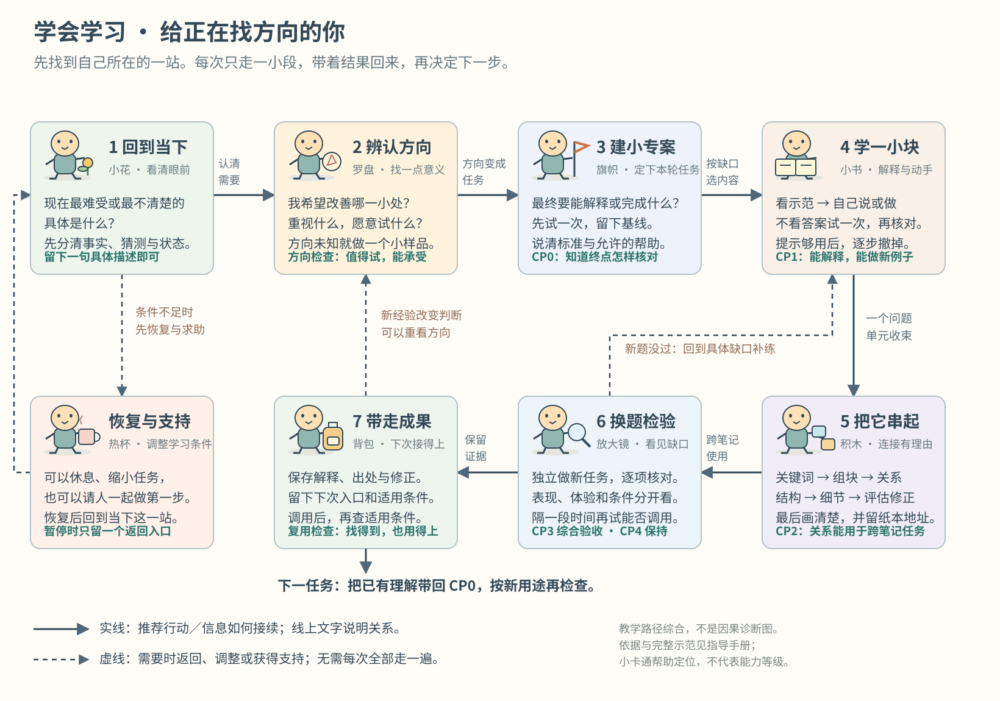

# 学会学习

这是一个用于建立理解、实践与反馈的学习空间，也保留认知与行为自助资料。2026-11-17 已完成《麻省理工深度思考法》《如何找到想做的事》的正文文字阅读与逐章教学笔记；随后完整阅读《当下的力量》，将觉察后的行动选择接入指导手册。各书阅读和图片核查范围分别记录。

## 学会学习，从这里开始

打开 [《学会学习：指导手册》](阅读/学会学习-指导手册.md)。它从“现在很迷茫，也可以先找到一句具体的话”开始：先用温和提问看清当下，再辨认方向、试一个小任务。任务明确时按“一次学习→单元整合→综合验收”跟做。第七节提供学习材料、笔记、小测、大测与核对答案。

[放大地图](阅读/图示/学会学习-学生导航地图.svg) · [可编辑地图](阅读/图示/学会学习-学生导航地图.excalidraw)。小卡通标记每一站；实线表示行动或信息接续，虚线表示需要时返回、调整或得到支持。先选当前的一站，无需一次完成全部步骤。

手册包含具体起步节奏、CP0—CP4检查点、未通过时的处理，以及纸质笔记的“地址—关系—主题入口”示范。七步整理法用于单元整合；时间和数量是可调整的教学起点，不是科学配额。

建立学习专案后，可直接查[Benchmark与验收](阅读/学会学习-指导手册.md#六怎样尝试一次大测让多个单元共同完成新任务)：区分基线与目标标准，明确检验任务、帮助条件、关键项及保持／迁移证据，并配闭环图和具体案例。

| 你想做什么 | 去哪里 |
| --- | --- |
| 很迷茫或缺少信心，想有人带着开始 | [当下、方向与动力的引导](阅读/学会学习-指导手册.md#先回到当下从一句具体的话开始) |
| 被“我不行”带走，怎样重新找到一步 | [觉察后的选择路线](阅读/学会学习-指导手册.md#觉察之后怎样回到学习)，配卡通分支图与求助／暂停示范 |
| 开始或调整一次学习 | [指导手册](阅读/学会学习-指导手册.md) |
| 喜欢一个领域，但不知道该学什么 | [方向试做示范与检查点](阅读/如何找到想做的事-阅读笔记.md#完整示范把我喜欢看书变成一个可尝试的方向) |
| 解释听起来有道理，却不知怎样验证 | [读图、模型与证据练习](阅读/麻省理工深度思考法-阅读笔记.md#跟做练习为什么学过却不会用) |
| 想改变，却卡在开始行动 | [迈出第一步：启动与反馈指南](阅读/迈出第一步-启动与反馈指南.md) |
| 理解架构与图示为什么这样组织 | [方法地图与推导](阅读/学会学习-方法地图.md) |
| 回查作者说法、章节和边界 | [书目与单书笔记入口](阅读/书目与阅读地图.md) |
| 对齐一个术语的含义 | [共同术语表](阅读/共同术语表.md) |
| 延续个人对话与反馈 | [认知与行动记录](记录/认知与行动.md) |

2026-11-10 起暂停一般性新书通读、网络扩展及 Box 阅读任务；2026-11-17 按用户指定恢复上述两本资料及《当下的力量》的本地阅读，现已完成各自所列范围。其他未读资料与Box任务仍暂停，后续按具体需要回查。

## 如需继续认知与行为自助对话

AI 提供 CBT 思路的自助支持，不担任医生或提供临床诊断。这部分与学习手册分别使用。

直接描述最近一次让你困扰的具体经历即可，不需要先整理成专业表格。我们逐步了解发生了什么、当时的想法和感受、采取的行动及后果，再共同选择一个小实践，下次检查实际效果。

持续背景与反馈保存在 [认知与行动记录](记录/认知与行动.md)。换对话时，可以说：「请先读 AGENTS.md 和记录/认知与行动.md，再继续。」记录只保存必要摘要，你可以纠正、暂停记录或要求删除其中的内容。本地文件为明文。

## 资料如何使用

`资料/` 当前包含 19 个 PDF/EPUB 文件，其中有合集。最新阅读状态见 [书目与阅读地图](阅读/书目与阅读地图.md)，已核对的术语见 [共同术语表](阅读/共同术语表.md)。已完成指定的两本 CBT 书籍、《少有人走的路》《当下的力量》及下表八本学习相关书的正文阅读与笔记；《心流》仅首册，图像限制见各笔记。其他待读资料保持暂停，不因本次整理自动恢复。全文提取不等于通读；引用时记录书名与可核查的章节或页码。自助书、哲学观点和临床方法需区分，不混作诊断依据。

CBT 自助框架参考：[NHS：认知行为疗法](https://www.nhs.uk/tests-and-treatments/cognitive-behavioural-therapy-cbt/) 与 [NHS：想法记录练习](https://www.nhs.uk/every-mind-matters/mental-wellbeing-tips/self-help-cbt-techniques/thought-record/)。公开资料核对日期：2026-11-06；查询未包含个人经历。

已完成《思维改变生活》全部十一部分正文及练习答案的阅读，见 [逐章阅读笔记](阅读/思维改变生活-阅读笔记.md)。笔记包含页码、方法与练习索引、使用边界及后续对话的应用方式；采用逐页 OCR 阅读与重点图像核验，不代表逐页校勘。其他资料仍按阅读地图记录各自进度。

用户补充的网络收藏见 [文章参考](阅读/文章参考.md)；现成技能与 MCP 的核查结果见 [CBT 工具调研](阅读/CBT工具调研.md)。这些文件分别记录来源、适用范围与尚未完成的工作。

## 认知行为疗法分类

- **主要方法参考：**[《认知行为疗法（原著第三版）：基础与应用》笔记](阅读/认知行为疗法原著第三版-阅读笔记.md)。已读全部 22 章及附录 A—D；笔记包含章节定位、方法与练习、适用边界和可编辑流程图。依据用户指定，用于理解模式、形成可修正的假设、选择方法及复盘；不把教材作为个人确诊标准。
- **自助练习补充：**[《思维改变生活》笔记](阅读/思维改变生活-阅读笔记.md)。结合实际情况选择解释和练习，不自动布置任务。

后续对话先读取持续记录，再按议题查上述笔记和原文。判断需同时考虑实际环境、身体状态、技能和支持资源；无效时修正理解与方法。

## 成长与关系补充阅读

[《少有人走的路：心智成熟的旅程》笔记](阅读/少有人走的路-阅读笔记.md)：已读四部分全部 47 小节、前置文字及后记，附原书页码、术语边界和可编辑图示。用于讨论自律、责任、求助与关系；宗教哲学和历史临床观点与 CBT 方法分开，不据此评价人格或确诊。

## 学习资料按用途分类

觉察与灵性补充：[《当下的力量》笔记](阅读/当下的力量-阅读笔记.md)，已读全部十章及前置文字。采用其中观察念头、实际计划、接纳与行动的讨论，配[当下到行动地图](阅读/图示/学习教学-当下到行动.svg)、完整课堂和情境练习；保留对灵性、健康及关系归因的取舍，不归入CBT教材，也不作为技能达标标准。

| 用途 | 来源笔记 |
| --- | --- |
| 形成值得尝试的方向，再决定学什么 | [如何找到想做的事](阅读/如何找到想做的事-阅读笔记.md) |
| 从现象建立解释、读图与检验模型 | [麻省理工深度思考法](阅读/麻省理工深度思考法-阅读笔记.md) |
| 设计学习与选择策略 | [超速学习](阅读/超速学习-阅读笔记.md)、[大脑喜欢这样学](阅读/大脑喜欢这样学-阅读笔记.md) |
| 理解大脑运作与学习条件 | [加油吧，大脑](阅读/加油吧大脑-阅读笔记.md) |
| 加工知识、写作与长期复用 | [卡片笔记写作法](阅读/卡片笔记写作法-阅读笔记.md) |
| 理解投入体验与活动条件 | [心流首册](阅读/心流-阅读笔记.md) |
| 探索动机、判断与创造 | [不可能的艺术](阅读/不可能的艺术-阅读笔记.md) |

八本主体章节的实际阅读范围、OCR及图片限制见[书目地图](阅读/书目与阅读地图.md)。书中引用的外部文献未全部通读，《发现心流》第二册未读。分类按主要用途组织，各书的联系与取舍见[指导手册](阅读/学会学习-指导手册.md)末章。

使用顺序是：**手册找当前动作 → 单书笔记看示范或回查出处 → 自己完成练习 → 按证据纠正。** 方法地图用于理解架构为什么这样组织；文本索引用于查原文，不是另一套需要从头学习的课程。练习答案放在文末核对区；先保留自己的作答再查看，提前看过则换题检验。

现有图示在手册对应章节使用，原文件与可编辑版保留在`阅读/图示/`。原书、文本索引、Box草稿与原创笔记保持区分；工具完成资料整理，不代表学习者已经掌握。
