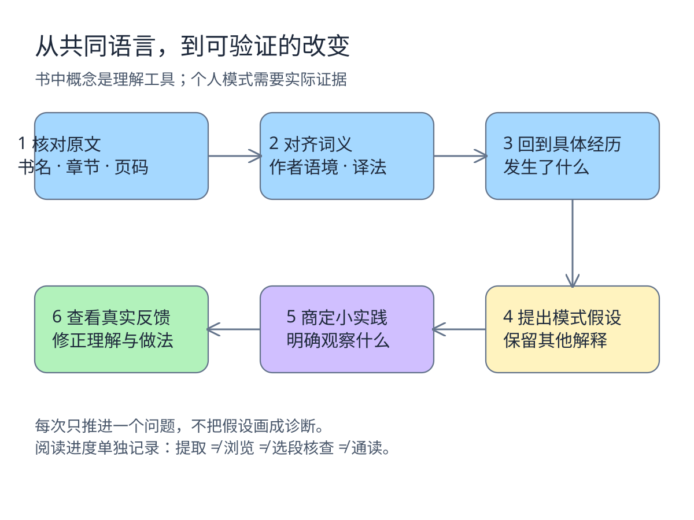

# 共同术语表

更新：2026-11-08。只列已核对的概念；每本书的完整阅读范围见书目与阅读地图。下面解释是摘要，不是原文逐字引用，也不是对用户的诊断。

## 本次必须纠正的出处问题

用户提到的「人格失调症」有书内依据，不应在查书之前将它当作用户自创的词。

《少有人走的路》本地版本为于海生译、吉林文史出版社 2006 年版（版权页：PDF 文件第 3 页）。第一部分「自律」包含「神经官能症与人格失调」一节，始于印刷页 20，即 PDF 文件第 33 页；第 34—36 文件页继续展开。

作者在这段讨论中，以过度承担责任与推卸责任来对比两种倾向，并在印刷页 21—22 讨论混合情况以及判断哪些责任属于自己的困难。这是该书的解释框架；不能直接凭拖延、羞于提问或阅读共鸣确立现代临床诊断。这里需要分别讨论「这个词在书里是什么意思」与「它是否适合解释某个具体经历」。

此前已视觉核查 PDF 第 1—12、33—40 页。2026-11-07 已完成四部分全部 47 小节、前置文字及后记阅读，并复核责任等重点页面；完整范围见 [《少有人走的路》笔记](少有人走的路-阅读笔记.md)。OCR 阅读不等于逐字校勘。

## 已核对的词汇

| 词汇 | 书内位置 | 本项目中的通俗解释 | 使用边界 |
|---|---|---|---|
| 神经官能症与人格失调／人格失调症 | 《少有人走的路》第一部分，印刷页 20—23；PDF 第 33—36 页 | 作者在此讨论责任承担偏向及其后果 | 保留原书译词，不自行等同于当前某项诊断；也不据此将用户分类 |
| 观察思考者 | 《当下的力量》第一章；EPUB `OEBPS/Text/chapter01.xhtml`；文本索引第 113—124 行附近 | 留意反复出现的内心语言，意识到自己正在产生想法 | 作者的觉察实践用语；不是要求停止思考，也不是诊断标准 |
| 心理时间／钟表时间 | 《当下的力量》第三章「摆脱心理时间」；文本索引第 283—291 行附近 | 书中区分实际安排时间，与持续陷在过去或未来的心理活动 | 活在当下不意味着不计划、不复盘；这些是作者自己的概念体系 |
| 痛苦之身 | 《当下的力量》第二章「瓦解你的痛苦之身」；EPUB `OEBPS/Text/chapter02.xhtml` | 作者用来描述旧有情绪痛苦被触发、影响当下反应的概念 | 属于该书灵性叙述，不把“能量场”当作已证实医学实体，不等同于创伤或人格障碍诊断 |
| 微习惯／微步骤 | 《微习惯》第 1 章；EPUB spine 7，`OEBPS/text00005.html` | 把目标缩小到很容易开始的行动，再观察能否持续 | 是待尝试的策略，不保证对每个人有效；不能用是否完成来评判人格 |
| 闪念笔记／文献笔记／永久笔记 | 《卡片笔记写作法》第一章八步流程、第二章“简洁”、第三章阅读与记笔记 | 临时捕捉；记录来源与理解；形成可独立讨论的个人想法并建立关系 | 作者正文已读；与按保存用途区分的“闪念／永久／项目笔记”不是同一个分类维度 |

## 《思维改变生活》共同用语

该书已逐章通读，详细解释与练习见 [阅读笔记](思维改变生活-阅读笔记.md)。以下均为纸页，PDF 文件页加 21；前五项关键术语已另核对页面图像。

| 词汇 | 纸页 | 后续使用方式与边界 |
| --- | --- | --- |
| ABC 与 D | 13–14 | 情境—解释或信念—情绪与行为后果；D 为检查解释。身体状态和现实条件也要纳入 |
| 自找罪受／personalisation | 24–25 | 原书译词，讨论过度归责或认为他人针对自己；交流时用中性描述，不用于指责 |
| 行为驳斥／现实检验 | 48–51 | 以实际行动检验预期；不预定结果，更不为证明用户想错 |
| 挫折耐受力低下／LFT | 56–59 | 作者用来解释部分不适回避；不等于懒惰、人格障碍，也不涵盖所有拖延 |
| 果敢坦率与完整信息 | 246–254 | 明确表达需求并尊重双方权益；可区分事实、理解、感受、请求，不保证对方答应 |
| 自尊与自信 | 145–146 | 整体价值感与特定能力判断不同；局部失误不能证明整个人无价值 |
| 活动安排中的快乐与成就 | 193–196 | 分别观察活动体验，计划与实际的差异用于反馈，不用于评分人格 |
| 心理阻碍与后勤保障问题 | 219–223 | 同时检查不适、担忧与时间、精力、技能等实际条件；疲劳不默认是借口 |

## 《认知行为疗法（原著第三版）》共同用语

归类为认知行为疗法／专业基础教材；用户指定为后续主要方法参考之一。已读 22 章及附录，详见 [逐章笔记](认知行为疗法原著第三版-阅读笔记.md)。以下“第 N 章”对应 EPUB 内部 `EPUB/text/chNN.xhtml`；解释为摘要。

| 词汇 | 原书定位 | 通俗解释与使用边界 |
| --- | --- | --- |
| 认知概念化／CCD | 第 3 章，认知概念化概述、传统认知概念化图 | 把经历、理解、情绪、行为、后果及可能的维持因素组织成可检验的解释；未知留空，随证据修正，不等于诊断 |
| 基于优势的认知概念化／SB-CCD | 第 3 章，图 3.4—3.5 | 同时理解能力、适应性信念、关系和资源；不是只记录缺点，也不是强迫积极评价 |
| 康复取向认知疗法／CT-R | 第 1—2 章 | 强调志向、价值、优势与有意义的生活行动；不只追求症状分数下降 |
| 引导式发现／合作性实证 | 第 2、14 章 | 一起检查证据和尝试新观察，而非诱导用户承认助手正确 |
| 自动思维／热认知 | 第 12 章 | 当时快速闪过的语言或意象；热认知是与重要情绪反应紧密相关的想法。不能用事后推测替代原来的念头 |
| 中间信念 | 第 3、17 章 | 影响理解和应对的态度、规则、条件假设；一个“应该”不能单独证明僵化规则长期存在 |
| 核心信念 | 第 3、17—18 章 | 对自己、他人和世界更深层的理解；要结合重复情境并由用户核对，不凭一句话推断 |
| 无能类／helplessness | 第 3 章，图 3.2 与译注 | 本译本的核心信念内容类别之一，不是客观能力鉴定；与不可爱、无价值分类都不是疾病类型 |
| 图式／模式 | 第 17 章 | 图式指组织经验的结构；模式涉及认知、情绪、动机、行为与生理的共同激活。与日常“习惯模式”有关联但不可不加区分地互换，更不等于人格诊断 |
| 行为实验 | 第 8、14、18—19 章 | 先明确预期，再用可行行动获得信息；结果不如预期也有价值。与《思维改变生活》的行为驳斥可对照，但不以证伪用户为目标 |
| 思维反刍 | 第 16 章 | 重复陷在思考中而难以获得新信息或行动方向；需要结合过程与功能判断，不把所有复盘或认真思考都叫反刍 |
| 正念 | 第 16 章与附录 C | 接纳地留意经验，允许想法出现而不自动服从；不要求停止思考，不等同于《当下的力量》的全部理论 |
| 个人化 | 第 14 章，认知歪曲相关内容 | 与《思维改变生活》personalisation／“自找罪受”译词对照；先了解实际责任，不以标签替代证据 |
| 意象 | 第 20 章 | 脑中的场景或感官表象；不只文字，也不一定是视觉。不能将引导后想象出的场景写成历史事实 |
| 行动计划与进展反馈 | 第 8、21—22 章 | 共同决定可承受的小尝试，并用实际结果修正方法；未完成时检查障碍和计划，不直接评价人格 |

本书“临床技术介绍”与本项目“可以提供的自助支持”分开：附录 D 的高级记忆体验工作、正式诊断和医疗安排，不因已读教材而自动纳入对话。书中个案的疾病或核心信念，也不由相似行为推广给用户。

## 《少有人走的路》补充用语

以下纸页对应 PDF 文件页加 13；解释为摘要，不是诊断或逐字引文。

| 词汇 | 纸页 | 书内含义与使用边界 |
| --- | --- | --- |
| 自律／推迟满足感 | 3–8、42–46 | 作者的四种工具包括延迟满足、责任、尊重事实、平衡；不等于惩罚自己或拒绝休息 |
| 责任辨别 | 18–26、42–46 | 区分自己的行动空间与不应承担的责任；不是将问题全部内归因 |
| 地图／移情 | 27–32 | 作者以旧有认识套用新处境解释某些困难；与 CBT 核心信念可以对照，但不是同义词，也不预设童年病因 |
| 合理的捷径 | 37–38 | 借助有效工具和帮助，与欺骗、回避实际工作有别；求助可以增加自主性 |
| 保持平衡／兼容并包 | 42–52 | 灵活调整标准和表达，保有自我又允许新认识进入；不是取消边界 |
| 精神贯注 | 62–65、71–76、80–81 | 对对象投入、依恋的过程；作者区分它与促进成长的爱，不等同于日常注意力训练 |
| 爱／自我界限 | 53–65、115–123 | 作者强调意愿、行动、成长及彼此独立；是特定定义，不用来否认读者情感或给关系评级 |
| 宗教／小宇宙与大宇宙 | 134–144 | 作者宽泛地指世界观，以及有限经验与更广现实；不等于判定每个人都信神 |
| 潜意识的智慧 | 176–185、203–207 | 作者用梦、联想、直觉与神学解释成长；线索不等于事实，不等同于 CBT 自动思维 |
| 同步原理／不期而遇的收获 | 185–190 | 作者关于巧合与意义的解释；不能据案例宣称心灵感应得到验证 |
| 熵／原罪 | 190–201 | 作者用于解释成长阻力的科学类比与神学叙述；不作为个人症状或拖延的机制证明 |

## 《超速学习》学习方法用语

归入**学习方法类**，与上述 CBT 概念分开。已读全部 14 章、附录及特别收录，见 [阅读笔记](超速学习-阅读笔记.md)。第 N 章位于 `OEBPS/text000NN.html`，内部编号为章号加 6（如第 4 章为 `text00010.html`），无固定纸页。

| 词汇 | 章号 | 通俗解释与边界 |
| --- | --- | --- |
| 超速学习／自主与高强度 | 2、13 | 主动选择方向并投入较高质量的练习；可以包含课程、老师与伙伴，不等于熬夜或一直冲刺 |
| 后设学习 | 4 | 研究学习对象的结构和获得能力的方法；用为什么、做什么、怎么做建立地图，不是无限研究方法 |
| 概念／事实／程序 | 4 | 分别关注理解、记忆和操作；是规划视角，具体知识可能跨类 |
| 标竿学习／强调与排除 | 4 | 先参考成熟路径，再按用途取舍；不是未经理解就跳过基础 |
| 直截了当／直接练习 | 6 | 练习包含目标用途真正需要的判断与操作；不等于取消理论、辅助练习或安全模拟 |
| 学习迁移 | 6 | 在新的任务或情境中运用所学；并非自动发生，也不是完全不可能 |
| 反复操练／瓶颈 | 7 | 从完整任务发现限制环节，隔离练习后回到整体验证；不能只看重复次数 |
| 提取记忆／测验效应 | 8 | 主动从记忆中回想或做出答案，测验也是学习过程；需核查错误，不等于所有工作都闭卷 |
| 有益的困境 | 8 | 适度困难可能增进保持；无法完成、缺少基础或负担过大时不保证有效 |
| 结果型／信息型／改正型回馈 | 9 | 分别提供整体结果、出错位置、修正办法；开放任务未必有唯一正确答案，不强行从总评推出原因 |
| 间隔法／程序化／过度学习／记忆法 | 10 | 分散练习、自动化常用操作、达标后继续练核心、建立联想线索；四种保留策略用途不同，不承诺永久记忆 |
| 理解深度的错觉 | 11 | 熟悉事物却不能说明其结构或过程；用解释、举例与操作检验，不用它评价人的智力 |
| 费曼技巧 | 11 及脚注 2 | 作者整理并命名的解释—发现缺口—查证方法；作者不能确定费曼本人明确用过此流程，与费曼图有别 |
| 勇于实验／实验心态 | 12 | 有计划比较资源、技巧与风格；不同于随意换工具，也不自动等同于 CBT 行为实验 |
| 维持／重学／专精 | 13 | 结束后选择保持核心能力、容许遗忘以后重学，或继续深入；不必把所有知识永远保持在最高水平 |

## 《大脑喜欢这样学》学习方法用语

以下出自黄翔 2024 年版，归入**学习方法／学习与脑科学科普**。全书已读，原文件定位及关键说法核查见 [阅读笔记](大脑喜欢这样学-阅读笔记.md)。术语有出处不等于相关机制全部得到证实。

| 词汇 | 原书定位（前缀 `EPUB/xhtml/`） | 通俗解释与使用边界 |
| --- | --- | --- |
| 学习型大脑／可塑性 | 第 1—2 章，`Chapter3_1_3`、`Chapter3_2_2` | 作者强调经验与练习带来的改变；不能由行为直接推断神经连接数量，不保证所有人能达到相同表现 |
| 内部模型／建模式学习 | 第 2 章第 3—4 节、第 5 章，`Chapter3_2_3`、`Chapter4_3_1`—`Chapter4_3_4` | 作者对知识组织、识别与运用的宽泛概括；不等于 CBT 核心信念、图式或测得的脑内结构 |
| 输入—关联—输出 | 第 5 章第 2 节，`Chapter4_3_2` | 获取并理解，联系已有知识，再回想、解释或应用；输出需要核对，不能仅凭说得顺认定正确 |
| 提取／存储强度与提取强度 | 第 5 章第 2 节，`Chapter4_3_2` | 区分学习和当前调用的难易；不能据此断言所有记忆永久完整保存 |
| 交错学习 | 第 5 章第 2 节，`Chapter4_3_2` | 混合相关任务以练习辨别方法；不等于无关信息间频繁切换，应考虑基础与负担 |
| 间隔／巩固 | 第 5 章第 3 节、第 7 章第 2 节 | 分散再练并留出恢复；不采用统一遗忘百分比，也不采用“只有睡眠才能巩固”的绝对表述 |
| SMART／自我效能感 | 第 3 章，`Chapter4_1_1`—`Chapter4_1_4` | 目标检查与对特定任务能力的判断；明确目标不保证自动实现，也不等于整体自我价值 |
| 积极反馈／错题本／导师反馈 | 第 6 章，`Chapter4_4_1`—`Chapter4_4_5` | 取得真实、具体、可修正的信息；不要求只有赞美、纸质记录或无条件相信导师 |
| 默认模式网络／脑内耗 | 第 7 章第 1 节，`Chapter4_5_1` | 前者是书中引入的神经科学用语，后者是较宽泛日常描述；两者不能简单画等号，更不能从反复思考判断某脑区异常 |
| 去甲肾上腺素型／多巴胺型学习 | 第 4 章第 2 节，`Chapter4_2_2` | 作者解释不同动力的分类说法；本项目不据此给人分型或推断递质水平 |

“学习金字塔”的固定保持率和按 90 分钟整数倍安排睡眠等说法，不纳入通用学习标准；书中的情绪与量表内容也不改变本项目的 CBT 方法来源和诊断边界。

## 对齐与实践图示

[下载可编辑 Excalidraw 图](图示/共同语言与实践.excalidraw)

图示是协作流程，不是已验证的个人心理机制。后续画个人模式图时，每个节点均需标注来自用户陈述、书中概念还是待验证解释。

## 脑科学理解与学习工具的新增用语

| 用语 | 来源定位 | 使用方式与边界 |
| --- | --- | --- |
| 神经可塑性 | 《加油吧，大脑》第 1—2 章 | 经验与活动参与神经系统的变化；不能推出无限潜能、人人相同或仅凭意愿就改变 |
| 自主神经系统 | 同书第 5 章；笔记另核对 MedlinePlus | 涉及心跳、血管等非随意活动。原书把它解释为随意控制，已纠正，不能照用 |
| 存储强度／提取强度 | 《卡片笔记写作法》第三章“记卡片盒笔记”；笔记另核对 Bjork 论文 | 理论中的学习关联程度与当前可访问程度，不是总存储容量，也不与某个软件一一对应 |
| 有意义的链接 | 同书第三章“发展想法” | 说明补充、反驳、例证或适用条件；共享关键词不够证明深层关系 |
| 主题概览／索引 | 同上 | 局部结构与进入讨论的入口；随理解修订，不要求完整穷尽知识 |
| 学习复利 | 同书第二章反馈、第三章记笔记及中文版实践附录 | 本项目指经检验的知识可以在新任务复用并修正；是工作性比喻，不是固定或指数增长保证 |

详见[脑科学笔记](加油吧大脑-阅读笔记.md)、[卡片笔记](卡片笔记写作法-阅读笔记.md)与[综合框架](学会学习-方法地图.md)。

## 心流与学习条件：两书对读

| 用语 | 来源定位 | 在本项目中的含义与边界 |
| --- | --- | --- |
| 享乐／乐趣 | 《心流》第3章，spine29 | 作者区分满足既有需要与挑战中发展的体验；不是把休息分成高低贵贱 |
| 自成目标 | 同书第3章，spine31 | 活动本身具有吸引力；可与收入、职业等外在目标并存 |
| 挑战—技巧关系 | 同书第4章 spine33；《不可能的艺术》第21章，PDF334—337 | 当前能力、挑战与主观判断的动态关系；不作个人固定分型 |
| 4%挑战 | 《不可能的艺术》PDF336，已核对图像 | 作者明确称为隐喻而非实际指标；不换算成学习难度配方 |
| 控制感／实际控制 | 《心流》第3章 spine30 | 体验上的把握与客观结果不同，仍需检查错误与后果 |
| 符号体系 | 同书第6章 spine46—53 | 用文字、数字、规则等组织和操作知识；记得关键词不等于已掌握关系 |
| 最小心流反馈（MFF） | 《不可能的艺术》第21章，PDF333—334 | 作者指足以指导下一步的具体反馈；是其工作术语，不是通用量表或“越少越好” |
| 总是说是 | 同书第21章，PDF353—354；354已核对图像 | 即兴协作中接续有价值的部分；作者明确说不等于同意所有观点 |
| 挣扎—释放—心流—恢复 | 同书第22章，PDF356—373 | 作者的工作周期模型；与挑战—技巧发展图不同，不当作人人必经的生理顺序 |
| 转换型适应 | 《心流》第9章 spine68—70 | 书内对重新分析处境、调整策略或目标的描述；不作为用户人格评级或诊断 |

来源范围及解释见[《心流》笔记](心流-阅读笔记.md)、[《不可能的艺术》笔记](不可能的艺术-阅读笔记.md)。两书主体章节已读；详细范围及校勘限制见各书笔记。

### 全文补读新增：动机、判断与创造

| 术语 | 来源定位 | 通俗解释与使用边界 |
| --- | --- | --- |
| 好奇—激情—目的 | 《不可能的艺术》2章，PDF48—62 | 从具体疑问、持续探索到值得投入的问题；作者的路径建议，不是每个人必须经历的固定阶段 |
| 自主／掌握 | 同书3章，PDF63—80 | 行动选择空间与能力进步；不要求完全自由，也不以主观进步感代替成果 |
| MTP／HHG／清晰目标 | 同书4章，PDF81—94 | 长期方向、项目层目标与当前任务；英文缩写是书内用语，不是评估量表 |
| 模式识别／异常识别 | 同书7章，PDF152—155 | 除相似之外还看缺失、机制、细微差异和局限；不能仅凭熟悉感决定 |
| 事实过滤器 | 同书8章，PDF156—162 | 核对判断所据的证据；来源数目不等于独立证据数目 |
| 匹配质量 | 同书14章，PDF211—221 | 兴趣、能力与活动要求是否适配；可通过探索修正，不是固定天赋标签 |
| 创造力：新颖与价值 | 同书15章，PDF223—242 | 候选产出需既有新意又对任务有用；不是连接数量或灵感强度 |
| 准备—孵化—洞察—验证 | 同书15—16章，PDF223—264 | 创造过程的描述模型，可交叠；孵化不是无限延期，洞察不等于验证完成 |
| 返回入口 | 整理者对同书17章的概括，PDF265—283 | 结束前留下具体下一步；不是作者的正式术语或普遍验证的法则 |
| 精神熵 | 《心流》2章，spine19—26；序一、二另有阐释 | 作者描述注意冲突与体验秩序的概念／比喻，不是可由聊天测得的物理量或诊断 |
| 独特化与整合 | 同书2、10章 | 个体发展及与更大关系结合的论述；不直接等同于知识组块或给人格分级 |

推荐序的说法不自动归属于正文作者，尤其需区分“心熵”“大心流”等推荐者解释，详见《心流》笔记末节。

## 学习方向与模型检验：新增两书

| 术语 | 原文定位 | 本项目怎样使用 |
| --- | --- | --- |
| 重要／擅长／喜欢的事 | 《如何找到想做的事》第3章，OEBPS/0015—0027.xhtml | 分别提问目的、做法、领域；是作者自我探索框架，不是能力量表或固定天赋分类 |
| 价值观与目标 | 同书第4章，0028—0038 | 价值描述希望持续体现的方向，目标是可完成的节点；排序图是作者示范，不是普遍等级 |
| 工作目的 | 同书第4、7章 | 希望工作带来什么改变，用来筛选候选方向；学习目的不必都等同职业贡献 |
| 假设—行动—修正 | 同书第7章，0052—0056 | 先试具体活动，再区分领域、动作、条件和技能缺口；本笔记概括，不是诊断流程 |
| 模型／动力机制 | 《麻省理工深度思考法》第2章，index_split_004.html | 前者为要素与关系，后者为持续作用后随时间的变化；动力机制不等于个人动机 |
| 正循环／负循环 | 同书第3章3.2，图3-2 | 强化／平衡反馈；正负不表示道德好坏或效果好坏，须按图中关系和条件解释 |
| 存量／流量 | 同书第4章4.3，图4-4 | 某时点累积量／单位时间进出量；帮助区别状态与速度，不把知识能力直接当可加水量 |
| 支点 | 同书第5章5.2 | 寻找能改变关键关系的对策；是否有效仍需实践反馈，不等于必有一个万能解 |
| 区分检查 | 本项目依据模型检验与学习反馈设计 | 用一个观察或任务帮助区分候选解释；不是两书统一定义的正式术语 |

详细原图解释、练习与限制分别见[方向探索笔记](如何找到想做的事-阅读笔记.md)、[深度思考笔记](麻省理工深度思考法-阅读笔记.md)。以上不作为个人心理诊断标准。
