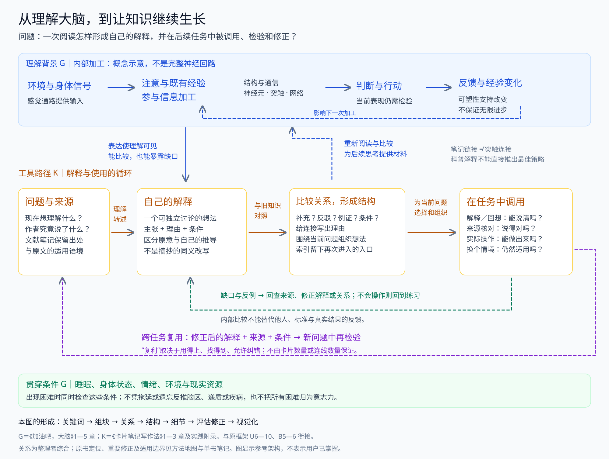

# 《加油吧，大脑！》阅读笔记

更新：2026-11-08。作者：黄翔，中信出版社，2022 年 8 月第 1 版，ISBN 978-7-5217-4493-4。

**分类：脑科学科普／理解大脑如何运作。** 按用户指定，本书承担理解背景的作用；学习与工作方法只是其中一部分。与《大脑喜欢这样学》是不同的书，与 CBT 教材分开。

## 阅读覆盖与使用方式

已在本地顺序阅读全部 58 个 EPUB spine 的提取文字（108200 个 Unicode 字符），包括推荐序、前言、8 章 41 个主体小节、“我和大脑的一天”、致谢、延伸阅读及版权。最后一批输出发生截断后，已单独补读字符 97500—104000，全文范围无缺口。浏览 34 张图片的缩略图，放大核对语言功能区示意图；未逐图校勘所有小字。原书文件与已有索引的哈希一致。

来源：`资料/加油吧_大脑_日常用脑指南_解决人们生活中常见的40多个关于大脑的问题_z_library_sk,_1lib_sk,.epub`。章节以内置路径定位，以下简写 `partNNNN` 均指 `text/partNNNN.html`。全文阅读不代表赞同书中全部结论；仅对下列少数关键表述做了外部核查，未通读所引论文、推荐书或验证全部临床故事。

本地阅读已替代上一版“选段核查”的进度。Box 的 6 段草稿保留为历史原始输出，不是本次完成依据，也无需重跑。

## 先建立一条理解主线

**环境与身体提供信号 → 感觉通路传入 → 神经网络加工，注意与既有经验参与 → 形成体验、判断与行动 → 行动产生新反馈，练习和经历改变后续加工。** 睡眠、营养、身体状况、压力与社会环境贯穿这个循环。

这条主线是整理者基于全书的概念重组，不是完整的神经科学模型，也不是作者逐字公式。它帮助区分五个层次：

1. **结构与通信：** 神经元、突触、神经通路、不同脑区及协作。
2. **功能与经验：** 感觉、语言、记忆、注意、计划及情绪，并非一个部位对应一种人格。
3. **变化与学习：** 可塑性使经验与练习能够影响后续表现，但不保证无限改变或人人相同。
4. **运行条件与健康：** 身体及环境影响功能；不能把困难都解释成意志力不足。
5. **观察与干预边界：** 临床检查、手术定位和脑机接口展示部分结构—功能关系；案例、技术演示、思想实验不是同一种证据。

## 第一章：大脑的一生——结构、功能与可塑性

定位：`part0005`—`part0010`。

| 小节 | 作者的核心解释及例子 | 整理者的理解与保留 |
| --- | --- | --- |
| 思考和学习：解锁大脑运作的秘密 | 神经元通过电化学活动和连接构成网络；用“议会”比喻决策中的竞争 | 从孤立脑区转向网络关系；“学习只是增加突触”“遗忘就是连接消失”过于单一，不作完整机制 |
| 你如何成为你：大脑如何发育成长？ | 从胎儿、童年到老年讨论发育、连接修剪、环境与认知储备 | 不将年龄或性别平均叙述当个人成熟度标准；受教育程度与寿命的关联不能直接化成每学习一年延寿多少 |
| 脑重塑：成年人的大脑定型了吗？ | 康复案例与伦敦出租车司机例子说明成人仍能变化 | 可塑性说明存在改变的可能；不能由单例承诺恢复，也不能从脑区体积推断能力全貌 |
| 幻觉：我们所认知的世界是否真实？ | 感觉器官转换信号，大脑加工；术后案例显示体验可偏离外界 | 感知经过加工不等于外界不存在。不能从幻觉内容推断“内心真实愿望”，也不能承诺术后幻觉一律无后遗症 |
| 脑垂体：生孩子究竟是谁说了算？ | 用上下级“发文件”比喻激素通信，结合垂体瘤病例 | 说明神经与内分泌及身体功能相互联系；比喻不是完整内分泌轴，更不支持用关系道德评价推断垂体健康 |
| 口才：管理语言能力的不是舌头，而是大脑 | 语言表达、理解、功能定位与康复 | 表达与理解可区分，但不能当成仅两个孤立模块；关于左利手、多语者脑区大小及必然成为口才达人的概括不直接采用 |

**本章留下的理解：** 同一个行为有结构、加工过程、经验和环境多个解释层次。经验可能改变功能，但“可改变”与“容易改变”“必定恢复”不同。

## 第二章：终身学习——记忆需要加工和调用

定位：`part0012`—`part0016`。

| 小节 | 作者组织内容的方式 | 融合与边界 |
| --- | --- | --- |
| 大脑只使用了10%吗？ | 从影像、损伤及进化角度反驳闲置大脑的想象 | 不把学习当作打开剩余90%的潜能；也不从成像颜色或某次活动比例读出智力 |
| 智力是天生的吗？ | 基因、环境、训练与测试局限 | 成绩或一次测验不等于全部潜力；但“先天差别不大”“不应相信智力测试”不能直接作为科学结论，G×E也不是个人智力的简单乘法 |
| 怎样吃才能让自己更聪明？ | 按三餐提出营养安排与机制解释 | 保留营养属于运行条件；不采纳统一补充剂、食物直接补递质、固定进食时刻等个人处方 |
| 怎样提升学习效率？ | 兴趣与意义、重复、使用、θ波、适度饥饿、睡眠；以海马体“管理员”比喻解释 | 学习方法与脑机制分开验收。保留目标联系、提取和应用的候选做法；不采用脑波配方、刻意饥饿或固定遗忘百分比 |
| 睡觉竟然是学习的一部分 | 讨论睡眠与恢复、记忆加工；提出整周期睡眠、停止输入、睡前学习 | 恢复支持学习，但睡眠不替代理解与练习；固定90分钟及严格睡前窗口需修正，见核查表 |

本章内部需要校正：把长期记忆比作硬盘、把海马体比作管理员有助于入门，但不能推出“只记与生存有关的事”“海马体只在睡眠时工作”或“复习必须完全相同”。

**与学习框架的关系：** 输入不等于掌握；需经过理解、组织、提取与使用，再检查延迟后能否调用。大脑机制只能提供解释背景，不能代替具体策略的行为证据。

## 第三章：高效工作——目标、注意与行为条件

定位：`part0018`—`part0023`。

| 小节 | 作者提出的内容 | 整理者的采用方式 |
| --- | --- | --- |
| 成功的秘诀藏在哪里？ | 以前额叶解释计划与控制；建议将目标写下来并反复看见 | 把愿望变清楚可能帮助行动，但不是前额叶自动规划成功。额头外形和成功、脑区发达的联系没有可靠依据，不采用 |
| 工作时注意力不集中，怎么办？ | 用去甲肾上腺素、多巴胺、血清素区分短期与持续动力；提出期限、奖励、休息、少切换 | 不按递质给人分类，不推断个人浓度。尤其不自动采用加大惩罚、制造危机的建议；观察目标、兴趣、干扰和负担即可 |
| 自律的人生如何炼成？ | 习惯具体化、结合兴趣与支持、小步推进、奖励；将自控比作肌肉 | 可用做法要落实到情境和动作；“自控是耗尽的能量池”保留为作者解释，不当作已确定生理事实 |
| 压力，大脑的隐形杀手 | 强度、持续时间、应对能力；信息、控制感、支持与喜欢的活动 | 同时检查压力源和可行动部分。原文“归咎于自己”不是本项目原则；调整环境、求助和责任边界同样重要 |
| 靠咖啡续命？喝还是不喝？ | 咖啡因与腺苷受体的竞争比喻，区分清醒感与真正恢复 | “感觉清醒”不证明疲劳已消失。书内剂量、杯数及健康保证不作为个人摄入建议 |
| 怎样健身能提升脑力？ | 讨论有氧、复杂动作、BDNF及运动与学习配合 | 运动与学习可以互相支持，但动物实验、学校案例不能推出所有人都应达到同一高心率；不采用固定强度配方 |

**本章的张力：** 作者一方面建议制造损失和紧迫感，另一方面强调持续高压的代价。框架不能只摘取其中一句；后续选择策略应看任务负担和实际效果，而不是用更强惩罚保证执行。

## 第四章：良好睡眠——节律、恢复与个体差异

定位：`part0025`—`part0029`。

- **为什么现代人的睡眠质量越来越差？** 作者从松果体、光线、生活方式与压力解释睡眠。保留光照与节律、行为和环境有联系；“进化迟滞是根本原因”是宏观解释，不等于个人病因。“符合一条就失眠”的清单不作为诊断标准；松果体、DMT及超常知觉的叙述不进入已确定知识。
- **为什么每天都睡不醒？每天睡多少才算够？** 区分时长、质量和个体差异，但又过分强调90分钟整数倍。理解重点应是多维条件，而非一个闹钟公式。
- **怎样睡觉才能让大脑更高效？** 从环境、放松、入睡、觉醒及疾病药物等方面展开。书中“黄金90分钟”“两个闹钟差20分钟保证阶段”没有完成证据核查；NREM不全是深睡，不能据此压缩总睡眠。
- **夜猫子工作法，可取吗？** 讨论夜间劳动与次日表现、长期健康及轮班约束。区分晚睡、睡眠不足、节律错位和工作要求；不把它们混成一件事，也不采用补维生素抵消熬夜损害的逻辑。
- **午睡有必要吗？怎样午睡效率最高？** 小睡、疲劳与醒后状态；作者给出多种时间建议。它们是书内建议，不是每个人必须遵循的标准，不能拿午睡替代充分夜间睡眠。

**本章留下的问题：** 休息改善后，注意与表现是否变化？若没有变化，还应检查任务、环境或其他因素。这里没有据书给用户制定作息或推断睡眠障碍。

## 第五章：情绪自救——身体感受、解释与现实处境

定位：`part0031`—`part0033`。

1. **神经衰弱是怎么回事？** 作者想通过交感／副交感解释心跳、紧张与恢复，但把“自主神经”解释为随意控制的神经，命名错误；不能以此建立术语框架。“神经衰弱就是副交感衰弱”也不作为诊断解释。
2. **摆脱焦虑的三个原则。** 作者描述身体感受、恐惧、反复关注之间的循环，并提出面对、接受、参与生活和耐心等待。其病例还包括减轻工作环境压力，这一点不能漏掉。书中“疼痛不会造成伤害”及固定心跳／早搏阈值不能用来排除疾病；没有改善也不证明当事人“不是真正接受”。
3. **抑郁的真相及自救指南。** 书中介绍情绪、睡眠、精力和功能变化，说明筛查不等于诊断，并给出一个综合治疗案例。本文不复制量表供用户自诊；不依据总分宣布健康、确定治疗方式，也不移植案例中的治疗比例。

**必须保留的边界：** 本章不能替代项目的 CBT 专业教材。“事实不会伤害人”“只要换个解读就肯定不会发生严重后果”等绝对句，不被本项目采用。现实事件能造成真实损失与伤害，支持与环境同样重要。当前阅读与用户是否有相关疾病无关。

## 第六章：常见脑疾病——症状、通路与鉴别

定位：`part0035`—`part0041`。这些内容作为脑健康与临床理解保留，不并入学习技术主干。

| 小节 | 概念收获 | 使用限制 |
| --- | --- | --- |
| 脑瘤识别：头痛该怎么办？ | 同一症状可能有多种原因，时间、变化及伴随表现需要整体考虑 | 书中症状表不能自行确认或排除脑瘤；发病率、检查和用药规则未逐项更新 |
| 辐射问题：脑瘤与使用手机有没有关系？ | 区分电离／非电离、相关性与因果性 | 书内风险归因需对照更新证据；见下表，不能把2B分类当已证实因果 |
| 鞍区肿瘤：视力下降不一定是眼睛的问题 | 感觉器官、传导通路和脑加工的任何环节都可能影响视觉 | 戴眼镜不能解决不等于问题必在脑；作者故事不是完整鉴别流程 |
| 胶质瘤：得了恶性脑瘤，应该怎么办？ | 疾病分型、功能、规范治疗及生活质量共同影响决策 | 分型、预后与治疗会更新；不推广个案长期存活，也不把病情归咎于不够乐观 |
| 听神经瘤 | 听觉、平衡及邻近神经的关系；治疗需权衡功能 | 不以案例或书中尺寸直接选择手术／放射治疗 |
| 脑出血、脑梗 | 血管、凝血和身体健康与脑功能的关系 | 不能由忘事推断腔隙性脑梗，也不能把所有脑血管病归为凝血异常 |
| 脑外伤与3D打印颅骨 | 医疗结果依赖材料、器械、专业知识及经验的组合 | 技术改变解决问题的条件；不把打印颅骨等同于修复脑组织 |

## 第七章：手术台上的脑外科医生——怎样观察并保护功能

定位：`part0043`—`part0046`。

- **开颅手术：** 作者介绍手术前规划、麻醉、无菌及暴露病灶的过程。理解重点是病灶与正常组织的区分，以及功能保护；不把科普描述当操作指南。
- **唤醒手术：** 通过实际语言任务结合刺激定位，识别对该患者重要的功能区域。书中术后突然精通语言的故事未独立验证，不推导“手术提升语言天赋”。
- **导航：** 影像帮助定位、设计路线和判断边界，医生仍需结合解剖与现场条件。工具提供信息，不能免除判断。
- **神经电生理监测：** 用可测信号辅助辨别与保护功能。形状或粗细不足以决定功能，需验证；作者把个案神经粗细归于训练的解释不能直接推广。

**对学习的间接启发（整理者类比）：** 目标、路径、实时反馈与约束共同决定行动。这里借用的是问题解决结构，不是在学习框架中复制医疗实践。

## 第八章：脑机接口与未来——从事实走向假设时要换标签

定位：`part0048`—`part0052`。

- **大脑进化：** 作者通过环境、行动、工具和社会协作串联人类发展。对脸型、审美、其他人种语言能力等叙述，证据不足且推演过强，不纳入基础知识。
- **脑机接口：** 把信号输入、解码、训练及输出连接起来；人工感官、感觉替代与运动控制例子再次说明“连接设备”不等于立即掌握，仍可能需要适应和训练。书中2020—2021年案例是历史叙述，不表示当前技术水平已核查。
- **电脑能否战胜人脑：** 作者比较能耗与能力，并介绍中文屋思想实验。其“电脑只能简单重复、没有创造力”等属于书中时代背景下的观点；思想实验不能当作已经解决智能与意识问题的实验证明。
- **意识与智慧能否脱离生命：** 讨论部件与组织、互动及涌现，提出载体可以不同的可能性。书内推演与已观测事实分开。
- **永生与连接组：** 作者自己指出，结构快照不等于运行中的电化学动态；随后谈意识上传。应保留这个限制，而非把“未来一定实现”写成研究结论。

**与工具书的联系：** 外部工具可以扩展可处理的信息与操作条件，但拥有工具不等于形成理解。卡片之间有链接，也不自动产生可靠知识。

## 书末材料

“我和大脑的一天”是作者在特定医疗工作条件下的个人作息，包括短睡、饮食、运动和写作。它不能被包装成用户模板，且重复了整周期睡眠、饥饿促进记忆等未经充分支持的建议。致谢说明写作来自零碎时间的积累与编辑协助；延伸阅读是推荐名单，不是本文已经验证或通读的资料。

## 关键说法核查与修正

核查日期：2026-11-08。下列官方资料用于修正概念，不是个人医疗建议。查询未包含个人记录。

| 原书问题 | 修正与依据 |
| --- | --- |
| 自主神经＝能由意志随意控制的神经 | **命名错误。** 自主神经系统恰恰涉及心跳、血管等非随意活动。不能按字面“自己做主”解释。[MedlinePlus](https://medlineplus.gov/autonomicnervoussystemdisorders.html) |
| 以快乐中枢器质改变、某递质不足统摄抑郁 | **过度简化。** NIMH说明遗传、生物、环境、心理因素都可能参与，评估也需考虑身体情况与药物影响。[NIMH](https://www.nimh.nih.gov/health/publications/depression) |
| 90分钟整数倍更重要；NREM四阶段；非快速眼动均等于深睡 | **不能这样套用。** NHLBI采用三个NREM阶段，深睡是其中一阶段；周期约80—100分钟，并随夜间和年龄变化。[NHLBI](https://www.nhlbi.nih.gov/health/sleep/stages-of-sleep) |
| 从手机使用、症状或儿童脑瘤趋势直接推出辐射危害 | **推论超出证据。** NCI综述认为迄今证据不支持手机使用导致人类脑癌或其他癌症；相关性、研究偏差与风险分类不能省略。[NCI](https://www.cancer.gov/about-cancer/causes-prevention/risk/radiation/cell-phones-fact-sheet) |
| “前额叶成功区”、额头外形、单一递质学习类型、连接越多越聪明 | 当前无充分核查依据，不进入本项目解释标准；分子、回路、行为及社会结果不能跳级等同 |
| 褪黑素早晨反向变成血清素、统一补充剂、饥饿学习、运动固定高心率 | 不作为已核查机制或个人行动建议；若以后确需讨论，要另外查适用人群与研究证据 |
| 负面想法伤脑、疾病未改善因为没有真正接受、积极心态保证恢复 | 不采用此类归责与保证；书内经验、推断与普遍规律分别记录 |

## 如何融入学习框架

依用户指定的七步：**关键词**提取结构、信号、加工、记忆、可塑性、状态、反馈；**组块**为“信息加工—经验改变—运行条件—观察与证据”；**关系**明确输入经过加工、行动反馈影响后续学习、条件影响表现；**结构**作为学习主干的解释背景，不与提取、操练等策略摆成等权清单；**细节**为每个概念补来源、例子、条件和不能推出的结论；**评估修正**用行为表现和外部证据检查，不用脑区故事替代验证；**视觉化**与卡片工具书共同展示“内部加工与外部表达如何形成反馈”，见[学习方法地图](学会学习-方法地图.md)。

可选理解问题：同一个“记不住”，可能分别在哪些环节发生？为什么知道一个脑区参与某功能，并不能直接告诉我们最好的学习方法？一个生动病例与普遍规律之间还缺什么证据？这些问题不是用户已接受的练习。

## 配套关系图

[可编辑 Excalidraw](图示/学习理解与知识复用.excalidraw)。这是两书与既有学习框架的综合图；主线、关系依据和修正理由见[方法地图](学会学习-方法地图.md)。
