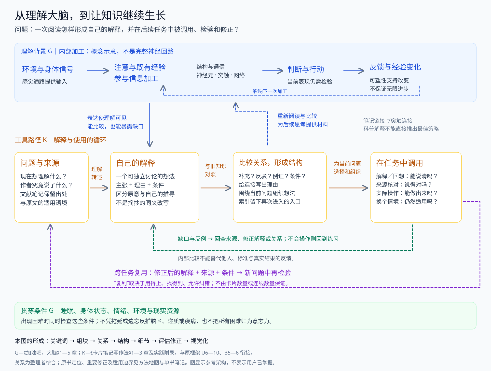

# 《卡片笔记写作法》阅读笔记

更新：2026-11-08。**分类：学习工具书／知识加工、写作与跨任务复用。** 重点是阅读、思考和写作如何配合，不是收藏软件教程；与 CBT 教材分开。

## 版本、来源与实际覆盖

申克·阿伦斯（Sönke Ahrens）著，陈琳译，人民邮电出版社，2021 年 7 月，ISBN 9787115564672；原著 How to Take Smart Notes，2017 年。

本地来源：`资料/卡片笔记写作法_如何实现从阅读到写作_德申克阿伦斯_Sönke_Z_Library.epub`。已顺序读完 28 个 spine 的全部提取文字，索引字符区间 `[0,137453)`，包括前置序言、三章十四个主体小节、注释、后记、参考文献条目及刘少楠的中文版实践附录。浏览全部 12 张图片缩略图，放大核对交易平台专题、卡片与结构化输出示例；未逐字校勘全部软件截图，未访问二维码。阅读参考文献条目不等于读过所列论文。本轮没有重新上传资料或调用 Box；旧草稿保留为历史，不作为完成依据。

以下用 EPUB 内部路径定位，避免伪造阅读器页码：K1＝`text/part0010_split_000.html`—`003.html`；K2＝`text/part0011_split_000.html`—`003.html`；K3＝`text/part0012_split_000.html`—`005.html`。各章分节与文件尾号对应。

## 全书的主问题与我的理解

作者要解决的是：**怎样让平时的阅读、思考与记录，逐渐形成可以论证和表达的内容，使写作不再临时从空白页开始？**

整理后的主线：**带着问题阅读 → 忠实理解来源 → 用自己的话形成可独立讨论的想法 → 与已有想法比较并说明关系 → 形成问题集群 → 在写作或实际任务中调用 → 由缺口与反馈修正笔记，再引导阅读。** 这是我的综合，不是书中逐字给出的七阶段模型。

把理解写出来，能让它成为可以比较、批评和修改的对象。外部笔记支持思考，但不能代替本人理解、记忆和行动。书中大量“唯一”“必然”“指数增长”的措辞不直接成为本项目的结论。

## 前置文字：分清是谁说的

| 位置 | 内容与归属 | 阅读处理 |
| --- | --- | --- |
| spine 6，作者中文版序 | 以思考过程为中心，工具可以变化，方法要适合使用者 | 不把购买、迁移软件作为前提 |
| spine 7—9，三篇推荐序 | 阳志平、李峻、刘少楠分别介绍认知、思考及知识复利 | 推荐者经验不归给阿伦斯；“知识复利”不是收益保证 |
| spine 10，译者序 | 用闪念、文献、永久笔记介绍个人实践和阅读路径 | 译者对 Anki 等工具的类比不等于记忆科学定义 |
| spine 11，导论 | 可靠工作结构比临时逼迫自己更有帮助 | 注释已承认自我损耗理论存在争议，不能省掉限定 |

## 第一章：把整个工作流程看作一个系统

### 1. 关于写作，你需要知道的（K1／000）

作者将问题从“怎样写出好句子”前移到“平时怎样处理思想”。灵活结构让阅读、思考、记录和写作各自可开展，又能互相供给材料。卢曼的文献卡片盒记录书目信息和阅读提示，主卡片盒保存自己的思想及关系。

**关系：** 来源提供材料，自己的解释赋予新用途，链接让想法进入持续讨论。分类整齐不保证产生论证。明确目标的工程任务仍需要计划；本章主要批评探索性写作中过早锁死结论的线性安排。

### 2. 关于写作，你需要做的（K1／001）

八步流程：捕捉闪念；记录文献要点及出处；思考它对自己问题的意义并写永久笔记；放入已有关系网络且留入口；继续发展问题；选择材料支持的主题与提纲；按当前论点写草稿；修改和校对。

**关键转折：** 文献笔记回答“作者讲了什么”，永久笔记回答“我提出什么想法，它为什么成立，与什么相关”。后者不是脱离来源随意发挥。草稿也不是机械粘贴卡片，而要为读者重新组织论证。

### 3. 关于写作，你需要具备的（K1／002）

工具承担四项功能：随手捕捉、管理来源、关联思想、形成稿件。书中软件只是当时的实现例子。先确认功能是否欠缺，再考虑工具；当前 Markdown 文档与链接足以开始，不自动安装软件或迁移旧资料。

### 4. 关于写作，你需要注意的几个问题（K1／003）

工作系统服务整个流程，局部“记得更快”若只增加待处理摘抄，未必改善写作。复杂工具可能挤占思考。书中的太空笔故事明确标为都市传说，不当历史证据使用。

## 第二章：四个原则及其边界

### 1. 写作是唯一重要的事情（K2／000）

在作者讨论的学术与非虚构工作中，写作让观点可公开检查，让研究在日常阶段留下成果。可取“写出来以便检验”，但不接受所有学习都以写作为唯一目标：实际操作、欣赏和探索有各自的成果。

### 2. 简洁是最重要的（K2／001）

这里有两套分类，不能混成四个强制文件夹：

| 分类依据 | 类型 | 用途 |
| --- | --- | --- |
| 处理过程 | 闪念 → 文献 → 永久笔记 | 捕捉、理解来源、形成解释；不是每条都必须经过全部步骤 |
| 保存与使用范围 | 闪念／永久保存／项目笔记 | 临时提醒、长期思考材料、仅对某项目有用的草稿与待办 |

作者长期保存的内容包含文献笔记与主卡片盒的思想笔记。闪念要及时处理；一两天是作者建议，本项目不把时限当道德要求。永久笔记需要未来脱离原场景仍能读懂；项目材料允许修改和归档。书中“永不扔掉”是卢曼做法，不意味着错误结论永不修正。

### 3. 没有人完全从零开始写作（K2／002）

问题、角度和判断来自既有经验与材料；记录使来源能够追溯。阅读与问题相互改变，因此题目是可修正起点。**结构不是一次定稿的目录**：它应随理解变化。按时交付时，可以调整论证和范围，同时保留期限与验收标准。

### 4. 让工作推动你前进（K2／003）

解释来源时发现没懂、连接旧笔记时发现矛盾、形成论证时发现证据不足，是较短的反馈循环。它们不能替代同行、读者或真实结果的反馈。作者以复利与指数增长比喻积累价值，本项目采用更可检验的表述：**旧材料被正确调用、补充或纠错，才形成积累的作用。**

此节中文本将吸热／放热的释义倒置；这里只将它看作动机比喻，不作为化学解释或学习机制依据。成长型思维的强调也不构成对拖延者的诊断。

## 第三章：成功写作的六个步骤

### 1. 明确区分独立而又相关联的任务（K3／000）

阅读、寻找联系、编排提纲、写草稿、批评和校对，需要不同关注点。先让想法可见，再审查和修改，避免在每句话上同时承担全部任务。局部专注与阶段间切换并不矛盾，不能据此鼓励频繁被消息打断。

用笔记保存当前问题、所得结果和下一步入口，可以在休息后接续工作。这个作用需要可靠回看，不是“记下来就自动不会焦虑”。作者既讨论 7±2，也介绍约四个组块的研究，不应取一个数字当人人固定上限。压成关键词还不等于掌握组块，要能说明内部关系。

作者把专家直觉解释为经验与反馈的积累。整理者保留其领域条件：熟悉环境中的判断不能直接推广到陌生领域。反计划口号不能被读作取消清单、训练或安全规程。本节短信导致智商下降的报道是作者批判的案例，绝不能摘成已证实结论。

### 2. 阅读和理解（K3／001）

边读边用自己的语言解释，是检查理解的方法；转述必须保留原意、条件与出处，不能为了适配框架改变作者意思。文献笔记详略取决于材料难度、已有知识和用途，不要求所有材料使用同一模板。

选择信息要看它是否与问题相关，包含反驳自己的内容。对概念追问“作者用它区分什么、排除了什么、默认了什么”。模式识别由认词走向识别论点结构、假设与适用范围。

检验可以是合上资料后解释，再回查遗漏。书中把重读说成完全无用过于绝对：有目标地回查误解，与仅凭熟悉感判断已会，应当区分。手写与打字也不能凭本书的一项研究确定对所有任务的优劣。

### 3. 记卡片盒笔记（K3／002）

永久笔记是一项明确主张或问题，写到能独立讨论，同时说明与已有思考的联系。书中《稀缺》的例子从“作者讲稀缺影响认知”转成“社会不平等分析为什么需要考虑此影响”，再追问已有理论如何处理。**抽象出意义，再放入新问题中，必须保留这一步推导。**

添加时给稳定标识、接入相关笔记、建立可找到的入口；编号是地址，不是固定等级。作者建议每天若干张作为可完成单位，本项目不采用卡片数量考核。更有用的观察是：这条记录后来支持了什么判断，在哪儿被修正。

作者讨论外部记忆与理解的分工，但把“存储强度”说成总体容量的表述需要纠正，见下方核查。保存资料、理解概念、需要时从脑中想起、实际执行，是不同任务。

### 4. 发展想法（K3／003）

这是知识复用的核心。比较新旧笔记，说明它们是补充、反驳、例证、适用条件还是仅有表面相似；不同作者的同一术语也可能意思不同。链接只是地址，**解释为什么连接才是思考成果**。

索引提供进入讨论的少数入口；主题概览记录当前组织方式，可以更新。两者都不需要先把全世界知识分类完。松散网络服务探索，围绕一个问题的结构图服务解释；本书反对僵化全局分类，并不否定局部概览或本项目的心智图。

作者列四类交叉引用：主题概览、相邻卡片集群概览、逻辑前后位置、普通笔记间关联。其中部分用于补偿纸卡限制，不必照抄为四种软件操作。

比较后还要发现重复、细微差异、矛盾、缺失证据和错误归属。创造性重组不是随意连线：先在原语境理解，再抽象，最后在新场景检验。单个卡片尽量集中于一个能独立讨论的想法；不要为“原子化”切碎到失去意义。一屏或 A6 大小是作者的格式建议，不是字数法则。

### 5. 分享你的洞见（K3／004）

从问题集群选择一个能由材料支持的问题，形成线性论证；筛掉不服务本篇主题的内容，发现缺口再补读。提纲在写作中变化，文章结构本身就是论证的一部分。

作者建议项目间共享副产品，本项目理解为保留可复用材料，不要求同时开多个项目。改稿分别检查论点、证据、组织和措辞。小任务的实际用时有助于调整估计；反计划口号与本节“根据日常反馈调整第二天计划”必须一起阅读。

### 6. 养成习惯（K3／005）

把少量可持续的处理动作接到日常阅读上：捕捉后加工，再关联。减少操作负担可以支持重复，但习惯不等于无需努力，也不保证固定天数自动形成。若新增记录让学习负担更重，应缩小范围、删掉无用步骤，而不是指责未坚持。

注释修正了若干主文简化：团体头脑风暴可改为先独立产生想法再汇总；相关研究有局限；某句话出处作者也未找到。这些限定不能丢掉。

## 后记与中文版实践附录

后记（`text/part0013.html`）强调改变工作流程，而非在原有收藏行为上套新工具。作者也承认本书并不是对整套卡片系统完成了科学证明。

参考文献（`text/part0014.html`）已阅读条目，未把所引论文视为全部验证。本轮只针对下述关键概念额外查证。

刘少楠实践附录（`text/part0015.html`）从交易平台的具体问题，经过碎片记录、主题聚合、工作决策、反馈和阶段输出，发展成一个专题。其软件操作是个人经验与历史产品示例，不代表今天的功能保证，也不是原作者要求。放大图例能看到原文观点与作者补充的案例连接，形成“定价方式—交易特征—适用场景”的结构，而非只堆关键词。

值得接入本项目的是：**解释性输出与实际决策反馈都重要。** 一张图显示当前理解，还需要在具体任务中检验。案例中的业绩与三年积累是附录作者自述，不是用户经历，也不能证明工具单独造成收益。

## 重点核查与解释边界

| 书中表述或易误读处 | 本项目采用的处理 |
| --- | --- |
| 存储强度等于大脑存储容量，甚至“无法提高” | 与 Bjork 理论定义不符。在该理论中，它针对某个记忆表征的学习与关联程度；提取强度是当时可访问程度，两者可随学习或练习改变。这是理论构念，不是硬盘容量。来源：[Bjork 等，2007，作者实验室论文](https://bjorklab.psych.ucla.edu/wp-content/uploads/sites/13/2016/07/RBjork_EBjork_Caughey_2007.pdf) |
| 理解后几乎不会忘；详细阐释总比其他方法好；重读完全无用 | 记录为作者的过强措辞；本框架保留理解、隔时提取和实际任务的分别检验，按缺口回读 |
| 查到卡片等于从脑中主动提取；随机遇到等于系统复习 | 查资料与闭卷回想分别记录；必须即时掌握的内容另设提取检查 |
| 闪卡必然孤立；手写必然优于打字 | 不把某种工具的常见用法当作能力上限；看是否保留语境、关系和检验 |
| 固定意志力资源、自我损耗 | 书内已有争议说明，不作为既定生理机制解释个人困难 |
| 卡片越多价值必定指数增长 | 学习复利是比喻；维护成本、错误累积、找不到和从不使用都可能抵消收益 |
| 所有学习都应写作；没有笔记等于没读 | 限定在作者关注的知识工作情境，不抹去操作、观察、讨论的价值 |

## 按七步接入既有学习框架

1. **关键词：** 来源、转述、独立想法、上下文、链接、索引、反例、论证、反馈、复用。
2. **组块：** 理解来源；形成解释；关联与定位；使用与修正。按作用分组，不按软件按钮分组。
3. **关系：** 解释暴露没懂；比较暴露冲突；入口支持重新遇见；使用检验适用范围；修正改变后续阅读。
4. **结构：** 接在已有“理解—练习—反馈”的循环旁，让本次成果成为下次的材料；脑内理解与外部记录往返协作。
5. **细节：** 有价值的主张补来源、理由、条件、反例及相关问题，不要求把每段原文转成卡片。
6. **评估修正：** 分开检查说得清、说得对、找得到、用得上；修正来源归属、连线与适用条件。
7. **视觉化：** 呈现具体关系和反馈回路。见[综合方法地图](学会学习-方法地图.md)，图是可修正的当前理解。

### 示范记录：外部记录不能替代理解

以下由整理者构造，不是用户已完成的练习。

- **主张：** 可靠笔记能保存出处与解释，但保存成功不等于学习者能解释或运用。
- **依据：** K3／001 的转述检验、K3／002 的外部思考、K3／003 的比较与关联。
- **与旧知识的关系：** 补充《超速学习》的提取与直接练习；解释了为什么“资料齐全”仍需检查表现。
- **条件与反例：** 允许查询的任务可以依赖外部细节；需要即时判断或动作时，不能只靠事后查阅。
- **如何检验：** 合上资料说明一条关系，再核对；随后在新例子里判断是否适用。
- **可能修正：** 说明困难检查概念；说明准确但执行失败增加练习；来源不支持结论则先改笔记。

这是可选学习工具说明，不是用户已约定的每日任务。

## 配套关系图

[可编辑 Excalidraw](图示/学习理解与知识复用.excalidraw)。这是两书与既有学习框架的综合图；主线、关系依据和修正理由见[方法地图](学会学习-方法地图.md)。
