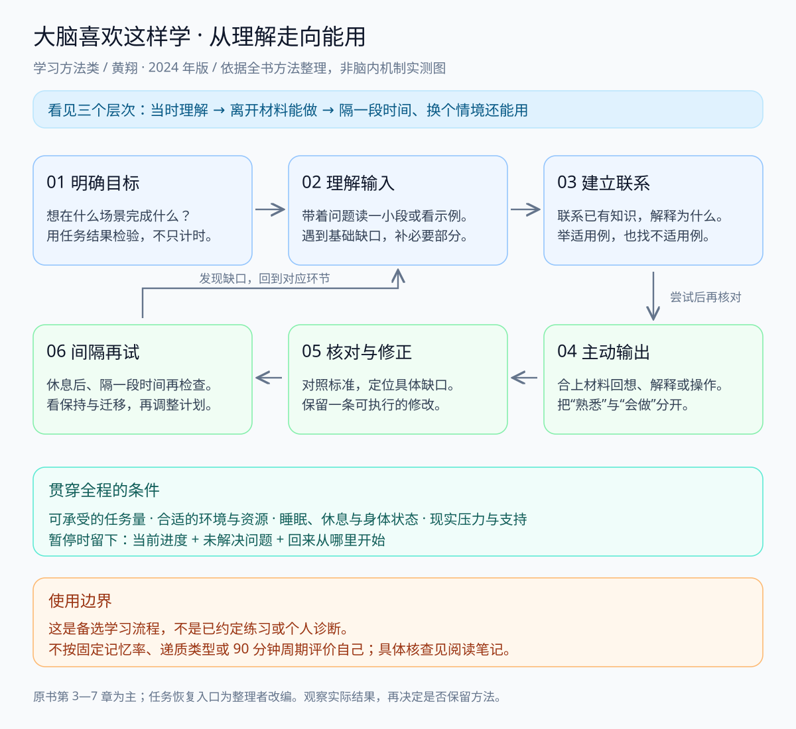

# 《大脑喜欢这样学》阅读笔记

阅读日期：2026-11-07。分类：**学习方法／学习与脑科学科普**。按用户指定归入“学习”，与 CBT 分开。

这本书最适合用来检查学习活动是否形成了完整过程：目标是否清楚，输入是否经过理解与联系，是否真的尝试提取和应用，是否得到反馈，以及是否留有恢复和再次练习的机会。书中若干脑科学解释、故事和健康建议存在简化、依据不明或错误，不能因为作者使用了专业词汇就全部采用。

## 版本、阅读覆盖与定位

- 作者：黄翔；中信出版集团，2024 年 10 月；ISBN 9787521768848。版权页标注 108 千字。本笔记对应用户提供的这一版本，不是其他作者的同名或近名书。
- 原书：[本地 EPUB](../资料/大脑喜欢这样学_黄翔_z_library_sk,_1lib_sk,_z_lib_sk.epub)。原文件未改动、未上传。
- 已按 spine 顺序阅读全部文字：版权、推荐序、引言、三部分正文全部 **9 章**、后记、延伸阅读，共 47 个阅读顺序文件。封面文件的文字提取空缺已由封面图像补核。
- 已浏览封面及 22 张正文 JPG 图，包括学习金字塔、年龄与专注时长表、舒尔特方格、遗忘曲线、反馈循环和脑区示意图；PNG 均为相同“注”图标，核对了代表图。图像浏览不是解剖标注的专业校勘，也不代表认可图中数值。
- 已核对原书 SHA-256 与既有提取清单一致：`054b419662f61d90c095f65e31699102a464c52b80474bacf5b2ec3e103082df`；复用[本地文本索引](文本索引/大脑喜欢这样学_黄翔_z_library_sk,_1lib_sk,_z_lib_sk.txt)，未重复提取。
- EPUB 无稳定纸页；下面记录内部路径与章节。路径以 `EPUB/xhtml/` 开头，多数文件**没有扩展名**。spine 指阅读顺序，不是纸页。
- 未逐一阅读书中引用的论文、延伸书目，也未验证所有历史故事、统计数字和 AI 预测。仅对下文列出的关键表述做了外部核查；不要将“本书已读”扩大为“所有依据已验证”。


### 阅读地图

| 位置 | 内容 | EPUB 内部文件／spine | 本次覆盖 |
| --- | --- | --- | --- |
| 前置文字 | 推荐序、引言 | `Chapter1`、`Chapter2`／3–4 | 全部文字 |
| 第 1 章 | 揭秘大脑：学习是如何发生的？ | `Chapter3_1_1`—`Chapter3_1_4`／6–9 | 全章 4 节 |
| 第 2 章 | 学会学习：重构大脑的内部模型 | `Chapter3_2_1`—`Chapter3_2_4`／10–13 | 全章 4 节 |
| 第 3 章 | 设定目标：让孩子主动学习的脑科学秘密 | `Chapter4_1_1`—`Chapter4_1_4`／15–18 | 全章 4 节 |
| 第 4 章 | 训练专注：提升效率，训练大脑跟你一起做时间管理 | `Chapter4_2_1`—`Chapter4_2_4`／19–22 | 全章 4 节 |
| 第 5 章 | 对抗遗忘：用建模式学习提升记忆力 | `Chapter4_3_1`—`Chapter4_3_4`／23–26 | 全章 4 节 |
| 第 6 章 | 积极反馈：让错误成为学习的一部分 | `Chapter4_4_1`—`Chapter4_4_5`／27–31 | 全章 5 节 |
| 第 7 章 | 高效休息：怎样呵护大脑，让孩子吃好睡好？ | `Chapter4_5_1`—`Chapter4_5_5`／32–36 | 全章 5 节 |
| 第 8 章 | 调节情绪：如何提高孩子的情绪韧性？ | `Chapter4_6_1`—`Chapter4_6_4`／37–40 | 全章 4 节 |
| 第 9 章 | 人脑是我们最强大的武器 | `Chapter5_1_1`—`Chapter5_1_4`／42–45 | 章引言及 3 节 |
| 书末 | 后记、延伸阅读 | `Chapter6`、`Chapter7`／46–47 | 全部文字；未延伸通读推荐书 |

## 全书框架：从“接收信息”到“能用并能改”

**作者的组织方式：** 第一部分解释学习与大脑变化、内部模型；第二部分依次讨论目标、专注、建模式学习、反馈、休息，再补充情绪；第三部分讨论 AI 时代的教育。引言概括的五个要素并不意味着只有五种影响学习的因素。

**整理后的工作方式：** 确定一个具体用途 → 在可承受的条件下学习 → 联系已有理解 → 关掉材料提取或完成任务 → 对照证据发现缺口 → 修正后间隔再试。休息、现实资源与情绪贯穿过程，不能只在完成任务后才被允许考虑。



[可编辑 Excalidraw 图](图示/大脑喜欢这样学-学习过程.excalidraw)。图为整理者对书中方法的改编，不是原书插图、脑内过程实测结果或用户个人模式图。

评价学习时分开看三个问题：**当时是否理解、离开材料能否完成、隔一段时间换个情境是否还能用。** 笔记漂亮、熟悉材料、花费很多时间，都不能单独回答这三个问题；它们也不是无用，只是承担的功能不同。

## 逐章笔记

### 第 1 章｜学习发生了什么变化？

定位：`Chapter3_1_1`—`Chapter3_1_4`。依次讨论学习成绩的反差、宏观大脑、微观连接及刺激经验。

**作者观点与解释：** 勤奋和成绩并不总是同步。作者通过脑外科经历、神经元与突触、出租车司机海马体研究等，强调学习伴随大脑改变，并把丰富经验、练习和睡眠作为重要条件。他用“硬件／软件”比喻区分可见结构与微观连接，希望削弱“聪明完全由天生决定”的观念。

**可保留的方法：** 遇到“投入很多却不会用”，先检查投入的内容：是否只整理或反复看材料，是否接触了相关实例，是否尝试解释和操作。学习机会可以来自课程、讨论、实践、观察，而非仅增加书桌前时长。不同形式需服务同一学习目标。

**整理者评述与边界：** 宏观相似不能证明每个人能力完全相同；可塑性也不保证任何目标都能达到。“连接更多”不是衡量一切学习的唯一尺度。动物关键期、丰富环境实验和个人故事不能直接推出成年人学习处方。书中的学习金字塔以固定百分比排列听讲、阅读、实践和教人，这部分不采用，外部核查见后文。不能据它把阅读说成“只剩 10%”或强迫每次公开讲课。

**可检验的问题：** 学习后增加的是材料收藏、术语熟悉，还是某一种可观察的解释或完成任务的能力？这是学习设计问题，不是对学习者智力或人格的评价。

### 第 2 章｜“内部模型”要落实到能理解和运用

定位：`Chapter3_2_1`—`Chapter3_2_4`。依次讨论智力观、努力方式、内部模型及五步安排。

**作者观点与解释：** 只背知识点、只重复容易任务、同时处理多项任务，以及缺少睡眠，都可能让投入与表现脱节。作者把能组织信息、识别结构、预测并处理问题的能力称作“内部模型”，用双义图、专业识别和解题来说明既有经验如何影响理解。

**可保留的方法：** 把孤立信息放到用途里；不只问“这是什么”，还问“为何成立、在什么条件下用、与另一种方法怎样区分”。观察一个范例，遮住答案自己尝试，比较差异，再回到完整任务中验证。遇到卡点先定位知识、判断或操作中的具体环节。

**整理者评述与边界：**“内部模型”在本书中涵盖较广，接近知识结构、心理表征和可运用的经验组织，但这些概念不是严格同义词。日常表现不能直接测出某种神经网络是否建立；它也不等同于 CBT 核心信念或人格结构。书中将视觉神经通路数量比例推广为感知内容比例，不能照搬为“多数现实都是脑补”的结论。对 IQ 的批评不等于所有差异都由教育造成。

**明确勘误：** 本章第二节把《刻意练习》作者安德斯·艾利克森写成迅速成名的瑞典网球选手。其所属大学资料确认他是心理学教授与专长研究者；书中这个人物故事不能作为证据。[FSU 心理系人物纪念](https://psychology.fsu.edu/article/k-anders-ericsson-1947-2020-worlds-foremost-expert-expert-performance)

**成人应用示例（整理者编写）：** 学习一个技术概念时，除定义外写出一个适用例、一个不适用例和一个能区分二者的小任务。示例不代表用户已有某种能力缺陷。

### 第 3 章｜让目标能够引导选择和行动

定位：`Chapter4_1_1`—`Chapter4_1_4`。依次讨论目标作用、自动加工、SMART、主动学习与持续。

**作者观点与解释：** 目标帮助选择信息，进展和奖励有助于维持行动，自我效能感影响是否愿意尝试。作者主张将较远目标拆分，让学习者参与决定，并把社会支持、奖励与习惯纳入安排。

**可保留的方法：** 用 SMART 检查目标是否具体、可观察、可行、相关并有时间边界；再落实成一次能开始的动作。能力目标和时间指标分开，例如“能解释并完成一次任务”是结果，“阅读半小时”只是投入。反馈应指出真实进步及下一步，不捏造成功。

**整理者评述与边界：** SMART 是安排工具，不是每种探索都必须遵守的唯一标准。“潜意识会工作”可以作为酝酿问题的描述，不能承诺写下愿望就自动实现。书中的哈佛长期目标调查没有提供可追溯原始研究，本次未证实，不采用其比例作为效果依据。也不因目标有帮助就否认经济、时间、健康与他人行为的限制。

**可选练习：** 把一个笼统目标改为“在某个场景，我想能独立完成什么；怎样知道做到了；这次先做哪一小步”。若目标过重，先缩小范围，而不是通过惩罚增加压力。

### 第 4 章｜专注需要合适任务与条件

定位：`Chapter4_2_1`—`Chapter4_2_4`。依次讨论专注表现、神经递质解释、训练方式及实践安排。

**作者观点与解释：** 专注受动机、环境、身体状态及任务难度影响。方法包括降低屏幕干扰、稳定场所与时间、定义本轮任务、番茄钟、舒尔特方格以及在适当难度下练习。作者将不同动力状态归为去甲肾上腺素型与多巴胺型学习。

**可保留的方法：** 开工前明确本轮只解决什么，准备需要的资料，降低无关切换；时间块可以试着设短，再依据实际表现调整。走神后记录干扰，返回任务，不把一次走神当作整轮失败。结束时保存当前进度、未解决问题与恢复入口。

**整理者评述与边界：** 上述“类型”不是本项目用于分类人的标准，不能从拖延反推出递质水平。书中年龄—专注时长表（`image_012.jpg`）与舒尔特速度阈值未给出充分测量依据，不能用于 ADHD 筛查或认定“先达标才有资格学习”。方格练得快，也不能自动推定真实工作能力提高。

书中有让大脑感觉任务已经完成的建议；对容易忘记待办的情境，更合适的改编是**标明实际状态并设置恢复线索**，不是把未完成记作完成。25／5 分钟、早晨前三小时、成年人连续一两小时等安排，都不作为固定要求。困倦或负担过重时，应检查恢复与任务量，而不是一律加压。

**观察方式：** 看一次任务中发生了哪些切换、什么触发中断、能否返回，以及产出了什么。不要只计坐了多久。

### 第 5 章｜建模式学习：输入、关联、输出与间隔

定位：`Chapter4_3_1`—`Chapter4_3_4`。依次讨论建模式框架、三个环节、巩固及模型应用。

**作者观点与解释：** 学习不仅是记入信息，还要建立联系并提取、运用。作者讨论细节理解、多感官线索、把知识与兴趣及已有经验结合、交错学习、重复、间隔和休息，用这些方式建立可调用的内部模型。

**可保留的方法：**

1. **输入：** 带着具体问题阅读一小段，厘清关键概念与步骤；发现前置知识缺口时补最必要的部分。
2. **关联：** 说出它与什么已知内容相连，举例、比较，并写出适用条件，避免只画没有含义的连线。
3. **输出：** 离开材料解释、回想、解题或操作，再回查校正。读前提问主要用于引导注意，不自动等于从记忆中提取。
4. **交错：** 在有一定基础后混合容易混淆的任务，练“选哪种办法”；与一边学习一边刷消息的切换有别。
5. **间隔：** 过一段时间再试，看哪些能独立完成，哪些仍依赖提示，据此调整下一次复习内容。


**整理者评述与边界：** 多种呈现形式不等于存在固定“视觉型／听觉型学习者”，增加声音、气味也不保证帮助。情境变化需服务迁移，不故意在生病、危险或明显不适的状态下训练。书中的遗忘曲线百分比不能预测每个人每天遗忘多少；“存储强度／提取强度”的理论区分也不证明所有经历永久完整保存。

本章承认清醒休息期间的重放和巩固，与其他章节“只有睡觉才形成长期记忆”的绝对说法冲突。核查支持保留“休息参与学习”的方向，但不据特定实验的倍数承诺通用效率，更不据此减少睡眠。

**可选练习：** 读完一个概念后，合上书用三句话解释，写一个例子，再查出遗漏。下一次先回想再打开材料。记录具体缺口即可，不必抄写整章。

### 第 6 章｜反馈要告诉我们改什么

定位：`Chapter4_4_1`—`Chapter4_4_5`。依次讨论反馈重要性、错误、鼓励、主动输出和导师反馈。

**作者观点与解释：** 经验年数不等于持续进步，缺少可用反馈时可能一直重复旧方式。错误可以提供修正方向，积极反馈支持持续投入；讲解、写作和导师可以使盲点显现。

**可保留的方法：** 先做出可检查的尝试，再对照答案、结果或明确标准。错题记录至少保留“哪里错、当时怎样判断、正确依据、下一次怎样识别”，复习后删减已掌握部分。求助时说明目标、已经试过什么、卡在哪，以及希望对方帮助检查的一个问题。

**整理者评述与边界：**“粗心”只是待解释标签，要继续查读题、条件识别、步骤遗漏或技能熟练度。犯错不自动产生进步，仍需要纠正与再次使用。容易任务也可能承担巩固或自动化作用，不宜全部视为浪费时间。

鼓励应真实、具体，关注有效策略、修正和投入；不是只夸努力，也不是说“你天生聪明”。书中反对 App、要求纸质错题本的意见不作为项目硬规则，本地数字记录可以承担同样功能。导师也可能误判或带有偏见，仍要核对其依据与任务适配性；公开发布不是获得反馈的必要条件。

**成人应用示例（整理者编写）：** 代码不能达到预期时，先保留最小输入、预期结果、实际结果，再请求检查差异。这个结构用于让问题可回答，不用于证明自己“不应求助”。

### 第 7 章｜把恢复视为学习条件

定位：`Chapter4_5_1`—`Chapter4_5_5`。依次讨论疲劳、睡眠作用、睡眠安排、饮食与运动。

**作者观点与解释：** 作者区分长时间集中、单调、久坐和反复思考等疲劳情境，介绍短暂休息、正念、睡眠、饮食与运动，希望学习者不靠长期透支换取时长。

**可保留的方法：** 区分“需要恢复”“任务单调”“身体久坐不适”“担忧占据注意”等可能情境，选择合适的暂停、活动或任务调整。休息前写下停在哪里，回来先看恢复线索。是否恢复，应观察实际清醒程度、身体舒适与任务表现，不能只问是否又坚持了一轮。

**整理者评述与边界：**“神经递质耗尽”不是本项目判断疲劳的依据；默认模式网络也不能简单等同于有害内耗。书中部分例子认可放松时产生联想，另一些则把自发思考概括为浪费，不能据此要求自己一直停止想法。

睡眠有助于学习，但“只在睡眠中形成长期记忆”“人人按 90 分钟倍数安排就更好”不可作为安排依据。尤其不能因为四个周期算成六小时，就认为减少睡眠更科学。书中“一律每天补多种维生素”、食物直接定向改变脑功能、追求固定高心率或运动后必须立刻学习等说法，不转化为个人处方。已核查部分见后文；未核查部分保留未证实状态。

**可选记录：** 只记录本轮前后的状态、休息方式与返回后表现，比较哪种安排适合当前任务。此处是备选方法，用户尚未同意实施，不新增打卡要求。

### 第 8 章｜情绪和现实处境不能被一个脑区解释完

定位：`Chapter4_6_1`—`Chapter4_6_4`。依次讨论情绪控制、情商、压力与抑郁。

**作者观点与解释：** 作者用前额叶及相关脑区说明情绪调节，介绍情绪维度、换角度观察、活动、支持、压力管理，并提醒关注持续的情绪困难。

**可保留的学习层面：** 当情绪妨碍学习，先了解具体事件和现实要求，区分可调整的任务、需要支持的处境与需要恢复的状态。学习计划应能随状态调整；求助、改变环境与减少不合理要求，也属于可以考虑的行动。

**整理者评述与边界：** 本章不能因涉及心理内容而归入 CBT 教材。书中“情绪问题先检查前额叶／做头部磁共振”的概括，不作为本项目的通用就医路径；是否需要检查取决于专业评估。也不采用“所有心理问题来自自我否定”“停止抱怨就应归咎自己”等总括解释。作者既讨论现实压力，又提出强烈内归因要求，两者需要辨别，不能删去现实环境只留下自责。

书中包含自评量表及分数后的就医、服药和住院措辞。本项目不据此确诊、不复制为自动判断流程，也不依据单个分数决定治疗。关于抑郁的形成与评估，已对照 NIMH／NHS，见核查表。没有新增关于用户情绪、疾病或病因的判断。

**后续查阅方式：** 学习压力的任务安排可参考本章；若讨论想法、行为与情绪的相互影响，仍回到既定 CBT 主要教材及具体事件，不把脑区示意图当成个人概念化。

### 第 9 章｜面对 AI，保留目标、判断与检验

定位：`Chapter5_1_1`—`Chapter5_1_4`。包括章引言、家庭教育机会与挑战、人脑与机器的比较、未来能力。

**作者观点：** 作者预期 AI 改变内容获取、个性化教育和评价，担心碎片信息、选择困难、竞争与社交机会减少。他强调选择有价值的问题、跨学科学习、沟通、创造和使用工具的能力。

**可保留的方法：** 让工具服务具体学习目标；把工具给出的答案与任务要求、可信资料和实际检验对照。保留自己解释、尝试、提问和修改的过程，避免只积累现成输出。复杂任务可以拆分，但需要回到整体检查。

**整理者评述与边界：** 这是 2024 年出版时的观察与预测，不是当前 AI 能力报告。“中文房间”是哲学思想实验，不能单独证明某种现有系统的实际能力边界；书中关于机器无法创造、二进制与非线性等论述，不作为本项目的技术判断依据。本次没有逐项更新其 AI 事实或预测。

书中设想教育设备采集数据，不意味着用户授权上传个人记录。学习活动可以使用本地资料与必要工具，仍需核验答案；不能用“人脑优于机器”替代证据，也不能因工具说得流畅就默认正确。

## 前置文字与书末材料

推荐序强调学习环境、连接和反馈，是推荐者的概括；引言用早读、音乐与回想区分输入和提取，引出五要素。饥饿、低温、音乐等例子不直接转化为提高学习能力的处方。

后记记述作者在飞机上帮助学生调整状态的经历及成书过程。这能说明写作动机，但一次更换音乐、活动和鼓励后解出题，不能辨别到底哪个因素起作用，更不证明音乐“激发脑电波”产生了特定效果。

延伸阅读共列出 15 本相关书，涉及学习、成长、休息、营养、青春期与 AI。本次读了这些推荐说明，**未因此将所推荐书籍标为已读**；其中的宣传性效果表述也未逐一核实。

## 关键表述核查与采用边界

核查日期：2026-11-07。只检索公开的书内主张，没有提交个人经历或本地记录。下面分清“已有反证或明确修正”“本次未证实”以及“方法可用但机制不能照搬”。网页核查不是对全书的系统综述。

| 原书位置与说法 | 核查结果／证据范围 | 本项目处理 |
| --- | --- | --- |
| 第 1 章第 4 节、图 3：学习方式对应固定保持率 | Lalley 与 Miller 的论文作者摘要指出未找到支持该金字塔的可信特定研究；不同方法需依内容与背景选择。[ERIC 原论文记录与摘要](https://eric.ed.gov/?id=EJ790160)。本次读摘要，未通读该论文 | 不使用 5%—90% 作为学习效果预测或方法排行榜 |
| 第 2 章第 2 节：《刻意练习》作者为网球选手 | FSU 心理系的职业经历与此身份叙述不符，另有院系资料明确其为该书合著者。[FSU 人物资料](https://psychology.fsu.edu/article/k-anders-ericsson-1947-2020-worlds-foremost-expert-expert-performance)、[FSU 专长研究介绍](https://artsandsciences.fsu.edu/spectrum-winter-2021/article/practice-makes-perfect) | 标为人物身份误述；不以该故事证明训练效果 |
| 第 1、2、7 章：只有睡眠才能形成或巩固长期记忆 | NIH 对 Buch 等 2021 年研究的报告显示，清醒短休息中也观察到与技能巩固相关的重放；任务为特定按键序列。[NIH 研究报告](https://www.nih.gov/news-events/news-releases/study-shows-how-taking-short-breaks-may-help-our-brains-learn-new-skills?ck_subscriber_id=2332818880)，DOI：10.1016/j.celrep.2021.109193。本次读机构报告，未通读论文 | 修正“只有”；也不能把该实验倍数推广为所有学习的收益，不能替代睡眠 |
| 第 7 章第 3 节：按 90 分钟固定周期安排睡眠 | NHLBI 的说明为约 80–100 分钟，并描述各阶段随夜间及年龄变化。[NHLBI 睡眠阶段](https://www.nhlbi.nih.gov/health/sleep/stages-of-sleep) | 不以 90 分钟整数倍设定所谓必然更优的睡眠时长 |
| 第 7 章第 4 节：每天都补多种维生素 | NIH ODS 说明补充剂不能替代多样饮食，是否需要与摄入、年龄及特定情况有关，过量也有风险。[ODS 消费者说明](https://ods.od.nih.gov/factsheets/MVMS-Consumer/) | 不把补充剂作为所有学习者的默认步骤 |
| 第 8 章：情绪问题一律先查脑、单一自我否定解释及自评分数决定后续治疗 | NIMH／NHS 强调症状、持续时间、功能影响及鉴别其他状况；NHS 明确抑郁没有单一原因。[NIMH 评估说明](https://www.nimh.nih.gov/health/publications/depression)、[NHS 诊断](https://www.nhs.uk/mental-health/conditions/depression-in-adults/diagnosis/)、[NHS 病因](https://www.nhs.uk/mental-health/conditions/depression-in-adults/causes/) | 不据书中简化说明判断用户，不用分数代替评估；这也不等于说任何情况下都不需要影像检查 |
| 第 3 章第 1 节：哈佛多年目标调查的精确比例 | 本次未找到该版本的原始研究。耶鲁图书馆否认另一个常流传的“1953 年目标调查”，但那不是对本书哈佛版本的直接核查。[耶鲁档案答复](https://ask.library.yale.edu/faq/175224) | 标为本次未证实；不用另一故事的辟谣冒充逐项核实，也不采用比例 |
| 递质类型、专注常模、情商成功占比、食物定向健脑、运动后必须立即学、AI 的永久边界 | 书内依据不足以直接支持普遍适用；本次未分别完成文献核查 | 记录为作者主张／未证实，不作为人的分类、诊断或固定行动标准 |

## 与《超速学习》的对照

| 议题 | 本书侧重 | 《超速学习》对应 | 后续使用 |
| --- | --- | --- | --- |
| 确定方向 | 目标、动机、任务拆分 | 第 4 章后设学习、第 13 章项目设计 | 先明确用途与验收，再选资源 |
| 专注 | 环境、时间块、身体状态 | 第 5 章专心致志 | 从实际干扰和负担调整，避免追求统一时长 |
| 会用知识 | 输入—关联—输出、内部模型 | 第 6 章直接练习、第 11 章理解 | 以解释、任务和迁移检查结构，不推断神经变化 |
| 提取与保持 | 回想、间隔、交错与休息 | 第 8、10 章提取与保留 | 区分熟悉感、当下表现及延迟后表现 |
| 反馈 | 错误分析、真实鼓励、导师 | 第 9 章结果／信息／改正型回馈 | 取得能指向下一步的信息，不只得到总分 |
| 持续调整 | 状态、任务与环境的配合 | 第 12 章实验心态 | 一次比较一个重要调整，结果不好就修正方法 |

这是方法层面的对照，不是两书独立验证了所有共同主张；它们也可能引用同样的二手材料。

## 后续对话怎样调用这本书

用户希望先理解机制，再决定是否实践。这里保存的是**可用的解释与备选方法**，不是已经确定的个人模式或练习安排。

| 具体学习困难 | 先核对什么 | 可查章节 |
| --- | --- | --- |
| 看懂了，离开材料不会 | 能否独立提取；是否缺少示例、基础或操作练习 | 2、5、6 |
| 收藏和笔记很多，不知道学到了什么 | 目标用途与验收；笔记是否回到任务中使用 | 3、5、9 |
| 练了很久仍反复出错 | 是否有可用反馈、错误是否定位、难度是否合适 | 5、6 |
| 学习时容易中断 | 任务是否清楚，环境、疲劳、担忧与资源怎样 | 4、7、8 |
| 一暂停就忘了回来 | 是否留有任务状态和恢复入口；还需了解具体事件 | 4、7；这是改编假设，不是书内对用户的解释 |

可选的一轮学习记录，未来需要时再共同决定使用：

```text
想能完成的具体任务：
这一轮学习的材料或示例：
离开材料后实际能解释／完成什么：
核对后发现的一个缺口及依据：
下一步调整；若暂停，恢复时从哪里开始：
隔一段时间再试的结果（尚未观察就留空）：
```

无需为了记录填满表格；真实困难、暂时无效和未完成也都是信息。学习方法的好坏以实际能力、保持、可持续性及负担评估，不以篇数、打卡次数或所谓脑类型评估。

## 自测问题与笔记使用规则

1. 为什么熟悉一段文字不等于能独立解释或使用？
2. 输入、关联和输出各自补上了什么环节？
3. 混合练习与分心切换的区别是什么？
4. 什么样的反馈能够指向下一次修改，而不是只制造好坏评价？
5. 暂停时留下什么，才容易恢复任务？
6. 哪些书中说法是方法、哪些是机制假说、哪些已发现错误或尚未证实？


使用时先看相应章节及核查表，必要时回到原 EPUB。对书中有用的方法保持开放，对具体效果保留检验；不把科普故事当作用户经历，不将“学得不好”直接解释为认知偏差、递质不足或人格问题。
