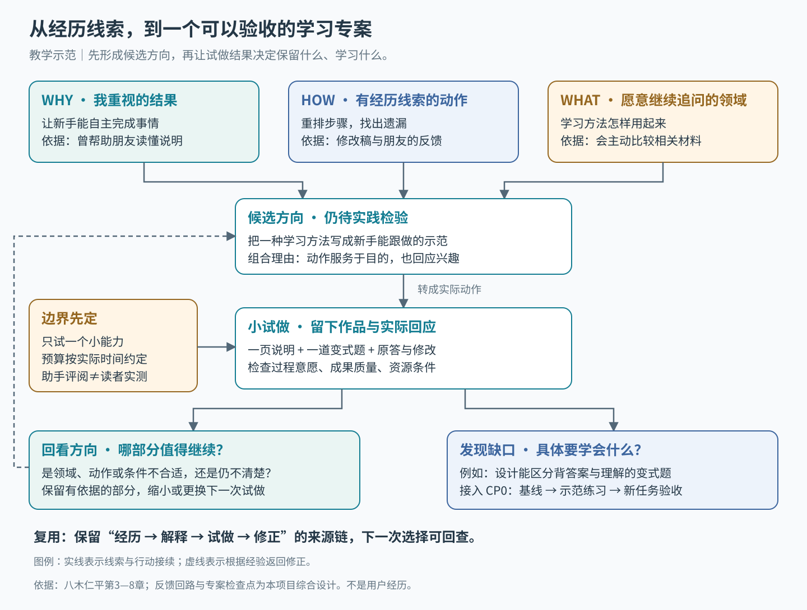

# 如何找到想做的事：把自我描述变成可尝试的学习方向

分类：学习方向／自我探索与专案选择。更新：2026-11-17。

这本书帮助回答“我愿意为什么问题投入学习”。最有用的结果不是一句完美的职业标签，而是一个有经历依据、可以试做、允许修正的方向。**重要的事提供判断标准，擅长的事提供候选做法，喜欢的事提供探索领域。** 三者结合之后仍须行动检验。

还不知道学什么，先看[完整示范](#完整示范把我喜欢看书变成一个可尝试的方向)。已有明确任务就直接用[指导手册](学会学习-指导手册.md)，不需要先做完自我探索。所有学生案例与验收条件均为整理者教学设计，不是对用户的评估。

## 版本、定位与实际阅读范围

- 本地书名为《如何找到想做的事》，八木仁平著，徐艺菊译，机械工业出版社；所读电子文件含微信读书2024-05-22版本信息。对应用户提到的《如何找到自己喜欢的事情》。
- [原始 EPUB](../资料/如何找到想做的事_八木仁平_z_library_sk,_1lib_sk,_z_lib_sk.epub)。已按阅读顺序读完全部70个 spine 文档的提取文字，含前置说明、8章、三组各30问的文字附录及致谢；这不等于完成书内自我探索练习。
- 定位采用 `OEBPS/NNNN.xhtml`，以下范围含章节标题文件。图片内文字不会自动进入全文索引。
- 已逐图核对：0035价值观分组图、0037价值观排序图、0045成功模式清单及两张自评表、0062总流程图，共6张。附录0066—0068的三份“100例”图片清单尚未逐项核对，其他图片也未逐张校勘；不把示例清单称为已全部读完。
- [提取清单](文本索引/新增两书提取清单.json)保留哈希与文档段数；未通读外部引用资料，未核验作者所有自传事实或营销性效果主张。

## 逐章理解：从筛选标准走向实践

### 第1章：先松开“一次选对一辈子”的要求

定位：0005—0010。作者反驳五类观念：想做的事必须终身不变、找到时必有命定感、必须直接有益他人、只能靠不断行动寻找、无法成为工作。

教学取舍：可以先形成当前值得验证的方向，而非终身承诺；帮助他人与照顾自身需求并不冲突。作者为了破除限制使用了强烈措辞，不反过来要求“只要自我分析就不需要探索”。没有接触过的活动，往往仍需实际体验。

练习：把“我必须找到一辈子热爱的职业”改成一个近期能调查的问题。检查点是能安排行动和回看结果，例如“我是否愿意持续做解释和反馈，而不只是喜欢阅读”。

### 第2章：选项增加，不一定让选择更清楚

定位：0011—0014。作者用自己的求职、博客收入与意义感变化说明：外部回报与内在认可可能不一致；多获得信息仍可能缺少筛选标准。

这章适合教“先提出比较维度”：我重视什么工作方式、希望什么结果、有哪些现实限制。它不是证明任何人的迷茫都源于不了解自己。收入、安全、时间、照顾责任等条件要与偏好一起考虑。

检查点：能说明为什么暂选A而不是B，并承认尚缺什么资料。只列十个可能职业，没有判断理由，尚未完成本步。

### 第3章：把领域、做法与目的拆开

定位：0015—0027。作者区分喜欢的事（What，感兴趣的领域）、擅长的事（How，常见的做事方式）、重要的事（Why，希望实现的价值状态）。书中用乘法表达三者组合，它是组织思路的比喻，不是可以打分相乘的测量公式。

实际探索顺序是先价值观，再擅长，再喜欢，组合候选方向，最后找实现手段。重要区别是“喜欢书”不等于喜欢卖书，“喜欢电影”不等于喜欢片场的全部工作。必须落到动作，才能知道要学什么。

检查点：一句话含领域与动作，并能说明目的，例如“把学习材料整理成新手能跟做的示范，帮助他们独立完成任务”。这句话仍是假设，不等于已经有教学能力。

### 第4章：从经历提炼价值，而不抄一张美好词语表

定位：0028—0038。作者先区分价值方向与具体目标，再用敬重的人、影响深的经历、不满的现象、他人眼中的重视点和常给的建议等问题提取词语。随后分组、调整为自己可承担的行动方向、建立层次，再写工作目的。

要保留“词语来自哪段经历”。例如“自主”可能指能选择任务，也可能指不受打扰，二者需要不同安排。把希望别人改变的表述转回自己能做什么，有助于行动，但不能抹掉对合理支持与公平条件的需求。

检查点：每个暂用价值词至少有一个例子及一个选择含义。例子数量是本笔记起步设计，原书还提供更多提问，不要求一次全部写完。价值层次允许随处境调整，不是一张普遍正确的人生排序。

### 第5章：把“擅长”写成有情境、有动作的证据

定位：0039—0045。作者通过充实经验、对他人的不耐烦、他人反馈、不愿放下的工作和既有成功，寻找反复出现的做事方式；再追问背景、行动、想法、动机、终止与改进等维度，形成自己的使用说明。

“我擅长整理”太宽，改为“面对散乱说明时，我先按任务顺序重排，并让同伴试做来发现遗漏”。需要区分自己喜欢这样做、做过且有结果、尚待验证三个层次。作者倾向把擅长与天生特征联系，教学中不据此推断能力固定或不应补弱项。

检查点：能列出实际动作、当时条件与结果依据；若只有自我评价，补一次小任务或具体反馈。对别人感到不耐烦也可能来自期待、压力或沟通问题，不能直接当作天赋证据。

### 第6章：把喜欢的领域拆到你真正想追问的部分

定位：0046—0051。作者建议从愿意花钱了解的内容、书架、帮助过自己的领域、感谢的工作和不满的议题寻找兴趣。棒球的兴趣可以细分为战术、协作或技能提升，未必只能变成棒球行业工作。

学生可以选一个会继续追问的问题：“我爱看学习视频”再问一步，是喜欢主持人的表达、整理知识，还是想自己设计训练？区分观看时的愉悦与生产、练习时的意愿。

检查点：能说出想继续调查的具体问题，并做一次相关动作。章节标题“和努力说再见”不作为承诺；有兴趣仍可能遇到困难、疲惫和必要的基础训练。

### 第7章：组合之后，靠行动修改

定位：0052—0056。喜欢的领域与擅长的方式产生候选方向，再用工作目的筛选。作者从一对一咨询转向讲座，再调整到录制课程与消息支持的经历，说明可以保留领域或目的、改变实现方式。

这一章是全书接入学习实践的关键：**假设—尝试—回顾—再利用经验。** 不满意一次活动时，分开看领域、动作、难度和条件，不立即得出“这不是我喜欢的事”。作者将收入与感谢相连的说法是价值表达，不能据收入评定工作或人的价值。

检查点：尝试后能指出保留什么、改什么及理由，不能只写喜欢／不喜欢。没有结果也可以是信息不足，而不是方向失败。

### 第8章：方向先暂定，实现手段再学习

定位：0057—0062。作者把自我理解与手段调查分开，建议在方向明确后研究怎样实现，末尾总流程给出找不到价值、擅长或兴趣时的返回路径。

本项目把它接到能力训练：方向试做后暴露什么能力缺口，就为那个缺口设小专案，而不是先买全套课程。资源限制也会反过来影响方向，顺序可以往返。书中关于必然成功、失败消失等鼓励性表达不是效果保证。

检查点：知道下一次要调查、制作或练习什么，及完成后如何判断，而不只是得到一份人生宣言。

### 附录：问题是检索线索，清单不是测试量表

0063—0065的三组30问分别扩展价值观、擅长与喜欢的探索，文字已读。它们适合在已有问题卡住时挑一问，不要求一次答90题。0066—0068的三份100例图像清单未逐项核对，不作为本笔记的具体论据，也不用于打分或筛选人格。0069致谢已读。

## 读图课：分组、排序和流程分别在回答什么

### 0035：价值观分组图是归类，不是因果模型

原图以作者为中心，把词语归入审美意识、简单、热爱、成果、好奇心五组。虚线表示归属或关联，不表示一个词会导致另一个词。它展示的是作者的整理结果，不能直接当作学生的价值结构。

照着读：先挑一个词，解释它来自什么经历；再判断两词为何同组。自己操作时可以用两三个暂定组，不追求和原图一样的组数。**同义词合并后，仍要保留不同情境的差异。** “独立完成”和“独自工作”不必是同一种价值。

### 0037：金字塔问的是手段与目的

原图从底到顶依次为简单、好奇心、成果、热爱、审美意识，右侧明确标注基础→最终目的。读图重点是“这一层怎样支持上一层”，不是假定塔尖具有更高道德价值。

例如“想掌握工具→能独立制作→把想法表达清楚”，可以暂时形成手段—目的链；也可能有另一条路径达到同一目的。若你说不出相邻层的关系，就先保留并列，不要为模仿金字塔硬排高低。

### 0045：自己的使用说明要有结果校验

原图列出作者20条成功模式，另用◎、○等标记区分充实且成功、只有充实等自评状态。这里不是让学生复制20条规则，尤其不能把“多实操而非练习”推广为不需要基础练习。

读图时将一项转换为可观察句子：“把信息整理成体系”→“把材料按新手完成任务的顺序重排，让一位读者试做”。自评与成果证据分开：觉得充实可以记录，但读者是否完成任务需另查。学生可以先写一条，不把符号当作经验证的量表。

### 0062：总流程给出了分支，但仍须补实践反馈

图中顺序为价值与工作目的→擅长→喜欢→组合→用目的筛选→调查手段→行动。不能组合时，返回检查喜欢是否写成领域、擅长是否写成动作；缺少线索时，回到附录提问；缺少手段时，再调查资源。

这张总结图没有画出完整的行动后反馈回路。第7章文字却明确讲到尝试与修正，因此本项目综合时把“结果→修正方向／做法／能力缺口”接回去。这是有来源的补充，不是假装原图已有这条线。

## 完整示范：把“我喜欢看书”变成一个可尝试的方向

以下角色与结果都是虚构示范，学生需填自己的资料。先看完整过程，再独立做一轮。



[可编辑图](图示/学习教学-方向到专案.excalidraw)。实线表示线索与行动的接续，虚线表示根据经验返回修正。上方三种线索合流成为候选方向；试做结果同时检验方向与暴露技能缺口。技能不足不直接等于没有兴趣，方向探索也不要求先达到专家水平。

### 看老师怎样做

小周说“喜欢看书，可能应该做知识博主”。先不决定职业，拆成三类证据：

| 问题 | 示范回答 | 仍不能断定什么 |
| --- | --- | --- |
| 什么结果对他重要？ | 曾帮助朋友理解一份说明，希望别人能够自主完成事情 | 不证明他愿意承担所有教学工作 |
| 哪种动作已有线索？ | 做过一次步骤重排，朋友据此完成了安装；能回查修改稿与反馈 | 只有一次，尚不能称为稳定优势 |
| 对什么内容会继续追问？ | 会反复比较学习方法，想知道初学者为何用不起来 | 喜欢比较，不等于擅长训练或测评 |

候选方向：“把一种学习方法改写成新手能跟做的小示范。”另一个候选是“把读过的书整理成评论”。先试前者，因为它更直接对应“帮助别人独立完成”的当前目的。

**试做输入：** 指导手册第七节的百分比材料。**动作：** 制作一页说明，只教“第二次变化为什么要换基准”；请一位自愿读者试一题并解释过程，或先请助手检查内容与题目是否匹配。助手评阅只能提供初步内容反馈，不能替代真实读者可用性测试。

**留下产物：** 原始说明、读者作答或评阅记录、修改处和自己的过程感受。**试做条件：** 限定这一页和一个小能力；时间预算按实际可用时间先定，不由书籍保证效率。

假设反馈是：“他喜欢重排和解释，但出题时不会区分背答案与真正理解；读者原题会做，换题失败。”此时保留方向假设，把下一专案改为“设计能检验基准理解的变式题”，而不是再读十本学习书，也不是认定自己不适合教学。

### 轮到学生：只做一张方向试做卡

选一个最近真正接触过的领域，按下面六行填写；没有证据就写未知。

```text
领域与具体问题：
我重视的结果，以及对应经历：
我做过的相关动作，以及当时结果：
暂定方向（对什么内容，做什么，为何）：
一次小试做（输入、产物、预算、核对者或依据）：
完成后分别检查：过程意愿、成果质量、现实条件、暴露的能力缺口。
```

**方向 checkpoint：** 能提出有理由的候选；试做是一个实际动作；结果能帮助决定保留或调整；投入在当前可承受范围。这里检查的是“值得试”，不是职业适配已经证实。若只写“自媒体／程序员”，继续补具体动作；若完全没有经历，先观察或参与一个小任务，不逼自己从回忆里编证据。

**试做后 checkpoint：** 把四种结果分开看。过程愿意做但质量差，优先查技能与示范；质量尚可却不愿继续，检查动作、条件或方向；两者都不清楚，缩小任务再试；条件不可持续，调整预算和实现方式。一次感受不足以给人定性。

**进入学习专案的门槛：** 把暴露的缺口变成具体能力和可检查任务，接到手册CP0。专案内再经过示范、练习、小测、整合与综合验收；不把方向试做当作能力毕业考试。

### 小测：能不能识别“喜欢”与“做法”混在一起

材料：小陈喜欢看烹饪视频，说自己一定适合开餐厅。他做过一次家常饭，但没有接待顾客、备料或核算成本的经验。请写出一个当前能支持的结论、一个不能支持的结论，以及一次低成本试做与核对条件。[作答后核对](#小测核对)

## 怎样接入已有学习框架

关键词从具体经历提取；组块区分价值、做法、领域和现实条件；关系说明为何支持候选方向；结构组织成可试的行动；细节补输入、产物与条件；评估用实际回应修正；最后画出选择路径。这里得到的是学习方向与待练能力，之后由《超速学习》的直接练习、反馈与保持等方法承担训练，不能用自我分析替代练习。

与[《心流》](心流-阅读笔记.md)连接时，投入感是体验线索，不是能力或职业适配证明；与[《卡片笔记写作法》](卡片笔记写作法-阅读笔记.md)连接时，保留“经历→解释→试做→修正”的来源链，方便下一次决策复用。与[《深度思考法》](麻省理工深度思考法-阅读笔记.md)连接时，检查解释与证据是否混在一起。

## 小测核对

目前可支持：对烹饪内容有兴趣，并有一次家常制作经历。不能支持：已经适合经营餐厅，或具备稳定出品、服务与成本管理能力。可先在可用条件下为一顿普通家庭餐设计菜单、备料并记录成本与时间，检查出品是否符合约定，同时记录自己是否愿意做准备与清理工作；遵守已有饮食需求和日常卫生要求。这只能提供局部任务证据，不能替代真实经营考察。关键是试做包含实际动作，且结论不超出观察范围，不要求和示范选择完全相同。[返回练习](#小测能不能识别喜欢与做法混在一起)
