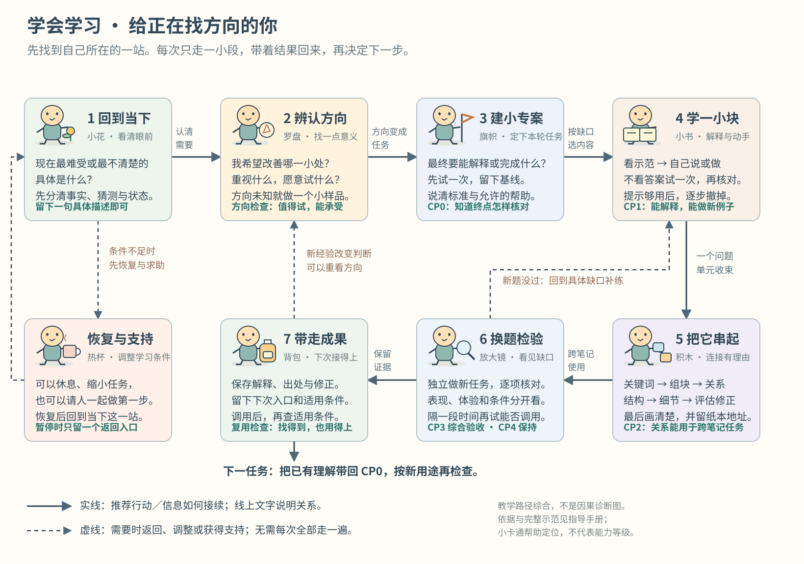
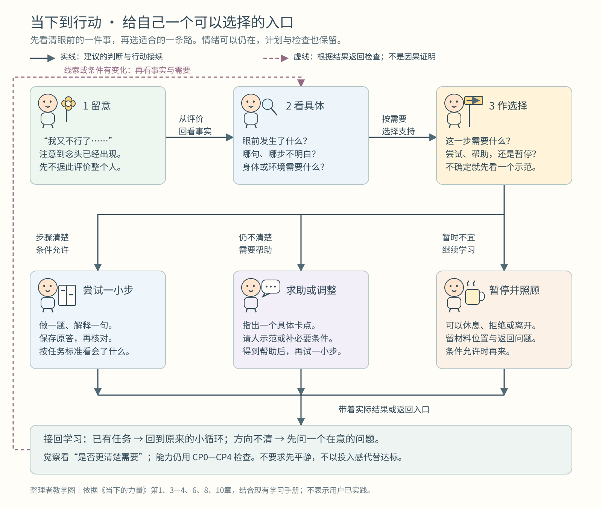

# 学会学习：从迷茫的一刻，到走得下去的一步

修订：2026-11-17。以实际学习任务组织材料；已补入指定新增两书的方向探索与模型检验，并在完整阅读《当下的力量》后完善觉察与行动入口。其他待读书不自动启动。

## 先明确这份手册要教会什么

如果你打开这些资料时，既想改变，又不知道该从哪里开始，可以先停在这一页。你可以说“不知道”，也可以带着疑问尝试；这里的第一步只需要找到眼前的一件具体事情。遇到困难时，我们一起检查是哪一步缺少解释、示范或支持。

这份手册教你逐渐做到：**看清当下 → 找到暂定方向 → 建一个小专案 → 学习与尝试 → 串联理解 → 检查结果 → 给下一次留下入口。** 信心不足时，可以先借助完整示范；熟悉一些后，再减少提示。一次没做出来，只能帮助我们定位这次任务的缺口，不能概括你的能力或价值。



[放大地图](图示/学会学习-学生导航地图.svg) · [可编辑版本](图示/学会学习-学生导航地图.excalidraw)。从左上开始，沿实线向右，再向下、向左。**实线表示推荐行动与信息接续，虚线表示需要时返回、调整或获得支持；线上文字说明为何相连。** 小卡通帮助辨认位置，不代表能力等级。其他分析图按各自图例解读，不能把所有箭头都当作因果关系。

**今天只做一件事也可以：** 读完下面的“先回到当下”，选一个问题回答一句；如果已有明确任务，直接进入第一节。暂时不需要把整张地图变成待办清单。

**第一次用：** 有明确学习任务，先看第一、二节，再按第三节做一轮；纸质笔记按第四节连接；第五节做单元整合；第六节做大测。还没有方向，先用下面的“开始前选路”。第七节有一份材料、笔记和考题齐全的短示范。不需要先购买软件、卡片或新笔记本，也不需要先读完所有单书笔记。

| 你要找的具体操作 | 入口 |
| --- | --- |
| 现在很乱、不自信，先从哪里停下来看看 | [先回到当下](#先回到当下从一句具体的话开始) |
| 想理解自己的看法、在意什么和动力 | [方向与动力的引导问题](#方向与动力每次只选一个问题) |
| 还不知道值得学什么，怎样先试一个方向 | [开始前选路](#开始前选路按眼下的问题进入) |
| 建立专案时先决定什么 | [一、专案起点](#一先建一个小专案让最后的任务引导现在学什么) |
| 到底什么时候串联、什么时候测 | [二、三个循环与起步节奏](#二什么时候串联把三个不同尺度的循环分开) |
| 一次学习怎样从头做到尾 | [三、单次学习](#三一次学习怎么做先走完这一个小循环) |
| 纸本上的分散笔记怎样关联 | [四、纸质关联](#四纸张分开怎样让理解连起来) |
| 怎样把几次学习变成自己的结构 | [五、单元整合](#五什么时候做一次完整串联在一个问题单元收束时) |
| 看得懂词语，却不会解释图中的关系 | [读图与模型检查](#读图与模型检查每条线都要能解释) |
| 怎样安排一次大测及判定结果 | [六、综合验收](#六怎样尝试一次大测让多个单元共同完成新任务) |
| 想直接模仿一次完整过程 | [七、跟做示范](#七跟做示范三次小学习接成一次大测) |
| 书里到底支持什么，哪些是教学安排 | [八、依据与边界](#原书原则与本手册的教学安排分别是什么) |

## 先回到当下：从一句具体的话开始

先看看周围，描述一件你现在看得到的东西，再把注意放回眼前的任务。保持自己舒服的姿势即可，没有闭眼、清空思维或立刻平静的要求。你可以在心里回答，也可以说给愿意倾听的人听。

**先问这一句：我现在面对的，究竟是哪一件具体事情？**

例如，“我的学习一直不行”很难直接处理。进一步看，可能是“我打开这一节，读到‘基准’就不知道它指什么”；也可能是“我知道该做什么，但今天已经很累”。两者需要不同帮助。我们先找出具体位置，再决定下一步。

| 当下说出来的话 | 可以温和地接着问 | 接下来允许做什么 |
| --- | --- | --- |
| “我又拖了，我是不是很差？” | 刚才具体发生了什么？“很差”是观察，还是我对自己的评价？ | 保留事实；暂不对整个人下结论，检查停在哪一步 |
| “我不知道，脑子很乱。” | 眼前最需要的是有人讲一个例子、一起选一项，还是先休息？ | 先选一种支持；仍选不出时，老师给一个最小示范供尝试 |
| “我怕做错，所以一直没试。” | 哪个后果最让我担心？怎样让这次尝试的代价小一点？ | 先做可修改的草稿，约定只看一个问题；真实高风险任务先求助 |
| “我真的没力气了。” | 眼前有哪些身体或时间条件需要先照顾？ | 可以暂停、调整时间或缩小范围；不把休息记为能力不合格 |

**此刻的检查点：** 能分开一件事实、一句自己的解释，或者指出一种需要的支持，就可以停在这里。这已经提供了下一步的线索；它不等于问题全部解决。若仍说不清，就请老师陪你看一小段原材料，不要求你先准确诊断自己。

《当下的力量》第1章“从你的大脑中解放出来”（`OEBPS/Text/chapter01.xhtml`）写道：

> 当你在倾听那种声音时，不要去做任何评判。

本书十章及前置文字现已读完，章级理解与取舍见[阅读笔记](当下的力量-阅读笔记.md)。这里借用觉察提议，提醒我们留意反复出现的自我评价；“本体”、能量与疾病解释不作为学习依据。上述提问是整理者设计；与已读CBT教材第16章的觉察方法可以作体验层面对照，但两套理论不等同。

### 觉察之后，怎样回到学习

**不必等到完全平静，才做下一步。** 第10章用“陷在泥沼里仍要设法脱身”说明接纳与行动可以并存；第3章也明确保留实际计划。这里把它转成一条课堂路线：留意念头 → 找出眼前事实或未知 → 选择适合的下一步。



[可编辑图](图示/学习教学-当下到行动.excalidraw)。上排看清当前处境，下排只选一条适合的路线；实线表示判断与行动接续，虚线表示根据实际结果重新检查。它是教学路线，不是个人心理机制的诊断图。

| 眼前更需要什么 | 可以怎么做 | 这一小步留下什么 |
| --- | --- | --- |
| 第一步清楚，条件也允许 | 做一个可修改的尝试，如标出一道题的起点量 | 原答或草稿，接回单次学习与核对 |
| 不知道怎么做，或需要调整条件 | 指出卡住的句子，请老师给例子；真实风险先求助 | 一个可回答的问题或获得的帮助，再试一小步 |
| 暂时没有余力，或处境不适合继续 | 允许暂停、保护边界，安排可承受的返回方式 | 材料位置＋回来先看什么；若条件仍不允许，继续调整 |

**一个短示范：** “我不适合学习” → “我知道80到60少了20，但不懂为什么除80” → “请老师示范基准的找法” → “换100到80，试着自己解释”。紧张可能仍在；能指出缺口是进展，能在新题中解释才是学习证据。[完整师生示范](当下的力量-阅读笔记.md#一次完整示范读不懂时如何回到学习)包含答不出、疲倦和需要提示时的分支。

**如果“还是不知道”：** 不再追问“为什么不能觉察”。老师先陪你看一个真实材料或做一个完成示例，再邀请你指出一个不明白的地方。如果只是当下不愿继续，也可以先停下，不把暂停解释成抗拒。

计划与复盘可以服务当下：留下一项安排、一条修正或一个待查问题，就有接续作用。若反复担忧却没增加信息，先问“眼前哪一部分能处理，哪部分需要帮助或等待”。不要把“想着未来”一律归为逃避。

这个入口随时可用，也随时可以略过。**已有明确任务时直接学；未平静不算未通过；不把觉察变成新的开工门槛。** 准备好了就进入下方方向问题或专案起点，做题中卡住则返回相关小节，不必从头重做自我探索。

## 方向与动力：每次只选一个问题

“三观”在这里不用来判断对错或给人分类，而是把三个大问题放回生活：**我怎样理解世界和眼前处境；我希望怎样生活；在实际选择中我更看重什么。** 答案可以暂定，遇到新经历可以调整。以下是师生对话的备选入口，不是需要一次填完的问卷。

| 想理解的部分 | 先问一个小问题 | 若答“不知道”，老师怎样接住 | 留下什么就够了 |
| --- | --- | --- | --- |
| 我对处境的看法 | 我认定“事情就是这样”的依据是什么？还有哪部分未知？ | 一起拿一个具体事件，先分“看到的”和“猜到的”，暂不反驳感受 | 一个事实与一个待核对解释 |
| 我想要的生活方向 | 如果这周有一小处好转，我希望是哪一处？ | 从少一点困扰、多一点自由、弄懂一件事等例子中找贴近的，也允许都不选 | 一个当前在意的改变 |
| 我如何取舍 | 两件都重要的事冲突时，今天更需要先保护什么？ | 把健康、责任、好奇、收入、关系等放回具体情境，不强排终身顺序 | 一个本次选择及其代价 |
| 兴趣从哪里来 | 什么问题会让我在没人催时仍想多问一句？ | 回想一次自发查找；没有就先接触一个小样品，再谈兴趣 | 一个可探索的问题 |
| 动力与现实条件 | 这件事值得做的部分是什么？最费力的环节又在哪里？ | 分开讨论意义、步骤、负担和支持；必要任务也可有现实理由 | 一个理由与一种需要的帮助 |
| 已经拥有的资源 | 过去哪怕只顺利过一次，当时什么帮了我？ | 可以是别人陪伴、具体示例、较安静的环境；暂想不到就先借用示范 | 一种可再次调用的支持 |
| 对自己的信心 | 相比开始前，我现在能指出哪个更具体的问题？ | 一起对比原答与修改，只说看得见的变化，不要求说“我很优秀” | 一条有事实支持的进展或缺口 |

这些提问综合了《如何找到想做的事》第4—7章的经历与价值探索、《心流》第10章的方向与反省，以及CBT教材第3、8章对优势、现实条件与行动障碍的重视；表格措辞和教学次序为本项目设计，不是心理量表。动力不预设成单一开关，不因学生暂时没有兴趣就停止教学支持。

### 看一段老师怎样陪学生往前走

下面是虚构对话，目的是示范如何回应迷茫；不能复制为用户经历。

**学生：** 我感觉自己什么都不会，不知道学什么。

**老师：** 先不用回答“学一辈子的什么”。最近哪件小事让你觉得，如果能弄懂就会轻松一点？

**学生：** 工作汇报里的百分比，我总怕说错。

**老师：** 那我们先照顾这件事。你担心的是算错，还是不知道该拿哪个数作比较？如果现在分不清，我先给你看一个例子。

**学生：** 我好像不知道为什么有时除80，有时除60。

**老师：** 现在我们找到了一个具体问题：比较的起点怎样选。我先示范80分钟变60分钟。然后换一组数，让你解释一次；你卡在哪里，我就从那里补，不要求一次全会。

**学生：** 如果我还是做不出来呢？

**老师：** 我们保留你的原答，一起看是起点没认清、计算出错，还是我的示范跨度太大。只补其中一步，再换一个小例子。今天也可以停在“知道下次要问什么”，留下返回入口。

老师的责任是给适当的例子、解释与反馈，并逐渐把判断交还学生。鼓励要指向证据，例如“你已经能指出自己不懂的是分母选择”，而不是用“你一定能成功”替代教学。

### 从一点方向接到第一步

《如何找到想做的事》第7章（`OEBPS/0054.xhtml`）有一句可作为这段路的提醒：

> 重要的是设立假设，行动，回顾，然后活用。

作者在这里讲的是方向可以在行动中修正。本手册据此允许先提出一个当前值得尝试的方向，并用小任务获得信息。你不必先证明它是终身热爱；现实中的必要学习，也可以从“让我更可靠地处理眼前任务”开始。

**方向检查点：** 我能说出一个在意的问题，以及一次可承受的小尝试。若还没有，就继续看示范或调查一项未知，不强行立宏大目标。接着使用下节选路；第一次只需要走到下一站。

## 开始前选路：按眼下的问题进入

学习方向、任务能力和学习条件是三个不同问题。先判断当前需要哪一类支持，避免在已经有任务时反复寻找人生方向，或在方向未明时大量购买课程。

| 当前情境 | 先跟做什么 | 到哪一步可以进入下一环 |
| --- | --- | --- |
| 不知道学什么，只有“我喜欢某领域” | [方向试做课](如何找到想做的事-阅读笔记.md#完整示范把我喜欢看书变成一个可尝试的方向)：用经历区分价值、做法与领域，做一次小样品 | 得到一个值得继续的方向，或一个需补信息的问题；不是确定终身职业 |
| 任务明确，但不知道怎样拆 | 本手册第一节：试一个代表任务，区分事实、概念、程序 | 留下基线、终点任务与帮助条件，进入一次学习 |
| 学过却不会用，想知道具体缺口 | [模型检查课](麻省理工深度思考法-阅读笔记.md#跟做练习为什么学过却不会用)：保留原答，提出两个解释，用小任务区分 | 下一步与观察结果对应，而不是一律增加阅读量 |
| 知道要做什么，但当时无法开始 | [启动与反馈指南](迈出第一步-启动与反馈指南.md)：核对第一步、身体状态、现实条件与任务负担 | 找到可承受的动作或需要的支持，不凭现象推断原因 |


[可编辑图](图示/学习教学-方向到专案.excalidraw)。读图先沿上方三类经历线索走到“试做”，再分开看底部两条反馈：方向是否值得继续，与具体能力缺什么。不能因为刚开始做不好就判定没有兴趣，也不能因为过程喜欢就判定能力达标。

例如，想“帮助别人理解学习方法”，先做一页讲解让人试用；发现不会出变式题，就把“设计能检验理解的题目”变成小专案。接下来按CP0—CP4练习与检验。这个例子来自新增笔记中的虚构示范，不是用户已经选择的项目。

## 一、先建一个小专案：让最后的任务引导现在学什么

专案不是“读完一本书”，而是想形成一项能力，随后用任务检查。例如，“学百分比”太宽；“能够比较任务耗时的变化，判断几段变化能否直接相加，并解释理由”就可以设计练习与验收。

先只用一张纸写四行：

```text
用途：我为什么需要这项能力？
终点任务：学完后，要独立解释或完成什么？
本轮范围：包含哪些内容，暂不包含什么？
验收约定：用什么任务、允许哪些帮助、哪些要求必须满足？
```

### CP0：开始前的检查点

**先试一道代表性问题，保存原答案。** 完全不会时可以写“未知”，然后看一个入门示例，记录用了什么帮助。它是基线，不是筛选你是否有资格学习。

能说出终点任务，并知道怎样核对结果，就可以开始。如果“我要变得更聪明”仍无法变成一个任务，先选一个实际问题；如果连任务是什么意思都不清楚，先看一个完成示例，不要花整天设计计划。

再做一次**行动前检查**：材料找得到吗？第一个动作说得清吗？今天的范围和帮助条件可承受吗？例如“读学习A的一个例子，写出起点量”比“今晚学好百分比”容易执行。任一项不清楚，先处理那一项；缩小任务后要如实记录新范围，不能把它当成原大目标已完成。

根据任务，把内容拆成三种需要：

| 需要 | 学习时做什么 | 例子 |
| --- | --- | --- |
| 记得或查得到的事实 | 核心内容回想，低频细节留查找入口 | 变化率的表达式 |
| 必须理解的概念与关系 | 解释、比较、举例与反例 | 为什么分母取起点量？ |
| 必须能执行的程序 | 自己做，出错后单练，再回整体 | 从题目辨认起点与终点并计算 |

三种需要常在同一任务里出现。学习顺序先取当前任务所需的一小块，再通过尝试暴露缺口。依据：《超速学习》第4、6、13章。

## 二、什么时候串联？把三个不同尺度的循环分开

**新笔记当天接入；一个问题单元结束时整合；多个单元需要配合时综合检验。** 这三件事不必等到同一天，也不能互相代替。


[可编辑图](图示/学习教学-三个循环.excalidraw)。小循环留下已纠正的理解和题目；中循环把它们组织成判断路径；大循环用新任务检查这些路径是否真的可用。反馈回到具体缺口，不从头重读所有内容。

### 给第一次尝试一个具体节奏

下面是**本手册设计的起步安排，不是书里的最佳时间公式**。先用于一个小专案：三个学习时段，每次处理一个能解释和练习的小问题。一次可暂留约40分钟，末尾留时间检验与连接；材料太多就减内容，不把小测一直挪到以后。

| 时点 | 本次动作 | 留下什么／检查什么 |
| --- | --- | --- |
| 第1次学习 | 学一个小问题，当场小测和纠错，连接已有知识 | 一条自己的解释、一份原答与修正；暂无旧笔记则记明确待解问题 |
| 第2次学习开始 | 先不看材料回答上次的核心问题，再学新内容 | 区分隔时还能调用与当场熟悉；新笔记与旧笔记建立具体关系 |
| 第3次学习结束 | 三次内容若已能共同回答一个问题，做单元整合 | 一张主题页，能解释关系，并完成跨笔记小任务 |
| 随后的一个单独时段 | 不紧接着背完答案就考，使用未练过的综合任务 | 大测原始作答、条件、逐项判断和修正方向 |
| 大测后一周左右 | 用同能力、不同情境的小任务复测 | 初步保持证据；若真实使用更早，就在使用前检查 |

“三次”“40分钟”“一周”只是便于启动的默认值。**触发条件优先于日历：** 第二次已经出现冲突或能联合解决一个问题，就提前整合；三次还都是互不相关的内容，就先检查专案范围，而不是强行画大图。一次课包含多个复杂问题，也可能需要拆成多次。

### 怎样调整这个节奏

- 下次一开始几乎全忘：先用提示恢复，再做一个小应用；下一次缩短间隔或减少新内容，别直接增加笔记量。
- 核心能回想，但不会连用：进入主题整合和混合任务，继续重读单条笔记通常没对准缺口。
- 能独立解释、做对新例子：减少熟练内容的重复，把时间留给薄弱项；之后适当拉开复测间隔。
- 连一次小问题都学不完：缩小材料范围、补前置示例或调整可用时间；并不要求硬撑到流程完成。


关联的依据是《卡片笔记写作法》“添加笔记时寻找联系”；隔时回想与复测的依据是《超速学习》第8—10章。**笔记整合不能代替记忆提取，记得住也不能代替实际操作。**

## 三、一次学习怎么做：先走完这一个小循环

初学时只处理一个可回答的小问题，例如“耗时从80分钟变60分钟，为什么不是按60作分母？”材料不清楚就先看完整示例，暂时不用强行闭卷。

| 顺序 | 你实际做的动作 | 留下的产物 |
| --- | --- | --- |
| 1 带问题进入 | 写下这次要回答的问题；若有旧内容，先回想一点 | 一个问题，或一份未看答案的旧题作答 |
| 2 看少量材料 | 看懂一个概念或步骤及其例子；标出不懂的具体位置 | 来源位置＋必要关键词，不整段抄录 |
| 3 自己解释 | 暂放下材料，用完整句子说明它回答什么、为什么 | 一条自己的解释，附一个具体例子 |
| 4 当场检验 | 不看这条解释，回答核心问题；技能则做一次操作 | 原始答案或结果；标明是否需要提示 |
| 5 核对修正 | 对照原材料或可信答案，指出哪一处偏了及其原因 | 原答保留，旁边追加修正和依据 |
| 6 接入与收尾 | 找相关旧笔记，写明关系；给下次留题目和入口 | 一个有含义的连接＋一个下次先答的问题 |

### 一条笔记应该长什么样？

```text
地址：A本 p12 / N001
问题：80分钟降到60分钟，下降百分比怎么算？
我的解释：下降量是20分钟；相对于原来的80分钟，下降20/80=25%。
边界：如果问从60回到80增加多少，要以60作基准，不能照用25%。
来源：本手册第七节，学习材料A。
关系：N002解释“换起点为什么改变百分比”；待下一次核对。
下次先答：100分钟降到80分钟，再升回100，两个百分比相同吗？
```

这不是让每段阅读都填写七栏。真正需要保留的是：**问题、自己的解释、依据、关系和未解决之处**。事实可以很短，复杂论证可以跨页；无关材料不必全部转成永久笔记。

### CP1：这一小块是否可以先放下？

核对三件事：能解释核心意思；能完成一个小例子或步骤；能指出使用条件。缺一项就保留具体问题。

如果答错，先定位原因：忘了信息就补线索；解释不清就回看例子；步骤做错就单练该步。核对后尝试一个小变式。连续尝试仍卡住，停止重复同一种做法，写下卡点并换解释或求助。已经依赖它的下一块内容暂缓，不相关的内容可继续。

当场改对只是“局部暂时可用”，不证明长期掌握。下次开头再试一次，才补上隔时证据。

### 看懂却讲不清时，怎样用输出帮助学习？

先解释一个小问题，记录卡在哪，再定点查资料；修正后换一个例子实际做。没有听众也可以先写下来。初学完全不懂时先看示范，面对人说不顺则可以用纸笔，分别检查知识与表达。


[可编辑图](图示/学习教学-解释到应用.excalidraw) · [跟做课堂与失败分支](费曼学习法-阅读笔记.md#跟做课堂把讲不清变成一个可修正的问题)。实线表示推进或条件分支，虚线表示带证据回查。图对应上面的单次学习循环，没有新增打卡体系。

《费曼学习法》第10、14、23章分别安排对自己复述、向他人复述和形成自己的理解。本手册取其检查功能：**讲明白后还要做得出，隔时再检查。** 不要求讲满三次、公开教学或创造新理论；不使用书中的90%留存率当达标线。卡住时先问“哪句话或哪一步需要帮助”，不要急着评价自己适不适合学习。

### 随堂题怎样产生？

《超速学习》第8章的试题簿法要求把重要观念改写成问题，而非摘抄后加问号。本手册建议第一次先留两类题：**解释题**检查“为什么、何时成立”；**变式题或操作任务**检查能否用。并在答案侧记来源，以后可以核对。

例如不要只问“变化率公式是什么”，还问“为什么两次同样的百分比变化不一定抵消”。程序性技能则不能只考术语，要留下实际挑战。小测题可以复用来保持记忆，但最终验收需要不同的同能力任务。

## 四、纸张分开，怎样让理解连起来？

纸质关联靠的是**稳定地址＋关系说明＋进入主题的入口**，不要求把所有笔记放在相邻页。先用现有笔记本，不迁移全部旧资料。

### 一次具体操作

1. 给笔记本起简短名字，例如“A本”，页码固定。每条需要引用的笔记标N001、N002；同页多条可写`A本p12上`、`A本p12下`，选一种能准确找到的办法即可。
2. 新笔记写好后，先翻与当前问题相关的主题页，顺着已有链接找一两条最相关笔记。不要每次从头翻完所有本子，也不强求凑足链接数量。
3. 在新笔记上写：`→ N001（A本p12）：补充它的基准条件，因为……`。只有“也谈百分比”不够，要写出补充、反驳、前提、例子或操作应用的具体含义。
4. 回到旧笔记，在页边加反向入口：`新比较见N002，B本p3`。反向入口是方便纸上寻找的安排，不是双向因果。
5. 在一张主题页记录当前问题、阅读路线和各条笔记负责解释什么。第一次可以很短，理解变化后更新。


[可编辑图](图示/学习教学-纸质连接.excalidraw)。图里N001、N002、N003分别在不同页；主题页M001组织的是解释路线，不是再抄一份全文。

### 主题页实际写什么？

```text
M001（A本p2）：怎样判断连续两次耗时变化？
1. 先确定起点和终点 → N001，A本p12：定义比较的基准。
2. 方向改变时要换基准 → N002，B本p3：解释为何减、增不对称。
3. 连续变化要跟踪中间量 → N003，A本p19：后一步接前一步结果。
待检验：连续降两次25%，总下降多少？
```

**CP2a：合上本子，再从主题页找到所需笔记，并说出它为什么在这里。** 找得到但讲不出关系，说明索引做好了，理解还没有做好；讲得出却找不到，修入口。无关联的新想法可以暂放并写问题，不编造关系。

笔记观点后来变化，不必撕掉旧页：标注“此解释已修正，见N004及日期”，把主题页入口指向当前解释，避免未来误用。编号是地址，尽量不因为分类变化而重编。稳定编号来自书中做法；“本名＋页码”是针对普通笔记本的简化适配。

## 五、什么时候做一次完整串联？在一个问题单元收束时

“单元”不是固定页数，而是一组能共同回答问题的内容。例如“基准是什么、方向改变会怎样、连续变化怎样计算”可以组成“比较变化”的单元。看到新旧解释冲突、几条笔记都依赖同一前提，也值得提前整合。

第一次可以在第三个学习时段后留约20分钟尝试下面的操作。时间是起步安排；若明显超出，先缩小中心问题。

1. **先不看笔记重建。** 在空白纸写单元的问题、能想起的关键点和连接，未知处标问号。不要先照着旧图抄一遍。
2. **按七步检查结构。** 关键词是否必要→能否按功能组块→连接是什么关系→是否有回答问题的主流程→补例子与条件→对照来源修正→最后整理图形。七步用于改善解释，不要求每个词画一张卡。
3. **打开笔记核对。** 用不同颜色补漏、改错，并写“为何修改”。保留原来的理解，才能看到自己真正缺什么。
4. **做一道跨笔记任务。** 要求同时调用至少两条关系，而不是逐条复述定义。完成后看是否真的按结构作出判断。
5. **更新主题页。** 把新结构和当前笔记地址写成可走的路线，给仍不清楚的连接留问题。


### CP2：从单条懂，走到能够连用

能沿主题页解释为什么要经过这些环节，并完成一个跨笔记任务，就可以尝试综合验收。若只能逐条背，却不知道先用哪个，补对照案例与决策关系；若关系说得通但某一步不会做，回到小循环练该步骤。

这也是“模式识别”的具体练法：找出相似例子的共同结构，再改变一个关键条件，看是否需要换方法。识别出来的模式必须有边界，不能只凭词语相似套用。

### 读图与模型检查：每条线都要能解释

整合时可以先画粗略草图帮助思考，再评估修正，最后做清晰的视觉表达。原图若是分类图，就读“属于哪组”；若是流程图，就读“先后与分支条件”；若是因果图，就读“通过什么过程产生影响”；若是数据图，还要读坐标、单位、样本与时间。不要把所有连线都解释成因果，也不要把示意曲线当作测量结果。

**跟做一个小动作：** 选原书一张图，遮住旁边的说明，用自己的话解释一条线；打开正文核对，再写“它表达什么、根据什么、不能据此断定什么”。之后改一个条件，看看解释是否仍成立。这样留下的是一条可以讨论的理解，而非照抄一张图。

| 检查项 | 合格的产物 | 卡住时怎么做 |
| --- | --- | --- |
| 读懂对象 | 说明节点／坐标是什么，区分示意与观测 | 回图题、图例与正文，未知处保留未知 |
| 读懂关系 | 用一句话解释一条线，写清归属、顺序、支持或因果假设 | 先解释单条线，不扩整张图 |
| 知道边界 | 提出一个例外、替代解释或适用条件 | 对比两个例子，改变一个条件 |
| 用得出来 | 用图回答一个新问题，并核对结果 | 看一次示范后换题；不能仅以复画原图验收 |

先用[价值分组图与金字塔读法](如何找到想做的事-阅读笔记.md#读图课分组排序和流程分别在回答什么)练区分关系，再用[循环、存量和切角图](麻省理工深度思考法-阅读笔记.md#读图课从箭头到可以检验的解释)练预测与检验。具体原图定位、解释、练习和文末答案均在单书笔记，手册不复制整套正文。


[可编辑图](图示/学习教学-模型与证据.excalidraw)。这张图示范如何检查“不会用”的具体原因：虚线是候选解释，先经过区分检查，再选补练内容。检查点是能根据结果改变下一步，而不是证明最初解释一直正确。

## 六、怎样尝试一次大测？让多个单元共同完成新任务

大测的“大”在于**整合与迁移**，不是题目数量多。若目标是写程序，就做一个接近用途的小作品；目标是解释理论，就给出新情境，要求解释、比较和处理反例。不能因为小测都做对，就假定整合能力已经出现。

### 在学之前准备轮廓，验收时才打开新题

先写验收蓝图，不急着知道具体答案。可用教材已有的章节测试、未做习题，或请教师／助手依据蓝图出题并核对答案。关键能力必须覆盖，不只抽自己擅长的内容。标准和评分方式在作答前说明。

| 想检验什么 | 任务形式 | 保留什么证据 |
| --- | --- | --- |
| 单元结构 | 闭卷画骨架或解释步骤与理由 | 原始解释及缺口 |
| 联合使用 | 一个必须调用多个概念或步骤的新任务 | 过程、作品和结果 |
| 策略选择与边界 | 改变条件，比较为什么应换方法 | 条件判断与理由 |

这三类是教学模板，不是强制三道题。对于工具使用本来就是目标任务一部分的专案，可以开卷；但要注明可查什么、AI可以做什么。训练中可给提示，验收中按事先约定执行。使用AI代做后再自评，不能证明自己的独立能力。

### 第一次大测照这个顺序做

1. 挑一个与最后密集练习分开的时段。先写帮助条件、任务范围及关键通过条件。
2. 独立完成预留的新任务，保留未经修改的原稿。不会的地方写下尝试，不即时偷看答案补成正确稿。
3. 完成后再核对答案、标准、测试结果或反馈。每个关键项写“满足／不满足／未验证”，并指向实际作答证据。
4. 把失误分到具体环节：信息没提取、概念误解、选错策略、步骤失误或题目／条件不清。只补影响目标的缺口。
5. 在另一道同要求的新任务中复测。修正原题证明你理解了反馈；新任务才能补充独立使用的证据。


### CP3：判断进步和达标

**基线**是你开始时的表现；**Benchmark**是本轮目标要求；**Rubric**是逐项核对的验收尺。进步对照基线，达标对照事先标准。准确性等关键项不能靠笔记漂亮或其他高分抵消。

| 结论 | 判定 | 后续动作 |
| --- | --- | --- |
| 已达本轮标准 | 必要关键项满足，要求的证据齐全 | 转入保持或下一目标 |
| 尚未达标 | 已完成有效检查，关键项未满足 | 针对缺口补练并复测 |
| 证据不足 | 缺题目、核验或约定的保持／迁移检查 | 补测，先不评价能力 |

若目标包含长期调用，大测后一周左右再用不同情境做一次简短检查，作为**CP4：初步保持**。之后按用途和结果调整间隔；一次延迟通过不证明永久掌握。真正重要的技能还需要在使用中维护。

改变目标时可以修改标准，但留下旧版本和理由。不能验收后悄悄降低条件，把“不满足原目标”写成“原目标达标”。更完整的判断关系见下图。


[可编辑图](图示/学习专案-Benchmark闭环.excalidraw)。

## 七、跟做示范：三次小学习，接成一次大测

**专案：比较任务耗时的变化。** 这是为了演示学习动作而设计的短课程，不是你的测评记录，不代表所有科目都只需三次学习。

**范围和标准V1：** 能以正确基准解释单次变化，处理先降后升及连续下降，区分分钟差和百分比。暂不讨论统计波动、性能测试可靠性或速度换算。例题可看示范，小测先独立尝试后核对；大测可用计算器，不看笔记、不由AI代答。三个关键能力都要满足；计算手误单独标出，但原题改正后仍需新题验证，不能直接判通过。

### 学习A：先认清“相对于谁”

**材料：** 耗时从80分钟降到60分钟，减少20分钟。相对于原来的80分钟，下降比例为20÷80=25%。若从60分钟升回80分钟，增加20分钟，相对于此时的起点60分钟，增加比例为20÷60≈33.3%。

**示范笔记N001：** 百分比变化使用这次比较的起点量作基准；相同分钟差，换起点后百分比可能不同。来源写“本节材料A”。

**现在尝试，不先看核对说明：** 从100分钟降到80分钟，下降多少？再升回100分钟，增加多少？解释为什么两者不同。

[作答后跳转：小测A核对](#小测a核对)

CP1暂时通过后，写N002：“变化方向反转时，起点改变，正反百分比通常不对称”，链接N001并注明“应用基准规则”；再在N001页边留下返回N002的地址。

### 学习B：下次先回想，再看连续变化

先合上材料解释N001，答一题旧内容；有缺口就恢复并核对，然后继续。

**材料：** 100分钟先降20%得到80分钟；再降20%，减少的是80的20%，得到64分钟。总下降36%，不是40%。每次下降后的剩余比例为80%，因此两次是100×0.8×0.8。

**示范笔记N003：** 连续变化时，后一次基准接前一次结果；只有同一固定基准下的变化量才可直接按那个基准合并。链接N001：“连续运用基准规则”；链接N002：“同样提醒基准会变，方向变化与连续变化是两种情境”。

**小测B：** 80分钟连续下降25%两次，最终多少分钟？总下降比例多少？

[作答后跳转：小测B核对](#小测b核对)

### 学习C：重建结构并跨笔记使用

闭卷写出：**确定比较起点→辨认变化方向→逐步跟踪中间量→回到总起点求总体变化**。然后打开N001—N003，对照第四节的M001主题页，补缺失关系。

**整合检查：** 某任务100分钟降20%后又升20%，是否回到100分钟？解释每一步的基准。

[作答后跳转：CP2核对](#cp2核对)

### 在单独时段尝试大测

**这是完整教学演示，不是受保密保护的正式试卷。** 如果你提前看了答案，就把这些题视为练习，正式验收另换同能力的新题。作答前记下是否看过答案。

| 题目 | 验收关键项 |
| --- | --- |
| 1. 耗时从90降到72分钟，又从72降到54分钟。分别下降多少？总体下降多少？ | 每步基准与总基准正确；给出过程 |
| 2. 有人说“先降10%，再升10%，恰好抵消”。以100分钟为起点检验，并说明原因 | 能识别反转后的基准变化，不只判对错 |
| 3. 方案甲使120分钟下降25%，随后再下降20%；方案乙直接减少42分钟。哪种最终耗时更短？短多少？ | 把不同表述转换到共同单位；选对方法并比较 |

[全部作答后跳转：大测答案与逐项判断](#大测答案与逐项判断)

### 大测以后做什么？

在M001加上“比较不同方案前先统一到最终量”，必要时写N004并连回N003。一周左右再用新的数字与表述检验所需能力；若可独立调用，按用途延长间隔。若失败，区分提取问题与关系问题，返回相应笔记和练习。

这就是小动作怎样推动整体能力：**解释和小测留下可核对的理解；连接形成可走的路径；综合任务暴露路径里的缺口；修正再回到笔记与下一次行动。**

## 八、怎样继续用，怎样核对教学依据

### 以后只保留这几样，不额外造复杂系统

专案开始时一张目标与验收页；学习中保存自己的解释、原始作答与修正；主题收束时一张入口页；验收后记录关键项和下一步。可以都放在现有本子里，无须为每次学习建新目录。

```text
本次问题／材料位置：
我的解释与例子：
不看材料的作答 → 核对后的修正：
接到哪条旧笔记，为什么：
当前checkpoint：已通过／具体卡点／待验证
下次从哪里开始，先回答什么：
```

这是第一次可照做的格式，不是永久考核表。理解已经很清楚的部分可简写；纸上保存的是后续会用的信息。暂停时留下当前状态和下一步即可，不必把未完成硬写成完成。

### 助手在教学中应承担什么

先根据你的目标提出合适的任务分解和学习顺序，给完成示例、对应材料、练习和判断依据；再听你解释、看你的作答，指出具体误解。你的提问用于发现教学缺口，不负责替助手设计课程。遇到方向不合适，我应说明理由并调整，而不是只把每条建议追加到手册。

每一轮逐步减少提示：先看示范→带少量提示练→独立完成新任务→解释为何这样做。任务要求实际操作时，助手写出答案不能替代你练习；你需要的是有效反馈，而非收到一份看似完整的成果。

提问时先听学生自己的解释，一次只追一个关键点；回答不出来就提供对比例子或演示，再让学生试。学生很疲惫、受挫时可以先调整条件，不把每次对话变成测验。反馈按“已经做对的具体部分→尚不清楚的一处→下一次怎样试”组织；没有通过时也应说明何种帮助可能有用。

### 行动走到哪一步，可以怎样检查

下面是回看用的短表，不需要每次全填。**通过的含义是这一步已有相应证据；未通过则决定教学往哪里补。**

| 时点 | 只看一个关键问题 | 证据与接续 |
| --- | --- | --- |
| 当下与方向 | 我现在面对什么，想先改善哪一处？ | 一句具体描述；未知就先看例子或寻求支持 |
| CP0之前的行动准备 | 我现在找得到材料，并能执行第一步吗？ | 动作＋对象＋做到哪里；还需选择就先处理那个选择 |
| CP0 专案起点 | 我知道最后怎样检查这项能力吗？ | 基线、任务、标准与帮助条件；不懂就看完成样例 |
| CP1 单次学习 | 换一个小例子，能自己解释或做吗？ | 原答与修正；靠提示完成则记录提示，之后逐步撤去 |
| CP2 单元串联 | 能说明关系，并用几条笔记合做一个任务吗？ | 主题入口与跨笔记作答；只会背就补比较与选择练习 |
| CP3 综合验收 | 在约定条件下，新任务的关键项满足了吗？ | 满足／不满足／证据不足逐项记；只补具体缺口 |
| CP4 隔时调用 | 隔一段时间，相关能力仍可调用吗？ | 新任务结果与帮助程度；失败就恢复、补练并调整间隔 |
| 暂停或收尾 | 下次找得到入口，知道先做什么吗？ | 材料位置＋一个问题；可以休息后再回来 |

“愿意尝试”“有进步”“本次达标”“保持待验证”是不同结论，都可以如实记录。看见一点进步值得保留；涉及可靠使用时，仍按事先标准检验。

### 原书原则与本手册的教学安排分别是什么？

| 方法 | 已回查的依据 | 本手册增加的操作安排 |
| --- | --- | --- |
| 从用途倒推学习地图、先整体尝试再练瓶颈 | [《超速学习》](超速学习-阅读笔记.md)第4、6—7、13章 | 一张专案页、CP0与小任务起点 |
| 复述暴露缺口，核查后简化与连接 | 《费曼学习法》第10、14、16—17、20—24章；[逐章笔记及原图解析](费曼学习法-阅读笔记.md) | CP1解释与变式题、卡点分流；CP2—CP4继续检验连用、实际任务和保持，不采用固定留存率 |
| 核心问题而非抄写细节；提取后核对 | 同书第8章`OEBPS/text00014.html`的试题簿、自创挑战、阖上书本学习；第9章反馈 | 解释题＋变式／操作题；CP1与原答保留 |
| 分散练习、根据用途安排保持 | 同书第10章`OEBPS/text00016.html` | 下次开头回想，示范的一周后复测；具体间隔不是原书统一要求 |
| 新笔记接入已有关系；稳定编号与纸上引用 | [《卡片笔记写作法》](卡片笔记写作法-阅读笔记.md)第一章`part0010_split_000`、`001`；第三章`part0012_split_002`、`003` | 本名＋页码、N001等地址、反向入口与查找检查 |
| 主题发展到需要概览时建立概览，并随理解修改 | 同书第三章`text/part0012_split_003.html`“发展想法”与交叉引用 | 第三个学习时段后的起步检查、M001主题页、CP2；不能把“三次”当科学规律 |
| 输入—关联—输出与具体反馈 | [《大脑喜欢这样学》](大脑喜欢这样学-阅读笔记.md)第5—6章 | 三个尺度的循环；跨笔记任务与纠错分支 |
| 实际表现与体验分开 | [《心流》](心流-阅读笔记.md)、[《超速学习》](超速学习-阅读笔记.md)第5章 | 不以顺畅、投入或美观代替达标 |
| 从价值、做法与兴趣形成方向，用行动修正 | [《如何找到想做的事》](如何找到想做的事-阅读笔记.md)第3—8章，尤其0052—0056 | 方向试做课；把体验、成果、条件与技能缺口分别检查，再接CP0 |
| 建立模型、检查时间变化与对策，按实践修正 | [《麻省理工深度思考法》](麻省理工深度思考法-阅读笔记.md)第2—6章 | 原图读法、替代解释、区分检查与新题复测；模型箭头不当作因果证明 |
| 留意思维认同，保留计划与行动，允许拒绝 | [《当下的力量》](当下的力量-阅读笔记.md)第1、3—4、10章；第6、8章补充倾听 | 事实与解释分开、行动／求助／暂停分支；是教学转化，不以宁静、开悟或灵性能量判定达标 |

《卡片笔记写作法》主要解决知识加工和写作，不能单独承担技能训练与测评；这些环节结合《超速学习》的直接练习、提取和反馈安排。三层循环、CP0—CP4、分钟数、时段数、示范题和验收门槛都是整理者的教学设计，不声称原书逐字提供了这套课程，也未验证它对每个人都有效。

[《加油吧，大脑》](加油吧大脑-阅读笔记.md)作为理解脑功能与现实状态的背景；[《不可能的艺术》](不可能的艺术-阅读笔记.md)补充动机、判断与创造。它们不被强行塞进每一次小测步骤。身体状态、可用时间、资源不足时，要调整任务条件，不推断人格或递质类型。

更完整的概念推导保留在[方法地图](学会学习-方法地图.md)，实际阅读范围见[书目地图](书目与阅读地图.md)，词义见[共同术语表](共同术语表.md)。指定两本新书及《当下的力量》的文字阅读已完成，图像范围分别记录；其他待读书与网络扩展保持暂停。

### 用什么检验这本手册本身是否有用？

读者应能照着做出一条自己的解释笔记，找到并说明它与旧笔记的关系，完成一次有核对依据的小测，知道何时做主题整合，并能组织与判定一次综合任务。如果仍需要自己猜中间步骤，教学就没有完成；应补示范和反馈，不以章节数、图数或链接检查通过来证明教学有效。目前完成的是教学材料修订，实际可用性还需读者使用反馈检验。

## 答案与核对

请先完成对应练习，再查看本区；提前看过答案的题目只作练习使用。每组说明末尾可返回原练习。

### 小测A核对

下降20%，回升25%。关键是分母分别为100和80。若都答20%，缺口是“第二次比较的起点变了”，而非仅仅算错。返回材料，标出两次起点，再试50分钟降到40分钟、随后升回50分钟；结果仍为下降20%、上升25%。不要仅记答案，要说明基准。

[返回练习](#学习a先认清相对于谁)

### 小测B核对

80×0.75=60，60×0.75=45分钟；总下降(80−45)÷80=43.75%。若直接相加成50%，回到中间量60，说明第二次减少15分钟而不是20分钟，再做一个不同数字的变式。

[返回练习](#学习b下次先回想再看连续变化)

### CP2核对

没有，先到80分钟，再增加80的20%即16分钟，结果96分钟。它同时用到连续变化和方向反转。能说出两个基准并算出结果，才说明关系已用于任务；只背“不能相加”还不够。

[返回练习](#学习c重建结构并跨笔记使用)

### 大测答案与逐项判断

1. 第一段20%，第二段25%，总体40%。不能把20%和25%直接相加。
2. 先到90分钟，再到99分钟；后一次增加9分钟而非10分钟。未恢复起点。
3. 甲：120×0.75×0.8=72分钟；乙：120−42=78分钟。甲最终耗时少6分钟。需要比较最终分钟数，不能直接比较百分比与分钟差。


**V1判定：** 三题关键关系解释正确，计算结果正确，帮助条件符合约定，才记“本次综合任务达标”。某题错误就记录具体项，再补练、用未见变式复测。这里只检验本节限定范围，不推广为“数学已学会”。若要把长期保持列入专案完成条件，延迟检查未做前，整体状态仍是“保持待验证”。

**一份假设反馈示范：** 第1、2题通过，第3题直接比较25%与42分钟。下一步补“统一比较量”，重新用另一道包含固定分钟差与连续百分比的任务验收；不重抄所有笔记。实际使用时填写自己的表现，不复制这个示范当记录。

[返回练习](#在单独时段尝试大测)
