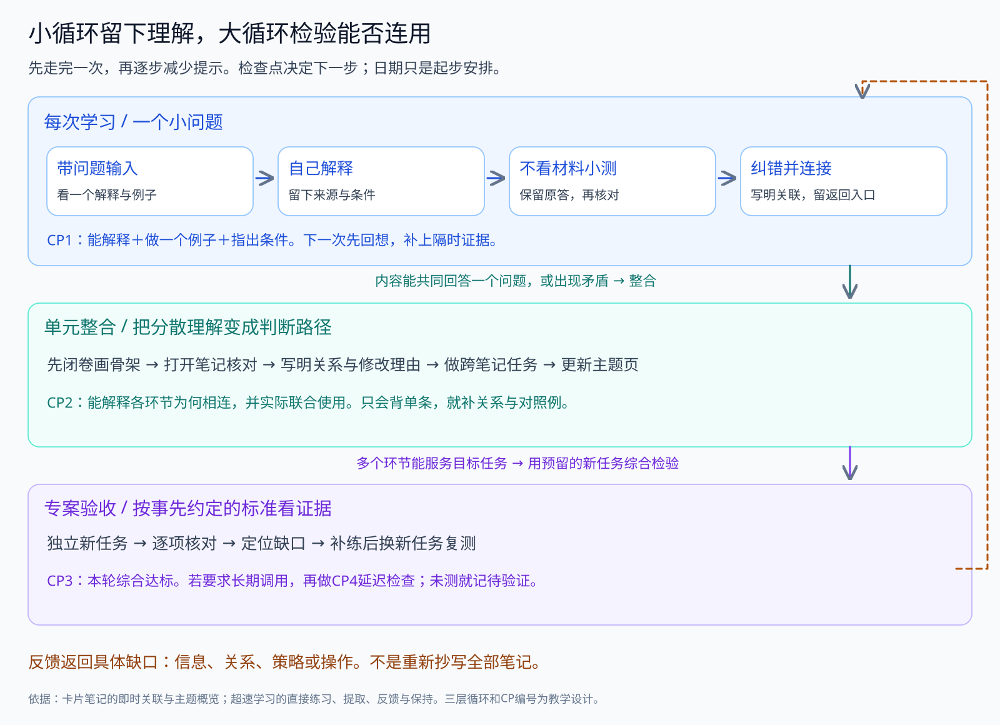
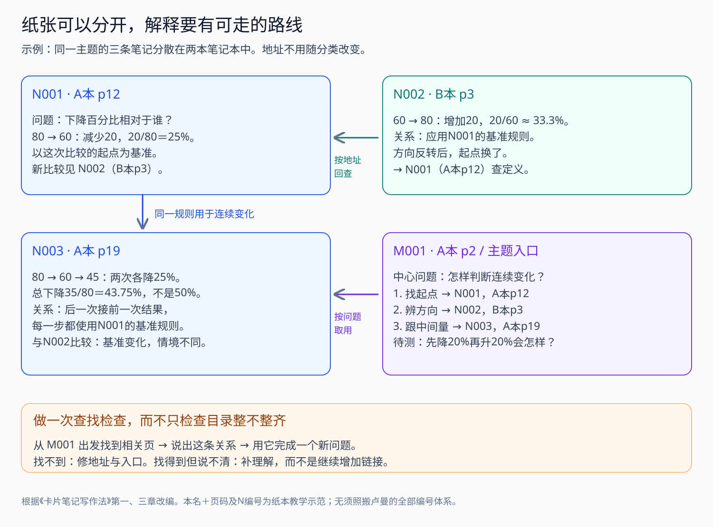
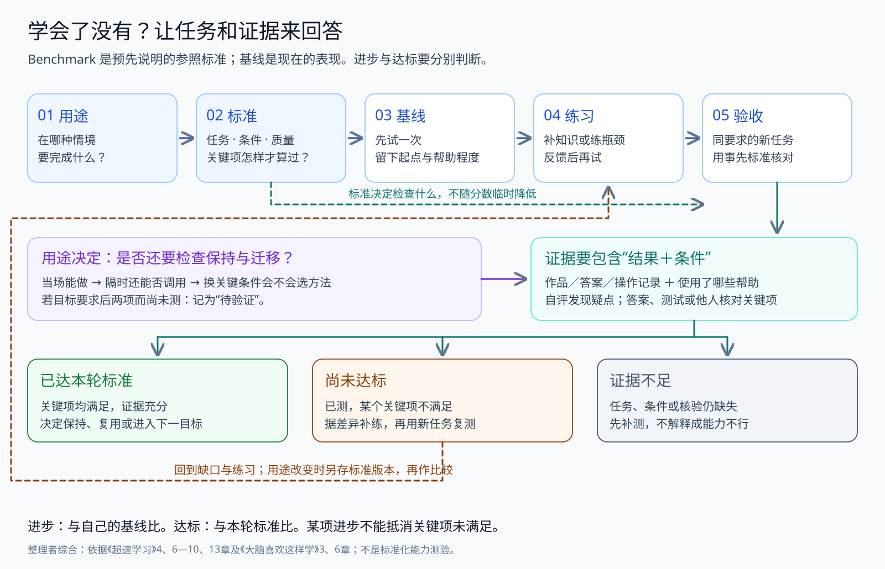

# 学会学习：从一次学习，到一个能验收的专案

修订：2026-11-10。当前停止扩展书目，以已读资料指导实践。

## 先明确这份手册要教会什么

你不需要先学会所有学习术语。先照着完成一次：**带问题学习一小段 → 用自己的话写下来 → 不看材料试答或操作 → 核对修改 → 接入已有理解 → 留下下次入口。** 随后再学会把几次学习整合成一个主题，最后在新任务里检验整个专案。

上一版可以查方法，但没有充分教会这些动作怎样衔接：把串联、复习和验收放在不同章节，让初学者自己补齐中间步骤；提供了模板，却缺少完成样例与失败分支。本版保留有出处的方法，改为“示范—尝试—检查—调整”的教学顺序。

**第一次用：** 先看第一、二节，再按第三节做一轮；纸质笔记按第四节连接；第五节做单元整合；第六节做大测。第七节有一份材料、笔记和考题齐全的短示范。不需要先购买软件、卡片或新笔记本。

| 你要找的具体操作 | 入口 |
| --- | --- |
| 建立专案时先决定什么 | [一、专案起点](#一先建一个小专案让最后的任务引导现在学什么) |
| 到底什么时候串联、什么时候测 | [二、三个循环与起步节奏](#二什么时候串联把三个不同尺度的循环分开) |
| 一次学习怎样从头做到尾 | [三、单次学习](#三一次学习怎么做先走完这一个小循环) |
| 纸本上的分散笔记怎样关联 | [四、纸质关联](#四纸张分开怎样让理解连起来) |
| 怎样把几次学习变成自己的结构 | [五、单元整合](#五什么时候做一次完整串联在一个问题单元收束时) |
| 怎样安排一次大测及判定结果 | [六、综合验收](#六怎样尝试一次大测让多个单元共同完成新任务) |
| 想直接模仿一次完整过程 | [七、跟做示范](#七跟做示范三次小学习接成一次大测) |
| 书里到底支持什么，哪些是教学安排 | [八、依据与边界](#原书原则与本手册的教学安排分别是什么) |

## 一、先建一个小专案：让最后的任务引导现在学什么

专案不是“读完一本书”，而是想形成一项能力，随后用任务检查。例如，“学百分比”太宽；“能够比较任务耗时的变化，判断几段变化能否直接相加，并解释理由”就可以设计练习与验收。

先只用一张纸写四行：

```text
用途：我为什么需要这项能力？
终点任务：学完后，要独立解释或完成什么？
本轮范围：包含哪些内容，暂不包含什么？
验收约定：用什么任务、允许哪些帮助、哪些要求必须满足？
```

### CP0：开始前的检查点

**先试一道代表性问题，保存原答案。** 完全不会时可以写“未知”，然后看一个入门示例，记录用了什么帮助。它是基线，不是筛选你是否有资格学习。

能说出终点任务，并知道怎样核对结果，就可以开始。如果“我要变得更聪明”仍无法变成一个任务，先选一个实际问题；如果连任务是什么意思都不清楚，先看一个完成示例，不要花整天设计计划。

根据任务，把内容拆成三种需要：

| 需要 | 学习时做什么 | 例子 |
| --- | --- | --- |
| 记得或查得到的事实 | 核心内容回想，低频细节留查找入口 | 变化率的表达式 |
| 必须理解的概念与关系 | 解释、比较、举例与反例 | 为什么分母取起点量？ |
| 必须能执行的程序 | 自己做，出错后单练，再回整体 | 从题目辨认起点与终点并计算 |

三种需要常在同一任务里出现。学习顺序先取当前任务所需的一小块，再通过尝试暴露缺口。依据：《超速学习》第4、6、13章。

## 二、什么时候串联？把三个不同尺度的循环分开

**新笔记当天接入；一个问题单元结束时整合；多个单元需要配合时综合检验。** 这三件事不必等到同一天，也不能互相代替。



[可编辑图](图示/学习教学-三个循环.excalidraw)。小循环留下已纠正的理解和题目；中循环把它们组织成判断路径；大循环用新任务检查这些路径是否真的可用。反馈回到具体缺口，不从头重读所有内容。

### 给第一次尝试一个具体节奏

下面是**本手册设计的起步安排，不是书里的最佳时间公式**。先用于一个小专案：三个学习时段，每次处理一个能解释和练习的小问题。一次可暂留约40分钟，末尾留时间检验与连接；材料太多就减内容，不把小测一直挪到以后。

| 时点 | 本次动作 | 留下什么／检查什么 |
| --- | --- | --- |
| 第1次学习 | 学一个小问题，当场小测和纠错，连接已有知识 | 一条自己的解释、一份原答与修正；暂无旧笔记则记明确待解问题 |
| 第2次学习开始 | 先不看材料回答上次的核心问题，再学新内容 | 区分隔时还能调用与当场熟悉；新笔记与旧笔记建立具体关系 |
| 第3次学习结束 | 三次内容若已能共同回答一个问题，做单元整合 | 一张主题页，能解释关系，并完成跨笔记小任务 |
| 随后的一个单独时段 | 不紧接着背完答案就考，使用未练过的综合任务 | 大测原始作答、条件、逐项判断和修正方向 |
| 大测后一周左右 | 用同能力、不同情境的小任务复测 | 初步保持证据；若真实使用更早，就在使用前检查 |

“三次”“40分钟”“一周”只是便于启动的默认值。**触发条件优先于日历：** 第二次已经出现冲突或能联合解决一个问题，就提前整合；三次还都是互不相关的内容，就先检查专案范围，而不是强行画大图。一次课包含多个复杂问题，也可能需要拆成多次。

### 怎样调整这个节奏

- 下次一开始几乎全忘：先用提示恢复，再做一个小应用；下一次缩短间隔或减少新内容，别直接增加笔记量。
- 核心能回想，但不会连用：进入主题整合和混合任务，继续重读单条笔记通常没对准缺口。
- 能独立解释、做对新例子：减少熟练内容的重复，把时间留给薄弱项；之后适当拉开复测间隔。
- 连一次小问题都学不完：缩小材料范围、补前置示例或调整可用时间；并不要求硬撑到流程完成。


关联的依据是《卡片笔记写作法》“添加笔记时寻找联系”；隔时回想与复测的依据是《超速学习》第8—10章。**笔记整合不能代替记忆提取，记得住也不能代替实际操作。**

## 三、一次学习怎么做：先走完这一个小循环

初学时只处理一个可回答的小问题，例如“耗时从80分钟变60分钟，为什么不是按60作分母？”材料不清楚就先看完整示例，暂时不用强行闭卷。

| 顺序 | 你实际做的动作 | 留下的产物 |
| --- | --- | --- |
| 1 带问题进入 | 写下这次要回答的问题；若有旧内容，先回想一点 | 一个问题，或一份未看答案的旧题作答 |
| 2 看少量材料 | 看懂一个概念或步骤及其例子；标出不懂的具体位置 | 来源位置＋必要关键词，不整段抄录 |
| 3 自己解释 | 暂放下材料，用完整句子说明它回答什么、为什么 | 一条自己的解释，附一个具体例子 |
| 4 当场检验 | 不看这条解释，回答核心问题；技能则做一次操作 | 原始答案或结果；标明是否需要提示 |
| 5 核对修正 | 对照原材料或可信答案，指出哪一处偏了及其原因 | 原答保留，旁边追加修正和依据 |
| 6 接入与收尾 | 找相关旧笔记，写明关系；给下次留题目和入口 | 一个有含义的连接＋一个下次先答的问题 |

### 一条笔记应该长什么样？

```text
地址：A本 p12 / N001
问题：80分钟降到60分钟，下降百分比怎么算？
我的解释：下降量是20分钟；相对于原来的80分钟，下降20/80=25%。
边界：如果问从60回到80增加多少，要以60作基准，不能照用25%。
来源：本手册第七节，学习材料A。
关系：N002解释“换起点为什么改变百分比”；待下一次核对。
下次先答：100分钟降到80分钟，再升回100，两个百分比相同吗？
```

这不是让每段阅读都填写七栏。真正需要保留的是：**问题、自己的解释、依据、关系和未解决之处**。事实可以很短，复杂论证可以跨页；无关材料不必全部转成永久笔记。

### CP1：这一小块是否可以先放下？

核对三件事：能解释核心意思；能完成一个小例子或步骤；能指出使用条件。缺一项就保留具体问题。

如果答错，先定位原因：忘了信息就补线索；解释不清就回看例子；步骤做错就单练该步。核对后尝试一个小变式。连续尝试仍卡住，停止重复同一种做法，写下卡点并换解释或求助。已经依赖它的下一块内容暂缓，不相关的内容可继续。

当场改对只是“局部暂时可用”，不证明长期掌握。下次开头再试一次，才补上隔时证据。

### 随堂题怎样产生？

《超速学习》第8章的试题簿法要求把重要观念改写成问题，而非摘抄后加问号。本手册建议第一次先留两类题：**解释题**检查“为什么、何时成立”；**变式题或操作任务**检查能否用。并在答案侧记来源，以后可以核对。

例如不要只问“变化率公式是什么”，还问“为什么两次同样的百分比变化不一定抵消”。程序性技能则不能只考术语，要留下实际挑战。小测题可以复用来保持记忆，但最终验收需要不同的同能力任务。

## 四、纸张分开，怎样让理解连起来？

纸质关联靠的是**稳定地址＋关系说明＋进入主题的入口**，不要求把所有笔记放在相邻页。先用现有笔记本，不迁移全部旧资料。

### 一次具体操作

1. 给笔记本起简短名字，例如“A本”，页码固定。每条需要引用的笔记标N001、N002；同页多条可写`A本p12上`、`A本p12下`，选一种能准确找到的办法即可。
2. 新笔记写好后，先翻与当前问题相关的主题页，顺着已有链接找一两条最相关笔记。不要每次从头翻完所有本子，也不强求凑足链接数量。
3. 在新笔记上写：`→ N001（A本p12）：补充它的基准条件，因为……`。只有“也谈百分比”不够，要写出补充、反驳、前提、例子或操作应用的具体含义。
4. 回到旧笔记，在页边加反向入口：`新比较见N002，B本p3`。反向入口是方便纸上寻找的安排，不是双向因果。
5. 在一张主题页记录当前问题、阅读路线和各条笔记负责解释什么。第一次可以很短，理解变化后更新。




[可编辑图](图示/学习教学-纸质连接.excalidraw)。图里N001、N002、N003分别在不同页；主题页M001组织的是解释路线，不是再抄一份全文。

### 主题页实际写什么？

```text
M001（A本p2）：怎样判断连续两次耗时变化？
1. 先确定起点和终点 → N001，A本p12：定义比较的基准。
2. 方向改变时要换基准 → N002，B本p3：解释为何减、增不对称。
3. 连续变化要跟踪中间量 → N003，A本p19：后一步接前一步结果。
待检验：连续降两次25%，总下降多少？
```

**CP2a：合上本子，再从主题页找到所需笔记，并说出它为什么在这里。** 找得到但讲不出关系，说明索引做好了，理解还没有做好；讲得出却找不到，修入口。无关联的新想法可以暂放并写问题，不编造关系。

笔记观点后来变化，不必撕掉旧页：标注“此解释已修正，见N004及日期”，把主题页入口指向当前解释，避免未来误用。编号是地址，尽量不因为分类变化而重编。稳定编号来自书中做法；“本名＋页码”是针对普通笔记本的简化适配。

## 五、什么时候做一次完整串联？在一个问题单元收束时

“单元”不是固定页数，而是一组能共同回答问题的内容。例如“基准是什么、方向改变会怎样、连续变化怎样计算”可以组成“比较变化”的单元。看到新旧解释冲突、几条笔记都依赖同一前提，也值得提前整合。

第一次可以在第三个学习时段后留约20分钟尝试下面的操作。时间是起步安排；若明显超出，先缩小中心问题。

1. **先不看笔记重建。** 在空白纸写单元的问题、能想起的关键点和连接，未知处标问号。不要先照着旧图抄一遍。
2. **按七步检查结构。** 关键词是否必要→能否按功能组块→连接是什么关系→是否有回答问题的主流程→补例子与条件→对照来源修正→最后整理图形。七步用于改善解释，不要求每个词画一张卡。
3. **打开笔记核对。** 用不同颜色补漏、改错，并写“为何修改”。保留原来的理解，才能看到自己真正缺什么。
4. **做一道跨笔记任务。** 要求同时调用至少两条关系，而不是逐条复述定义。完成后看是否真的按结构作出判断。
5. **更新主题页。** 把新结构和当前笔记地址写成可走的路线，给仍不清楚的连接留问题。


### CP2：从单条懂，走到能够连用

能沿主题页解释为什么要经过这些环节，并完成一个跨笔记任务，就可以尝试综合验收。若只能逐条背，却不知道先用哪个，补对照案例与决策关系；若关系说得通但某一步不会做，回到小循环练该步骤。

这也是“模式识别”的具体练法：找出相似例子的共同结构，再改变一个关键条件，看是否需要换方法。识别出来的模式必须有边界，不能只凭词语相似套用。

## 六、怎样尝试一次大测？让多个单元共同完成新任务

大测的“大”在于**整合与迁移**，不是题目数量多。若目标是写程序，就做一个接近用途的小作品；目标是解释理论，就给出新情境，要求解释、比较和处理反例。不能因为小测都做对，就假定整合能力已经出现。

### 在学之前准备轮廓，验收时才打开新题

先写验收蓝图，不急着知道具体答案。可用教材已有的章节测试、未做习题，或请教师／助手依据蓝图出题并核对答案。关键能力必须覆盖，不只抽自己擅长的内容。标准和评分方式在作答前说明。

| 想检验什么 | 任务形式 | 保留什么证据 |
| --- | --- | --- |
| 单元结构 | 闭卷画骨架或解释步骤与理由 | 原始解释及缺口 |
| 联合使用 | 一个必须调用多个概念或步骤的新任务 | 过程、作品和结果 |
| 策略选择与边界 | 改变条件，比较为什么应换方法 | 条件判断与理由 |

这三类是教学模板，不是强制三道题。对于工具使用本来就是目标任务一部分的专案，可以开卷；但要注明可查什么、AI可以做什么。训练中可给提示，验收中按事先约定执行。使用AI代做后再自评，不能证明自己的独立能力。

### 第一次大测照这个顺序做

1. 挑一个与最后密集练习分开的时段。先写帮助条件、任务范围及关键通过条件。
2. 独立完成预留的新任务，保留未经修改的原稿。不会的地方写下尝试，不即时偷看答案补成正确稿。
3. 完成后再核对答案、标准、测试结果或反馈。每个关键项写“满足／不满足／未验证”，并指向实际作答证据。
4. 把失误分到具体环节：信息没提取、概念误解、选错策略、步骤失误或题目／条件不清。只补影响目标的缺口。
5. 在另一道同要求的新任务中复测。修正原题证明你理解了反馈；新任务才能补充独立使用的证据。


### CP3：判断进步和达标

**基线**是你开始时的表现；**Benchmark**是本轮目标要求；**Rubric**是逐项核对的验收尺。进步对照基线，达标对照事先标准。准确性等关键项不能靠笔记漂亮或其他高分抵消。

| 结论 | 判定 | 后续动作 |
| --- | --- | --- |
| 已达本轮标准 | 必要关键项满足，要求的证据齐全 | 转入保持或下一目标 |
| 尚未达标 | 已完成有效检查，关键项未满足 | 针对缺口补练并复测 |
| 证据不足 | 缺题目、核验或约定的保持／迁移检查 | 补测，先不评价能力 |

若目标包含长期调用，大测后一周左右再用不同情境做一次简短检查，作为**CP4：初步保持**。之后按用途和结果调整间隔；一次延迟通过不证明永久掌握。真正重要的技能还需要在使用中维护。

改变目标时可以修改标准，但留下旧版本和理由。不能验收后悄悄降低条件，把“不满足原目标”写成“原目标达标”。更完整的判断关系见下图。



[可编辑图](图示/学习专案-Benchmark闭环.excalidraw)。

## 七、跟做示范：三次小学习，接成一次大测

**专案：比较任务耗时的变化。** 这是为了演示学习动作而设计的短课程，不是你的测评记录，不代表所有科目都只需三次学习。

**范围和标准V1：** 能以正确基准解释单次变化，处理先降后升及连续下降，区分分钟差和百分比。暂不讨论统计波动、性能测试可靠性或速度换算。例题可看示范，小测先独立尝试后核对；大测可用计算器，不看笔记、不由AI代答。三个关键能力都要满足；计算手误单独标出，但原题改正后仍需新题验证，不能直接判通过。

### 学习A：先认清“相对于谁”

**材料：** 耗时从80分钟降到60分钟，减少20分钟。相对于原来的80分钟，下降比例为20÷80=25%。若从60分钟升回80分钟，增加20分钟，相对于此时的起点60分钟，增加比例为20÷60≈33.3%。

**示范笔记N001：** 百分比变化使用这次比较的起点量作基准；相同分钟差，换起点后百分比可能不同。来源写“本节材料A”。

**现在尝试，不先看核对说明：** 从100分钟降到80分钟，下降多少？再升回100分钟，增加多少？解释为什么两者不同。

[作答后跳转：小测A核对](#小测a核对)

CP1暂时通过后，写N002：“变化方向反转时，起点改变，正反百分比通常不对称”，链接N001并注明“应用基准规则”；再在N001页边留下返回N002的地址。

### 学习B：下次先回想，再看连续变化

先合上材料解释N001，答一题旧内容；有缺口就恢复并核对，然后继续。

**材料：** 100分钟先降20%得到80分钟；再降20%，减少的是80的20%，得到64分钟。总下降36%，不是40%。每次下降后的剩余比例为80%，因此两次是100×0.8×0.8。

**示范笔记N003：** 连续变化时，后一次基准接前一次结果；只有同一固定基准下的变化量才可直接按那个基准合并。链接N001：“连续运用基准规则”；链接N002：“同样提醒基准会变，方向变化与连续变化是两种情境”。

**小测B：** 80分钟连续下降25%两次，最终多少分钟？总下降比例多少？

[作答后跳转：小测B核对](#小测b核对)

### 学习C：重建结构并跨笔记使用

闭卷写出：**确定比较起点→辨认变化方向→逐步跟踪中间量→回到总起点求总体变化**。然后打开N001—N003，对照第四节的M001主题页，补缺失关系。

**整合检查：** 某任务100分钟降20%后又升20%，是否回到100分钟？解释每一步的基准。

[作答后跳转：CP2核对](#cp2核对)

### 在单独时段尝试大测

**这是完整教学演示，不是受保密保护的正式试卷。** 如果你提前看了答案，就把这些题视为练习，正式验收另换同能力的新题。作答前记下是否看过答案。

| 题目 | 验收关键项 |
| --- | --- |
| 1. 耗时从90降到72分钟，又从72降到54分钟。分别下降多少？总体下降多少？ | 每步基准与总基准正确；给出过程 |
| 2. 有人说“先降10%，再升10%，恰好抵消”。以100分钟为起点检验，并说明原因 | 能识别反转后的基准变化，不只判对错 |
| 3. 方案甲使120分钟下降25%，随后再下降20%；方案乙直接减少42分钟。哪种最终耗时更短？短多少？ | 把不同表述转换到共同单位；选对方法并比较 |

[全部作答后跳转：大测答案与逐项判断](#大测答案与逐项判断)

### 大测以后做什么？

在M001加上“比较不同方案前先统一到最终量”，必要时写N004并连回N003。一周左右再用新的数字与表述检验所需能力；若可独立调用，按用途延长间隔。若失败，区分提取问题与关系问题，返回相应笔记和练习。

这就是小动作怎样推动整体能力：**解释和小测留下可核对的理解；连接形成可走的路径；综合任务暴露路径里的缺口；修正再回到笔记与下一次行动。**

## 八、怎样继续用，怎样核对教学依据

### 以后只保留这几样，不额外造复杂系统

专案开始时一张目标与验收页；学习中保存自己的解释、原始作答与修正；主题收束时一张入口页；验收后记录关键项和下一步。可以都放在现有本子里，无须为每次学习建新目录。

```text
本次问题／材料位置：
我的解释与例子：
不看材料的作答 → 核对后的修正：
接到哪条旧笔记，为什么：
当前checkpoint：已通过／具体卡点／待验证
下次从哪里开始，先回答什么：
```

这是第一次可照做的格式，不是永久考核表。理解已经很清楚的部分可简写；纸上保存的是后续会用的信息。暂停时留下当前状态和下一步即可，不必把未完成硬写成完成。

### 助手在教学中应承担什么

先根据你的目标提出合适的任务分解和学习顺序，给完成示例、对应材料、练习和判断依据；再听你解释、看你的作答，指出具体误解。你的提问用于发现教学缺口，不负责替助手设计课程。遇到方向不合适，我应说明理由并调整，而不是只把每条建议追加到手册。

每一轮逐步减少提示：先看示范→带少量提示练→独立完成新任务→解释为何这样做。任务要求实际操作时，助手写出答案不能替代你练习；你需要的是有效反馈，而非收到一份看似完整的成果。

### 原书原则与本手册的教学安排分别是什么？

| 方法 | 已回查的依据 | 本手册增加的操作安排 |
| --- | --- | --- |
| 从用途倒推学习地图、先整体尝试再练瓶颈 | [《超速学习》](超速学习-阅读笔记.md)第4、6—7、13章 | 一张专案页、CP0与小任务起点 |
| 核心问题而非抄写细节；提取后核对 | 同书第8章`OEBPS/text00014.html`的试题簿、自创挑战、阖上书本学习；第9章反馈 | 解释题＋变式／操作题；CP1与原答保留 |
| 分散练习、根据用途安排保持 | 同书第10章`OEBPS/text00016.html` | 下次开头回想，示范的一周后复测；具体间隔不是原书统一要求 |
| 新笔记接入已有关系；稳定编号与纸上引用 | [《卡片笔记写作法》](卡片笔记写作法-阅读笔记.md)第一章`part0010_split_000`、`001`；第三章`part0012_split_002`、`003` | 本名＋页码、N001等地址、反向入口与查找检查 |
| 主题发展到需要概览时建立概览，并随理解修改 | 同书第三章`text/part0012_split_003.html`“发展想法”与交叉引用 | 第三个学习时段后的起步检查、M001主题页、CP2；不能把“三次”当科学规律 |
| 输入—关联—输出与具体反馈 | [《大脑喜欢这样学》](大脑喜欢这样学-阅读笔记.md)第5—6章 | 三个尺度的循环；跨笔记任务与纠错分支 |
| 实际表现与体验分开 | [《心流》](心流-阅读笔记.md)、[《超速学习》](超速学习-阅读笔记.md)第5章 | 不以顺畅、投入或美观代替达标 |

《卡片笔记写作法》主要解决知识加工和写作，不能单独承担技能训练与测评；这些环节结合《超速学习》的直接练习、提取和反馈安排。三层循环、CP0—CP4、分钟数、时段数、示范题和验收门槛都是整理者的教学设计，不声称原书逐字提供了这套课程，也未验证它对每个人都有效。

[《加油吧，大脑》](加油吧大脑-阅读笔记.md)作为理解脑功能与现实状态的背景；[《不可能的艺术》](不可能的艺术-阅读笔记.md)补充动机、判断与创造。它们不被强行塞进每一次小测步骤。身体状态、可用时间、资源不足时，要调整任务条件，不推断人格或递质类型。

更完整的概念推导保留在[方法地图](学会学习-方法地图.md)，实际阅读范围见[书目地图](书目与阅读地图.md)，词义见[共同术语表](共同术语表.md)。本次只回查已有原书相关段落，未恢复新书阅读或网络扩展。

### 用什么检验这本手册本身是否有用？

读者应能照着做出一条自己的解释笔记，找到并说明它与旧笔记的关系，完成一次有核对依据的小测，知道何时做主题整合，并能组织与判定一次综合任务。如果仍需要自己猜中间步骤，教学就没有完成；应补示范和反馈，不以章节数、图数或链接检查通过来证明教学有效。目前完成的是教学材料修订，实际可用性还需读者使用反馈检验。

## 答案与核对

请先完成对应练习，再查看本区；提前看过答案的题目只作练习使用。每组说明末尾可返回原练习。

### 小测A核对

下降20%，回升25%。关键是分母分别为100和80。若都答20%，缺口是“第二次比较的起点变了”，而非仅仅算错。返回材料，标出两次起点，再试50分钟降到40分钟、随后升回50分钟；结果仍为下降20%、上升25%。不要仅记答案，要说明基准。

[返回练习](#学习a先认清相对于谁)

### 小测B核对

80×0.75=60，60×0.75=45分钟；总下降(80−45)÷80=43.75%。若直接相加成50%，回到中间量60，说明第二次减少15分钟而不是20分钟，再做一个不同数字的变式。

[返回练习](#学习b下次先回想再看连续变化)

### CP2核对

没有，先到80分钟，再增加80的20%即16分钟，结果96分钟。它同时用到连续变化和方向反转。能说出两个基准并算出结果，才说明关系已用于任务；只背“不能相加”还不够。

[返回练习](#学习c重建结构并跨笔记使用)

### 大测答案与逐项判断

1. 第一段20%，第二段25%，总体40%。不能把20%和25%直接相加。
2. 先到90分钟，再到99分钟；后一次增加9分钟而非10分钟。未恢复起点。
3. 甲：120×0.75×0.8=72分钟；乙：120−42=78分钟。甲最终耗时少6分钟。需要比较最终分钟数，不能直接比较百分比与分钟差。


**V1判定：** 三题关键关系解释正确，计算结果正确，帮助条件符合约定，才记“本次综合任务达标”。某题错误就记录具体项，再补练、用未见变式复测。这里只检验本节限定范围，不推广为“数学已学会”。若要把长期保持列入专案完成条件，延迟检查未做前，整体状态仍是“保持待验证”。

**一份假设反馈示范：** 第1、2题通过，第3题直接比较25%与42分钟。下一步补“统一比较量”，重新用另一道包含固定分钟差与连续百分比的任务验收；不重抄所有笔记。实际使用时填写自己的表现，不复制这个示范当记录。

[返回练习](#在单独时段尝试大测)
