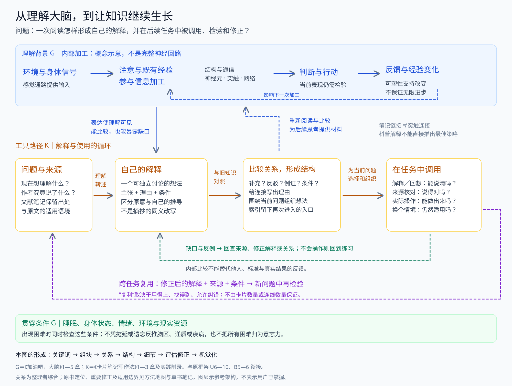
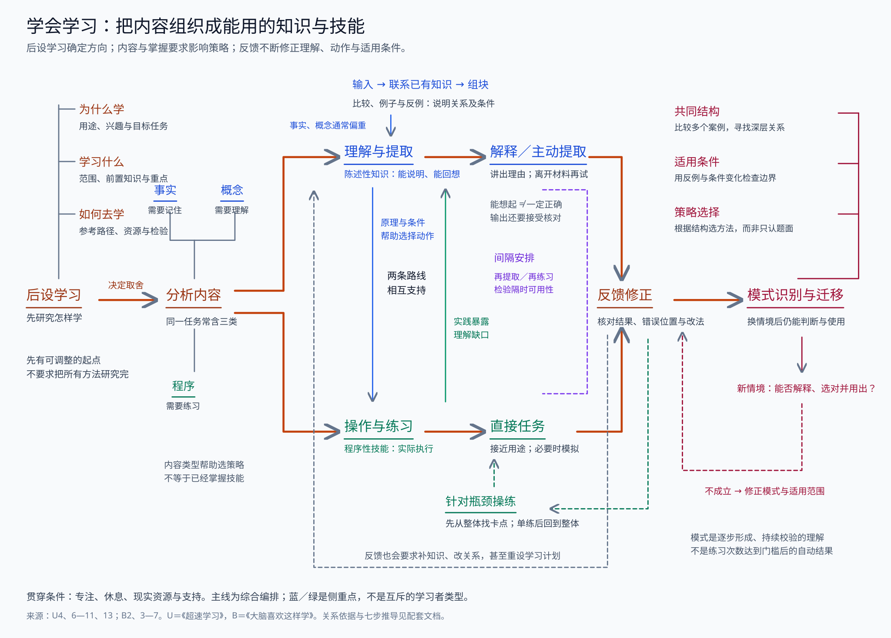
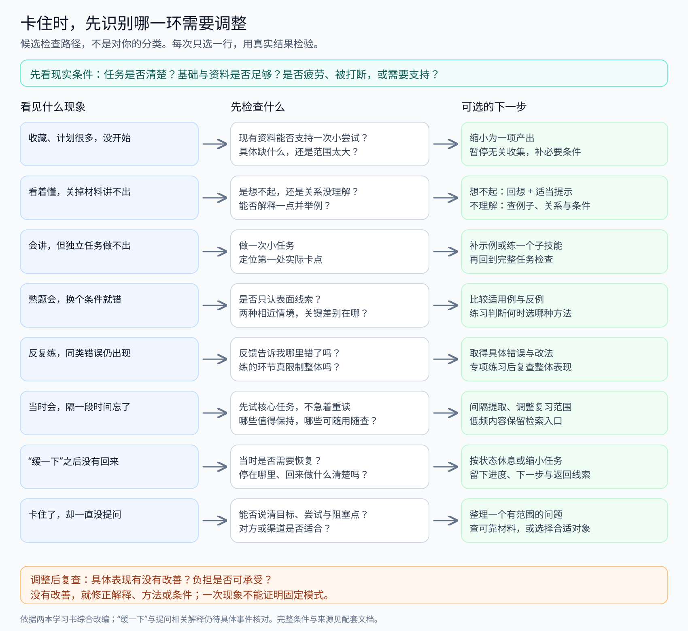
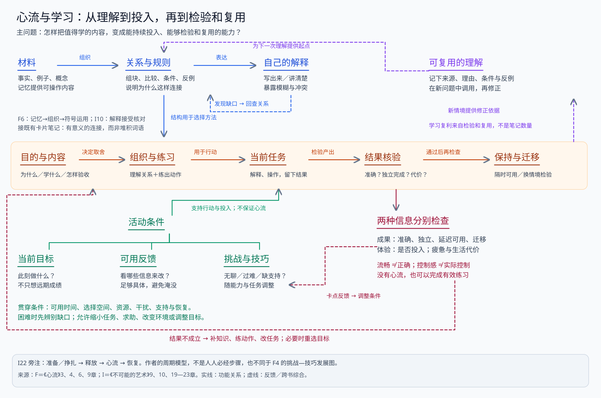

# 学会学习：方法地图与实现路径

**文档分工（2026-11-10）：** 实际学习优先使用[指导手册](学会学习-指导手册.md)。本文件保留原有关键词、组块、关系依据、架构修正及图示来源，作为推导参考；不再按阅读批次追加新的使用说明。新增书籍阅读已暂停。

**教学检视后的修正：** 原有图谱与单书笔记有来源回查价值，但不能仅凭概念覆盖与链接完整就称为新手教学。旧手册缺少单次学习的结束动作、整合触发条件、纸本查找演示和完整测验。本次指导手册改以三种尺度的循环、完成样例、检查点及失败分支组织；七步是单元整合的工具，不要求每次阅读都重做一遍大图。此修订完成的是教学材料，是否可用仍要由读者使用来检验。

更新：2026-11-10。分类：**学习方法／架构推导参考**。这份文档保留已有阅读笔记如何组织成框架的过程，围绕为什么学、学什么、怎么学、模式识别及实现路径说明关系依据；日常使用入口已整理到指导手册。

核心目标：**围绕自己认可的问题，选择必要知识，形成理解，在任务中使用，再用反馈调整学习。** 兴趣探索、欣赏与建立视野也可以是目的，不必把所有学习都变成职业产出。不同目的需要不同的完成证据。

## 从提炼到架构：本次重建的七步

### 本轮扩展：理解大脑怎样加工，以及知识怎样留下来继续使用

2026-11-08 按用户调整改为本地阅读。《加油吧，大脑》8 章及书末文字、《卡片笔记写作法》三章十四节及附录已顺序读完；具体图片与外部核查范围见各书笔记。2026-11-09已补齐《不可能的艺术》23章与《心流》首册十章及前后置文字。Box 的额度阻塞与旧草稿保留为历史，不能再代表这两本的当前进度。

**本轮中心问题：脑中的理解怎样形成可检验的解释，又怎样借助记录，在后续任务中被调用、修正和发展？**

两本分工不同：G＝《加油吧，大脑》，提供结构、功能、经验变化及运行条件的科普背景；K＝《卡片笔记写作法》，提供把理解外显、关联、使用与修正的工具性流程。G 不只是一组效率技巧，K 也不只是保存资料的办法。二者不能拼成一套已被整体验证的脑科学理论。

#### 1. 关键词：先保留来源与问题

| 关键词 | 出处 | 它在这里回答什么 |
| --- | --- | --- |
| 神经元、突触、通路、功能与可塑性 | G1；G6—7 补充观察与临床实例 | 大脑通过什么结构通信、功能怎样协作、经验怎样参与变化 |
| 记忆、注意、经历、习惯 | G2—3 | 为什么看到信息、理解信息与能用信息需要分别检查 |
| 睡眠、身体状态、环境与情绪 | G3—5 | 表现受哪些条件影响，为什么不能只归因于自律 |
| 来源、转述、文献笔记、永久笔记 | K1、K2；K3“阅读和理解”“记卡片盒笔记” | 怎样把别人的论证转成忠实且可讨论的个人理解 |
| 关系、索引、问题集群、反例、结构 | K3“发展想法” | 怎样重新遇见相关知识，并发现矛盾与缺口 |
| 写作、实践、反馈、复用 | K2“让工作推动你前进”；K3“分享你的洞见”；中文版实践附录 | 怎样检查记录有用，并使旧成果成为新任务的起点 |

G 后面的数字为章号；K 为章号与小节标题，准确 EPUB 路径在单书笔记中。G 的病理、手术与未来技术章节保留在科普背景中，不硬转成学习诀窍；K 附录为刘少楠经验，与作者正文区分。

#### 2. 组块：按作用组织，而非按书名并排

- **内部加工与条件：** 输入经过注意和既有经验参与的加工；记忆与经验变化支持后续判断。身体和环境是贯穿条件。
- **解释外显：** 从来源到自己的主张，保留依据和适用范围，让理解可见。
- **关系与入口：** 比较支持、反驳、例证和条件，为一个具体问题组织局部结构，留下可回到讨论的入口。
- **使用与积累：** 解释、回想或操作接受不同反馈；修正过的材料可被下一轮调用。


这些是整理者的功能组块。画出分组不能证明读者脑中已经形成稳定组块；也不把脑内突触与笔记链接当成同一个实体。

#### 3. 关系：每条线为什么成立

| 连接 | 连接理由 | 来源及边界 |
| --- | --- | --- |
| 输入 → 内部加工 → 判断／行动 | 信息进入不等于被原样储存；经验与状态参与当前反应 | G1—5 的概念重组，只是解释背景，不是完整神经回路模型 |
| 阅读 → 自己的解释 | 不借用原句时，更容易发现自己没说清的部分 | K3 阅读；解释流畅仍不保证准确 |
| 来源 ↔ 解释 | 新语境的主张要能回查原意和条件 | K1、K3；转述与个人推导分开 |
| 新解释 ↔ 旧想法 | 比较暴露补充、矛盾和概念差异 | K3 发展想法；不能只按共同词语连线 |
| 关系网络 → 当前问题的结构 | 按问题选择有用材料，组成论证或决策依据 | K3 发展想法、分享洞见；结构允许改动 |
| 解释／任务 → 反馈 → 修正 | 表达、来源核对、实际结果会揭示不同缺口 | K2、K3；与 U6—9、B5—6 衔接 |
| 修正后的笔记 → 新任务 → 再检验 | 旧材料减少重新寻找和重建的工作，但条件可能变化 | K3、附录；整理者称为跨任务复用，不承诺指数增长 |
| 状态与资源 → 整个过程 | 同一方法在不同条件下可能表现不同，需要检查负担与支持 | G3—5；不能据行为反推脑区或递质异常 |

#### 4. 结构：把外部笔记接到原学习主干

原主干仍是 **后设学习 → 内容分析 → 理解与提取／操作与练习 → 反馈 → 模式识别与迁移**。本轮添加与主干往返的外部支路：

**来源与问题 → 自己的解释 → 有理由的关系 → 当前问题的结构 → 实际使用 → 修正与可复用入口 → 下一轮学习。**

它不要求先建完整知识库再开始学习。可以从一个当前问题出发，缺什么再补。脑科学提供理解背景；工具书提供加工流程；原有学习书提供提取、练习和反馈策略，三个层面不互相替代。

《超速学习》的后设学习与 K 反对僵硬计划的张力仍需保留：明确能力任务要有验收标准；开放探索的题目可以随证据改变。K 第三章也支持用小任务反馈调整安排，所以不把“不做计划”变成通用戒律。

#### 5. 细节：用一个问题串起这条路线

整理者示例，非书中原例、非用户实践：**为什么收藏了“主动提取”的资料，还是不知道怎样学一个概念？**

1. 关键词有提取、理解、线索、核对、迁移；不能只收录术语定义。
2. 组块为“建立解释”“独立调用”“检查正确性”“换情境使用”。
3. 关系写清：回想暴露能否调用；例子与反例检查关系是否理解；回查来源纠正错误；新例子检查边界。
4. 结构因此是“先初步理解 → 尝试说明 → 核对 → 对照新例子”，允许随时回到来源；不是“摘抄→收藏→完成”。
5. 记录一条自己的主张及其来源、适用条件和反例，再链接到相关问题；不把一页摘抄当主张。
6. 如果能查到却讲不出，继续加工和回想；如果讲得出却用错，检查条件；如果两者都困难且状态差，同时检查负担。
7. 最后才画出关系，让图帮助解释为什么选这个策略。图是否好用，要看它能否帮助定位下一步。


#### 6. 评估与修正：本轮改变了什么

| 检查发现 | 具体修正 |
| --- | --- |
| 旧版把 G 主要放在效率与恢复条件 | 增加结构—功能—经验变化的解释层，保留全书健康、临床观察与技术边界 |
| 卡片越多不一定越有用 | 将“积累→成功”改为“保存解释与条件→调用→再检验”，标出查不到和错用的返回路径 |
| 查看笔记不等于脑中回想 | 外部查询与主动提取分开；需即时掌握的内容仍要练习 |
| 顺口的脑科学故事可能解释错误 | G 单列命名错误与过强断言；不把这些内容画成机制箭头 |
| 固定全局分类可能阻碍重组，但没有入口又难复用 | 保留围绕问题的局部结构与少数入口，允许按新证据改写 |
| 助手的总结不等于学习者理解 | 成果标为参考；后续以用户自己的解释和实践修正，不预先宣布已经学会 |

#### 7. 视觉化：内部加工与外部笔记怎样往返



[可编辑 Excalidraw](图示/学习理解与知识复用.excalidraw)。橙色沿线读主流程；蓝色说明内部加工及其与表达的往返；紫色是经修正后进入下一任务的循环；虚线表示反馈返回或支持条件。每条关系依据见上表。这是原总图的扩展图，不代表六本书已经全部融合。

单书依据：[加油吧，大脑](加油吧大脑-阅读笔记.md)、[卡片笔记写作法](卡片笔记写作法-阅读笔记.md)。原总图保留在下方，仍承担内容分类与策略选择的总览。

### 另外两书：从选段扩展到主体章节完整阅读

| 书籍及范围 | 当前可参考部分 | 边界 |
| --- | --- | --- |
| [不可能的艺术](不可能的艺术-阅读笔记.md)，23章 | 动机、主题学习、技能、创造与投入条件 | OCR非逐页校勘；机制与效果未全部独立核验 |
| [心流](心流-阅读笔记.md)，首册十章及六篇序 | 注意、目标、反馈、活动、关系及生活方向 | 图片非逐字校勘；第二册不在本轮范围 |

投入感不能替代学习正确性的证据；跨书相同词语也不自动是同一理论。原扩展图的出处范围保持可追溯，全文补读后的新关系见文末。

2026-11-08 修订：上一版把内容分为五个等权栏目，主要发挥导航作用，没有充分表达概念关系。本次依用户指定的 **keywords → chunking → relation → structure → detail → evaluation & refine → visualize** 重建。下面保留每一步的产物，使图的结构可以追溯，而不只交付一张成图。七步是本次整理工作的方法，不宣称是两本书共同提出的固定七阶段。

### 1. Keywords｜先提取概念，并保留出处

本轮中心问题：**面对一种想获得的能力，怎样判断该学什么、用什么策略，并逐步形成能迁移的理解与技能？**

| 从书中提取的关键词 | 定位 | 在中心问题中承担什么作用 |
| --- | --- | --- |
| 后设学习；为什么／做什么／如何做 | U4 | 决定方向、范围和初始学习路径 |
| 事实、概念、程序；瓶颈 | U4 | 分清需要记住、理解或练习什么，初步预测难点 |
| 输入、关联、输出；内部模型 | B2、B5 | 解释信息怎样经过组织与使用；“内部模型”保留作者语境，不当作可直接测得的脑结构 |
| 主动提取；解释；具体实例 | U8、U11；B5 | 检查能否独立调用并理解内容，避免只依据熟悉感 |
| 陈述性知识、程序性技能、程序化 | U10“记忆机制二”；另见 U4 的程序 | 区分知道／能说明与实际执行，并观察部分技能经练习变得更熟练的过程 |
| 直接练习、专项操练、反馈 | U6、U7、U9；B6 | 用任务揭示缺口，定位并修正，而不只是重复 |
| 间隔、交错、保持、迁移 | U6、U10；B5 | 检查延迟后能否调用，以及能否在变化条件下选用方法 |
| 专家模式、直觉、理解 | U11；B2 | 将学习结果指向领域内的结构识别与判断，而非仅记住表面特征 |
| 专注、休息、资源与环境 | U5、U13；B4、B7 | 支持学习过程；不把状态问题全部归为方法或意志力问题 |

这里 U 指《超速学习》，B 指《大脑喜欢这样学》，数字为章号。用户所说“快速学习”按本项目已有《超速学习》处理；“后置学习”对齐为该译本的“后设学习”。本次重点回查了 U4、U10 及 B5 的原文，其他依据此前已通读的章节笔记。

### 2. Chunking｜按功能组块，不照抄目录

**组块在这里指把有共同作用的知识组织成可理解的单元，不等同于仅把词放在同一框里，也不声称画出分组就已经形成了稳定的心理组块。** 以下六组由整理者重组：

- **定向与取舍：** 后设学习、目标、验收任务、资源。回答“要得到哪种能力”。
- **内容分析：** 事实、概念、程序、前置知识。回答“这项能力需要哪些成分”。
- **理解与提取：** 输入、关联、解释、回想。回答“知识能否组织起来并被主动调用”。
- **操作与修正：** 直接任务、反馈、瓶颈操练。回答“实际能否做出来，哪里需要调整”。
- **保持与迁移：** 间隔、不同案例、适用条件、模式识别。回答“过后或换个情境还能不能用”。
- **学习条件：** 专注、恢复、时间与支持。贯穿前五组，不能只列为学习结束后的奖励。


把“反馈”放在操作组只是主位置；解释、回想和画图同样需要反馈。跨组关系要在下一步明确。

### 3. Relation｜把连线写成能说明理由的句子

| 连接 | 为什么这样连 | 来源／综合判断 |
| --- | --- | --- |
| 学习用途 → 内容取舍 | 用途不同，值得优先掌握的内容和程度就不同 | U4；B3 |
| 目标任务 → 初步验收 | 若目标是会操作，仅背出定义不足以验收；若目标是理解，照做成功也可能不足 | U6；综合 |
| 内容分析 → 策略选择 | 需要记住的内容、需要理解的关系和需要执行的动作，不能用同一种练习替代 | U4 |
| 输入 → 关联 → 解释与使用 | 信息需要与已有理解、例子和用途建立关系；输出再暴露关系是否完整 | B5；U11 |
| 主动提取 → 反馈 | 回想能暴露缺口，但回想出的内容可能错误，还需核对 | U8、U9；B5、B6 |
| 理解 → 操作 | 原理和条件为行动选择提供依据，但知道规则不保证执行熟练 | U4、U6；综合 |
| 操作 → 理解修正 | 实践会遇到原解释没覆盖的条件，促使补充概念与限制 | U6、U11；B5；综合 |
| 完整任务 → 瓶颈操练 → 回到整体 | 先看真实卡点，再单练限制环节；最后检查局部改善是否帮助整体 | U7 |
| 反馈 → 更新内容或策略 | 出错可能是概念误解、事实想不起、操作不熟或目标失配，修正方向不同 | U9、U12；B6；综合 |
| 间隔 → 再提取／再练习 | 检查隔时可用性；安排时间不能替代理解和纠错 | U10；B5 |
| 对照案例／交错 → 识别条件 | 不只记“怎么做”，还练习辨别“这一种情况下为什么选它” | U6、U11；B5；综合 |
| 模式识别 → 新情境应用 → 再反馈 | 形成解释不等于永远正确，遇到新例子要重新验证适用范围 | U6、U11；B2、B5；综合 |

这些是本图的关系主张，有些直接来自书中方法，有些是跨书综合；箭头不一律代表实验已证明的因果，更不代表学习一定按固定顺序发生。

### 4. Structure｜从这些关系长出主流程

**后设学习 → 分析内容 → 理解与提取／操作与练习 → 反馈修正 → 跨情境识别与使用。**

理解与提取、操作与练习是两条交织的路线，最后共同服务目标任务。间隔安排连接两条路线；反馈既能回到局部练习，也能回到原来的概念和学习计划。专注与恢复是整个循环的条件。

#### 两套分类怎样对齐

| 视角 | 主要用途 | 不能直接等同的地方 |
| --- | --- | --- |
| 事实／概念／程序 | U4 用于分析“学习内容是什么” | 同一任务通常包含多类内容，不应把整个学科或一个人贴成某一类 |
| 陈述性知识／程序性技能 | U10 用于讨论知道是什么、知道怎么做及保持、程序化 | 不是两种互斥课程；背下操作步骤仍不代表具备该操作技能 |
| 输入／关联／输出 | B5 用于组织学习活动 | 输入不只限阅读，输出不只限动手；解释与回想也是输出 |

**本图的安排：** 事实、概念通常需要理解和提取方面的检查；程序需要实际执行方面的检查。两者会相互支持。例如，学习发音既可能需要知道发音规则，也需要实际发音、听反馈并调整。不能把“陈述性”压缩成死记硬背，也不能把“程序性”压缩成不需要理解的重复。

U10 以打字解释某些技能如何从记住步骤到执行更熟练；作者同时承认很多技能并未完全程序化，部分延伸策略具有推测性质。因此图中不画“所有知识最终自动化”的必然箭头。

### 5. Detail｜在关键关系处补例子、条件和策略

以“学会清楚说明一个方案”为贯穿示例。这是整理者编写的学习例子，不是用户已选任务。

1. **后设学习：** 为什么学？为了让听者理解选择依据。学什么？术语、方案关系、组织表达的步骤。怎么学？参考可信示例，尝试说明，再取得反馈。
2. **事实：** 关键术语指什么，能否准确提取；低频细节可查，不要求背下一切。
3. **概念：** 方案为什么适用、与替代方案怎样比较、条件变化后是否还成立；用例子和反例检查。
4. **程序：** 真正组织一次说明并表达出来。背会“背景—选项—理由—限制”这几个词，仍不代表能根据场景组织内容。
5. **反馈：** 若听者误解术语，回到事实／概念；若内容准确但顺序混乱，针对组织步骤练习；若对方问题超出原范围，可能需要补充内容或重新确认目标。
6. **迁移：** 换一个方案或听众，能否仍然说明选择依据。若只会复述原例，尚不足以说明已经识别了结构。


方法的适用条件也要连入架构：完全陌生时可先看示例；提取困难时可用线索再逐步撤去；交错练习不能退化成无关任务间的分心切换；专项练习之后必须回到整体验证。实践无法安全进行时，用合适的模拟任务。

### 6. Evaluation & refine｜本次实际检查了哪些连接

这一步检查图的逻辑，不声称已完成用户学习效果实验。

| 用于检查的情况 | 暴露的问题 | 对架构的修正 |
| --- | --- | --- |
| 能背出操作步骤，却做不出来 | 把“程序内容”直接等同于“程序性技能已掌握”会误导 | 保留内容分析与掌握检验两个层次；用实际任务验证技能 |
| 能顺利完成熟题，遇到条件变化就失效 | 把重复次数当成模式识别，缺少条件辨别 | 加入对照例、反例、变化情境及迁移反馈 |
| 图和解释很流畅，但解释有错误 | 输出本身并不保证正确 | 将解释／提取也接到反馈，而非只对操作结果反馈 |
| 初学时直接任务完全做不动 | 把直接练习理解成任何时候都不需要示例 | 加入示例与前置知识的返回入口 |
| 两本书都提到某方法 | 重复出现不代表存在两份独立科学验证 | 图上区分方法依据与综合组织，不宣称整张架构经过实验验证 |

另外，用户截图中的“模式”重点是知识结构与领域判断。上一版将学习卡点检查放得过重；现在将其保留为辅助查询，主图突出**内容—加工—使用—反馈—识别条件**。截图中的全部术语并不自动纳入两书架构，避免为了外形相似添加尚未核对的理论。

### 7. Visualize｜让图呈现已经梳理出的关系



[可编辑 Excalidraw 图](图示/学会学习-总览心智图.excalidraw)。橙色主线表达从学习规划到使用的组织关系；蓝色为理解／提取，绿色为操作／练习；紫色表示跨路线的安排，虚线表示反馈返回。颜色只帮助阅读，不是学习者分型。

先沿主线讲一遍“为什么走到下一步”，再进入分支查看方法；如果某条线说不清理由，回到上面的关系表修订。图是这次跨书理解的可修改版本，不代表用户已经掌握，也不是唯一正确架构。

以下五个主题保留为查询说明，**不再作为五个等权分支决定整张图的骨架**。

## 来源与编排依据

| 代号 | 来源及已核对范围 | 在这份地图中承担的作用 |
| --- | --- | --- |
| U | [《超速学习》笔记](超速学习-阅读笔记.md)，此前已通读；本次重读完整笔记 | 第 4 章定方向与范围；第 6—9 章任务、操练、提取与反馈；第 10—13 章保持、理解、实验与项目设计 |
| B | [《大脑喜欢这样学》笔记](大脑喜欢这样学-阅读笔记.md)，此前已通读；本次重读完整笔记 | 第 3—7 章提供目标、专注、输入—关联—输出、反馈和恢复的组织视角；沿用原笔记的事实核查边界 |
| G | [《加油吧，大脑》笔记](加油吧大脑-阅读笔记.md)，本轮本地读完全部文字 | 理解结构、功能、经验变化与运行条件；不把科普故事当个人诊断依据 |
| K | [《卡片笔记写作法》笔记](卡片笔记写作法-阅读笔记.md)，本轮本地读完全部文字 | 转述、关系、问题结构、论证与跨任务复用；区分作者正文和实践附录 |
| V1 | 薑餅資：[六个问题改进心智图](https://www.youtube.com/watch?v=yhFXHGeBeR4)，已读作者简介与带时间的章节提纲 | 作为检查定义、价值、用途、关系、分类理由与解决方案的提问框架 |
| V2 | 薑餅資：[用心智图学习困难知识](https://www.youtube.com/watch?v=P88ahuUNwow&t=694s)，已读作者简介与带时间的章节提纲 | 作为关键词、组块、关联、结构、细节、修正及视觉化的组织线索 |
| S | 整理者综合设计 | 七步提炼过程、关系表、双路线架构、模式检查表、阶段验收、示例、绘图规则与记录模板；不是任何一本书或视频的逐字复现 |

**视频阅读限制：** 本次获取了两个视频的标题、作者、时长及说明区章节，未获得字幕；音频转写因服务未配置而无法进行。未完整观看、未核对逐句论证与画面示例。随后已核对用户提供的四张截图中可见的主流程、分支和反馈圈；被字幕遮挡或无法辨清的文字不补写。视频贡献限定在已见提纲与截图，详细登记见[网络材料记录](文章参考.md)。用户提供的第二个链接定位 11:34，落在作者标注的 11:17 开始的视觉化部分；不能由此推断用户已认可某个具体做法。

当前地图以 U、B 为策略主干，新增 G 的脑科学理解背景与 K 的知识加工、复用循环；G、K 的全文覆盖和核查边界见单书笔记。I、F现已覆盖主体章节，早期选段推导保留，全文融合见本文件末节。《刻意练习》《如何阅读一本书》等未读材料不自动加入方法来源。后续读到新证据，再更新对应分支。

## 一、为什么学习：把“想变好”变成有意义的方向

先问：**学会以后，我想更好地理解、判断、体验或完成什么？**［U2、U4、U13；B3］

| 目的 | 可以怎样表达 | 合适的完成证据 |
| --- | --- | --- |
| 解决问题 | 我想处理某类反复出现的问题 | 在类似但新的情境中解决，并能解释取舍 |
| 提升判断 | 我想辨别不同方案什么时候适用 | 给出条件、比较和反例，而不只背结论 |
| 获得技能或资格 | 我想能做一项任务，或满足明确标准 | 操作／作品／考试要求分别检验，不相互冒充 |
| 兴趣与理解世界 | 我想理解一个主题、欣赏作品或探索问题 | 能提出更具体的问题、形成解释或有意义的体验，不强制量化 |

把目标写成一句可修改的话：

> 我想在【情境】中，能够【解释／判断／完成什么】，因为【对我的意义】；这一轮做到【可观察范围】就先结束。

再补一条现实条件：这件事目前值得投入多少精力？有哪些必须保留的休息、工作或生活安排？目标与代价不匹配时，可以缩小、延后或放弃，不需要把它解释成人格问题。

## 二、学习什么：从目标倒推内容，确定先后

采用“目标任务 → 能力差距 → 必要内容”的顺序。先尝试一个小任务，看看卡在哪里；完全陌生时先看一个最小示例，不把无法答题当成失败。［U4、U6、U7；B2、B5］

| 内容类型 | 真正要回答的问题 | 适合的学习动作 | 完成证据 |
| --- | --- | --- | --- |
| 事实 | 什么信息必须记得，什么可以查？ | 核心信息提取；低频细节保留检索入口 | 需要时能准确取得，知道来源 |
| 概念与关系 | 它是什么、为什么、与什么不同？ | 自己解释、比较、画有含义的关系线 | 举例、反例和适用条件相互一致 |
| 程序与技能 | 具体怎样做？哪里容易失败？ | 看示例后独立做；针对瓶颈练，再回到整体 | 能完成任务，并定位失误 |
| 情境判断（综合层） | 什么时候该用哪种知识或程序？ | 对照相似案例、改变条件、混合任务 | 能选方法并说明为什么，知道何时不适用 |

前三类借鉴 U4；第四行是为了落实“模式识别”新增的综合层，不宣称是原书的第四类。类型可能重叠。

编排范围时分成：**现在必须会、卡住再补、以后再学**。优先选当前任务的前置知识与限制环节，避免按整套课程目录无限扩张。资源先保留一个主来源和一个可核查的反馈入口，数量是简化起点，不是普遍配额。

例如“记住某方法名称”属于事实，“知道原理”属于概念，“独立操作”属于程序，“辨别何时该用”属于判断。读完同一篇文章，不代表四层都已经掌握。

## 三、如何学习：让方法服务于当前缺口

下面的顺序可以往返。初学时允许示例与提示；已有基础后逐步减少帮助。［U5—12；B4—7］

| 环节 | 采用的方法 | 方法解决什么问题 | 何时换下一步 |
| --- | --- | --- | --- |
| 理解输入 | 带问题读少量资料，看一个典型例子 | 不知道概念或过程如何开始 | 能指出主张、步骤与不懂的具体位置 |
| 组织关系 | 心智图、概念比较、自己的解释 | 知识散乱、术语之间没联系 | 能说清“是什么关系、为什么这样分” |
| 主动提取 | 合上材料回想、重画骨架、回答问题 | 熟悉感掩盖记忆或理解缺口 | 回答后核对，不靠猜测确认正确 |
| 直接练习 | 做接近用途的任务或安全模拟 | 学过但没有实际使用 | 得到一份可以检查的结果 |
| 瓶颈操练 | 单练影响整体的一个环节 | 完整任务中反复卡在同一处 | 回到完整任务，确认改善能迁移 |
| 获取反馈 | 对照答案、测试、标准、可信的人 | 不清楚哪里错或怎样改 | 留下一项具体修正，再试一次 |
| 保持与迁移 | 间隔后复测、改变情境、混合相近题型 | 当时会，后来忘；熟题会，新题不会 | 看延迟后能否用，以及维护成本 |
| 调整与恢复 | 改任务量、环境、支持或休息安排 | 当前条件不足以继续有效学习 | 根据实际状态返回、缩小或暂停 |

“解释—提取—应用”各有用途：能讲不保证能做，能做熟题不保证能处理变化。心智图承担关系组织与自测入口，实际任务承担能力检验；不让其中一种包办全部。

### 把心智图画成理解工具

以下是根据 V1、V2 的**章节提纲**及 U4、U8、U11、B5 综合改编的做法，不是视频完整教程的复现。

1. **先写中心问题。** 例如“怎样判断自己真的学会了”，比“某本书全部内容”更容易决定取舍。
2. **列少量关键词，再组块。** 按照要回答的问题或任务功能分组；数量以自己能解释为准，不追求固定分支数。
3. **给关系命名。** 除“属于”外，尝试“是前提”“用于检验”“与之对比”“限制”“根据反馈调整”。仅用线连接两个词，还没有说出关系。
4. **为关键节点补一个例子或反例。** 不能解释关系时，用问号标为待核对，不急着添加更多装饰。
5. **暂时收起来源，重画骨架或沿线讲解。** 回查后修正；若完全陌生，可先借助材料搭架，不强行闭卷。
6. **让图帮助完成一次任务。** 使用后如果找不到方法、解释不了卡点，就改分类和连线。视觉美化服务可读性，不作为学会的证据。


检查图时，逐个问：我能解释这个节点吗？它为什么值得放在这里？什么时候用？与谁有关系？为什么这样分类更利于当前目标？它最后帮助我作出什么决定？这六类问题依据 V1 提纲改写，具体应用由整理者设计。

**原导航的五个查询主题：**“为什么”决定取舍，“学什么”限定内容，“怎么学”安排加工与练习，“模式识别”决定该改哪里，“实现路径”把前四者变成可检查的进展。它们可作为查阅问题，但不能单凭这五个标题代替概念关系。主图现已按前述七步重建。

## 四、模式识别：识别知识结构，也识别自己的学习过程

### 4.1 知识中的模式：从表面相似到条件与结构

看到类似词语、熟悉题型或界面，只是线索。可以按下面顺序检查：［U6、U11；B2、B5；S］

**观察线索 → 比较共同结构 → 提出分类 → 检查适用条件与反例 → 选方法并验证。**

学习同一知识时，至少比较“一个可以用的例子”和“一个看起来相似却不能直接用的例子”。说出二者的关键差别，再找一个新例子判断。若判断错，修改分类依据；不要只记“这道题答案是什么”。这是培养领域判断的方式，不保证跨领域自动通用。

### 4.2 学习过程中的模式：从现象找到可检验的调整



[打开可编辑图](图示/学会学习-模式识别图.excalidraw)。下表是候选检查路径，**不是已确认适用于用户的个人模式**。同一现象可能同时涉及基础、任务、疲劳与现实条件。

| 看见的现象 | 待检查的解释 | 一个低负担检查 | 可选调整 | 怎样判断有用 |
| --- | --- | --- | --- | --- |
| 一直收藏、规划，迟迟没开始 | 目标不清、范围过大，或缺资源／担忧 | 现有资料能否支持一次最小尝试？不能的话具体缺什么？ | 写一项产出，暂停无关收集；缺必要条件就先补 | 出现第一份可检查的结果，而非更多目录 |
| 看懂了，关掉材料就空白 | 熟悉感、提取不足，或内容还没理解 | 不看原文解释一点，并举例；分辨是想不起还是不理解 | 前者加回想与提示，后者回查例子和关系 | 能独立解释，且核对后准确 |
| 会讲道理，独立任务做不出 | 程序缺失、练习与用途不匹配 | 做一个小任务，停在第一处实际卡点 | 补该步示例或专项练习，再回整体 | 新任务的独立程度提高 |
| 熟题会，题目一变就不会 | 记住表面线索，未辨别适用条件 | 比较两个相近案例，说出方法为何不同 | 对照例、反例与适度交错练习 | 能说明选择方法的条件 |
| 做很多遍，同样错误仍发生 | 重复熟悉部分、反馈不具体或判断错瓶颈 | 这次结果究竟告诉了我哪里错？ | 找具体错误与改法，单练后回到完整任务 | 同类错误减少，整体表现改善 |
| 当场会，隔几天用不上 | 需要间隔提取、线索或维护；目标可能不值得全记 | 不先重读，试一次核心任务 | 保持高频核心；低频内容保留检索或重学入口 | 延迟后可用，维护负担可接受 |
| “缓一下”后没有回来 | 可能疲劳、任务模糊、干扰或未留下恢复入口 | 当时状态怎样？停在何处？回来该做什么是否清楚？ | 需要恢复就休息；另留状态、下一步与返回线索 | 能按现实情况恢复或明确调整计划 |
| 卡住却一直不问 | 可能不知怎样问、担心打扰，或对方确实不适合 | 能否写清目标、已尝试与一个具体问题？ | 先查可靠材料；选择合适对象提出有边界的请求 | 获得新信息，或确认需换求助渠道 |
| 图越画越漂亮，却不能回答问题 | 可能在整理外观，未建立或检验关系 | 遮住图，说出一条关系及其例子 | 删掉当前无用分支；补关系理由和任务 | 图能帮助解释或决定下一步 |

其中“被动接收、少校验、担心打扰、缓一下后忘记”来自用户此前陈述；它们为何发生、在具体学习任务中如何表现，仍待核对。其他行是一般候选，不写成用户已有问题。

识别到一种现象后，**先选一个解释、做一个小检查、调整一个环节，再看结果**。如果没有改善，检查解释是否不对、任务是否过大、支持是否不足，而不是升级对自己的负面评价。

## 五、实现路径：用阶段证据前进

这是可以共同修改的建议路径，没有替用户设定每日打卡或固定疗程。按完成证据推进，不按看书数量推进。［U13；B3—7；S］

| 阶段 | 要完成的事 | 留下的最小成果 | 进入下一阶段的依据 |
| --- | --- | --- | --- |
| 1 定方向 | 选一个值得学的问题，限制本轮范围 | 一句目标＋一个验收情境 | 知道为何学、何时先结束 |
| 2 摸基线 | 做小任务，或看最小示例后试一次 | 现在能做的部分＋首个卡点 | 缺口能具体到内容或动作；不要求已经会 |
| 3 建地图 | 只整理解决当前任务必要的概念、事实和程序 | 一张简图＋主要来源 | 能解释分组和关系，并知道下一步练什么 |
| 4 练与改 | 直接任务 → 反馈 → 瓶颈练习 → 回到整体 | 初次结果、修改及再次结果 | 有可观察改善，或有证据调整目标与方法 |
| 5 验证与选择 | 隔一段时间换情境再试，检查成本 | 延迟／迁移结果＋下一步决定 | 能判断维持、重学、深入或暂停，不无限加码 |

若第 4 阶段一直卡住，回到第 2 阶段检查缺口；若目标不再重要，回第 1 阶段。路径允许回退、求助和暂停。

### 示例：学习“如何向别人提出一个可回答的问题”

这是根据用户关注点编写的**备选学习项目**，不是对过去事件的补写，也不是已约定任务。

- **为什么：** 让卡点更容易被理解，获得下一步信息；不以“对方必须回应”为成败标准。
- **学什么：** 问题目标、必要背景、已经尝试的办法、具体阻塞点，以及请求范围。
- **基线：** 先写一个假设场景中的问题，检查别人是否需要大量猜测；也可以先看一个示例。
- **怎么练：** 把模糊的“这个我不会”改成“我想得到 X，目前试了 Y，实际出现 Z；想请你帮我核对 A”。具体内容可依对象调整，不必机械套满。
- **怎么画图：** 中心“提出可回答的问题”；分支是目标、背景、尝试、卡点、请求；跨线“已尝试 → 缩小卡点”“请求范围 → 帮助对方判断是否方便”。
- **怎么反馈：** 请可信对象或助手指出哪里仍需猜测，再修改；对方未回应，不足以说明提问不当或自己没有价值。
- **怎么验收：** 换一个情境，能否独立组织一个问题，并判断向谁问、问什么、何时另找渠道。真实发送需由用户选择，本次只提供示例。


其他学习目标也可沿用同样路径，比如理解一个概念、掌握一个开发技能或练习表达；需要更换的是任务与标准，不必重建整套系统。

## 最小记录与后续更新

```text
这次想能做什么：
我实际尝试了什么，结果是什么：
发现的一个缺口及依据：
下一次只调整什么（或决定休息／暂停）：
下次从哪里接上；之后再检验什么：
```

记录服务于下一步判断，不要求每次填满。个人观察放入既有持续记录；图与方法解释保存在本文件，避免散成每次对话一个总结。

后续对话先选真实任务，再定位图上分支。新的反馈可用于增删节点、修改关系与方法；书籍和视频只是参考，是否有效要由实际结果决定。助手画出了地图，只表示参考工具已准备好，不表示用户已经掌握其中能力。

## 心流怎样接入学习：让理解、投入与检验互相支持

这是**已读章节的综合**：《心流》第三、四、六、九章（下称 F3、F4、F6、F9）；《不可能的艺术》第九、十、十九至二十三章（I9、I10、I19—23）。这段为早期选章融合，现已补齐主体章节；新增关系见文末，准确覆盖与边界见[心流笔记](心流-阅读笔记.md)和[不可能的艺术笔记](不可能的艺术-阅读笔记.md)。下面的七步是按用户要求采用的整理方法，不冒充两书原有章节结构。

### 1. 关键词：先回答一个真实问题

中心问题：**怎样把值得学的内容变成能持续投入、能够检验和复用的能力？**

从本次原文提取：目标、选择、事实、记忆、规则、关系、表达、技巧、挑战、反馈、注意、行动、乐趣、控制感、准备、恢复、核验、修正。筛选理由：每个词都需要连接到学习中的一个判断；不能只因在书里出现过就放进主图。

### 2. 组块：按功能组织，不按书名堆放

- **方向与内容：** 为什么学、需要解决什么问题、什么算可用。接后设学习与事实／概念／程序分类。
- **理解与表达：** 记忆提供材料；组块、规则与关系组织材料；输出暴露缺口。接 F6、I10 及卡片笔记。
- **活动条件：** 当前目标、反馈、挑战与技巧、选择空间、环境和支持。接 F3—4、I21。
- **执行与体验：** 实际解释、操作和产出；投入感另作观察，不作为能力分数。
- **核验与延续：** 结果、延迟可用性、迁移与代价；修正后再复用。接既有直接练习／反馈路线，F3、F9、I22 补充检验与回退。


### 3. 关系：每根线都要能说出为什么

| 连线 | 来源与依据 | 图中承担的作用 |
| --- | --- | --- |
| 用途→决定内容与验收 | 既有后设学习；F9 spine70 的目标—技巧—反馈 | 防止先收集大量资料却不知道要做什么 |
| 材料→关系与规则→自己的解释 | F6 spine47—52；I10；卡片笔记“发展想法” | 从记住词语推进到可表达、可调用的结构 |
| 当前目标→选择反馈→修正动作 | F3 spine30；I21 PDF330—334 | 反馈提供下一步信息，目标可以边做边细化 |
| 技能与任务变化→调整挑战 | F4 spine33；I21 PDF334—337 | 难度随学习变化，没有固定4%量尺 |
| 条件→支持投入→留下实际结果 | F3—4；I21 | 条件不保证心流，心流也不是学习前置门槛 |
| 结果核验→补知识／练动作／改任务 | F9 spine68—70；I22 PDF370—373；既有学习路线 | 失败信息返回具体环节，不一律增加努力 |
| 经检验的理解→卡片→新任务→再次修正 | F6与既有卡片笔记的综合 | 学习复利来自复用与更新，不来自笔记数量 |

### 4. 结构：保留主流程与两种反馈

**目的与内容→组织知识或练习动作→完成当前任务→检查结果→保持与迁移。**

活动条件围绕“当前任务”提供支持。执行中的反馈帮助继续行动；完成后及隔时的检验检查准确、独立程度与迁移。这两种反馈的时机和标准可以不同。结果不理想时，回到知识、技能、任务条件，必要时回到目标；有价值的理解再进入卡片与下一次任务。

《不可能的艺术》的“挣扎—释放—心流—恢复”作为作者的工作周期旁注，不替代这条主流程，也不与《心流》的挑战—技巧发展过程合并成同一个四阶段模型。

### 5. 细节：同样是卡住，下一步可能不同

| 具体观察 | 要区分什么 | 可检验的一次调整 |
| --- | --- | --- |
| 目标宏大，但不知道现在做什么 | 缺当前动作，还是缺前置知识 | 改写成一个可检查的小产出；仍做不了就定位首个知识缺口 |
| 很投入、解释很流畅，却用错条件 | 体验顺畅与知识准确不是同一件事 | 用一个反例或独立任务检查适用条件 |
| 任务已熟练且无聊 | 是否需要新条件或更高要求 | 增加一种变化，观察迁移表现 |
| 难度适合，却不断被打断 | 任务问题还是现实环境问题 | 在可控范围内减少一个干扰或约定一段可用时间 |
| 输出收到大量评价，更不知道怎么改 | 反馈过泛、矛盾，还是标准不清 | 指定最需要核对的一两个维度，再看具体证据 |
| 连续投入后明显疲惫 | 是否需要恢复或调整负荷 | 先照顾现实状态，保留返回入口；不把痛苦当作进步信号 |

以上均为候选检查，不能据此断言用户处于某个心理模式。

### 6. 评估与修正：这次具体改了什么

将原先笼统的“投入产生结果”细分为“行动留下结果”和“结果接受独立检验”；依据是 F3 的控制感与后果讨论、I22 的事后审查。增加 F6 到卡片笔记的跨线：写作可以形成理解，但成形后仍需核对。增加 F9 的回退路线：调整目标和环境也属于有效反馈。排除固定挑战百分比、固定专注时长、效率倍数、故意制造危险以及“越痛苦越正确”的推论。

### 7. 视觉化：把关系画出来，供解释和修改



[打开可编辑 Excalidraw](图示/心流与学习-关系图.excalidraw)。主线是学习任务；上部是知识组织，下部是投入条件，右侧分别检查成果、体验与代价，再将可用理解带回新任务。虚线表示反馈或综合连接，不表示必然因果。本图补充现有总图，聚焦心流与学习的关系，不代替全书架构。

一个可选的读图检验：沿主线解释一次自己选定的学习任务，再说出哪条反馈会让你改变知识关系、任务难度或目标。若解释不了，回到相关节点补关系，而不是先加装饰。此检验尚未与用户约定执行。


### 补读修正：投入的活动还要接受整体目标检验（2026-11-09）

来源为《心流》第七章 spine54—58、第十章 spine71—76。关键词新增“自主、工作设计、方向、承诺、反省、代价”；组块分为活动内部的体验与活动外部的生活价值。关系是：方向决定任务取舍，行动提供实际经验，反省根据经验修正方向。结构上补充“结果核验→回查为什么学”，而非把投入体验直接连到成功。

细节上区分：任务做起来有趣，不代表值得继续投入相同时间；目标有价值，也不代表任务条件合理。评估时同时检查结果、负荷及与其他重要事情的冲突。现有关系图的“必要时重选目标”反馈线承载这条关系，本轮补充其来源解释，不为新增章节另造一张同义图。

示例（整理者设计）：某技术练习很有趣，但与眼下要解决的问题无关，可以把它作为限量爱好保留；另一项必要技能练习枯燥，可以改反馈和任务结构。二者都不需要先评价学习者是否自律。此例不是用户事实或已约定任务。

## 全文补读后的融合：方向、模式识别与创造（2026-11-09）

范围：《心流》首册十章及六篇推荐序；《不可能的艺术》23章正文。以下沿用F／I标识章节，页码和阅读限制见各书笔记。这是跨书综合，不宣称六本书共同提出了同一个模型。

### 1. 关键词：先问每个词解决什么问题

新增的关键概念是：好奇问题、探索、目标层次、自主、掌握、模式与异常、适用边界、优势、匹配、新颖与价值、准备、孵化、验证、返回入口、关系支持。它们分别回答“为什么靠近这个领域”“该练什么”“凭什么认为判断有效”“如何产生新解释”“怎样让下一次能接上”。脑科学词汇保留在背景层，不拿递质名称代替这些可观察的判断。

### 2. 组块：六本书各自补哪一环

| 组块 | 核心问题 | 主要来源及作用 |
| --- | --- | --- |
| 方向与探索 | 为什么学，尚不明确时怎样发现值得学的问题 | 《超速学习》后设学习；I2—4、14；F10 |
| 内容与策略 | 是事实、概念还是程序，需要记住、解释还是操作 | 原两本学习方法书；I10—11；F6 |
| 状态与条件 | 当前任务是否可投入，环境、资源、恢复是否支持 | 《加油吧，大脑》的背景理解；F2—5、7—8；I3、5、21—22 |
| 判断与创造 | 已有关系何时成立，异常提示什么，怎样形成候选解释 | I7—8、15—18；F5—6 |
| 检验与复用 | 哪些理解可信且可用，如何带入下一次任务 | 既有检索、反馈与迁移；《卡片笔记写作法》；I10、15 |

### 3. 关系：增加的是判断依据，不是更多技巧清单

| 关系 | 原文依据 | 为什么这样连接 |
| --- | --- | --- |
| 具体好奇→小规模探索→修正学习目的 | I2、14 | 不必先有终身激情；探索本身会提供选择信息 |
| 长期方向→项目能力需求→当前可检查动作 | I4，PDF81—94 | 三层目标承担不同任务；当下动作不能只写“成为专家” |
| 掌握细微差异→发现新问题→调整挑战 | F5，spine37—44；I7 | 学习改变可辨认的内容，反馈因而能更具体 |
| 模式→检查异常、机制与边界→选择策略 | I7—8，PDF152—162 | 识别相似只是入口，还要知道为何相似及何时失效 |
| 多样输入／卡片关系→候选连接→任务验证 | I15—16；卡片笔记知识加工 | 连接生成与正确性检验分开；可检索的旧解释能节约重新找材料的成本 |
| 独处／沟通支持→调整可用学习条件 | F8，spine59—65；I13 | 别人的反馈是信息，自己的理解需要可用时间；不把支持不足都写成意志问题 |
| 留下明确下一步→下一次接续→继续修订 | I17，PDF265—283 | 返回入口连接两次工作；属于作者经验，需按实际效果调整 |

### 4. 结构：主流程有返回，不是单向升级

**为什么学／探索目的→定义要解决的问题→区分内容→选策略→解释、练习或产出候选方案→验证→保留可复用理解→带入新问题。**

三条跨线使它不只是步骤表：

- 探索获得新信息，允许回改目的；不要把早期目标锁死。
- 检验发现错误，回到条件与关系；操作困难则回到技能练习，现实负荷过高则先调整条件。
- 已验证且保留出处的理解进入卡片；新任务调用后仍可推翻旧卡片。复利来自复用后继续修正。


### 5. 细节：用一个学习实例走通关系

整理者示例：学习数据库索引，目的是解释并改善一类查询。先区分术语事实、索引原理与执行计划等概念、测量和调整查询的程序。用自己的话连接“条件、数据分布、访问路径、代价”，再实际观察计划及耗时。若只记得“索引更快”，就需要找不满足条件的例子；若能解释却不会测量，就转向直接操作。

尝试新索引是候选方案，不能因为想法新颖就算改进。验证后把“在哪些条件下有效、依据是什么、有什么反例”写成相连的卡片，下一类查询再调用。专注与即时反馈支持这段工作，但不能代替结果验证。这个例子没有读取或修改用户数据库，也不是已约定实践。

### 6. 评估与修正：本次具体改变

- 把“先有目的才能学习”改为“有暂定用途，或用探索澄清用途”；依据I2、14。
- 把“模式识别就是看见共同点”补为“共同点＋异常＋机制＋适用边界”；依据I7—8。
- 把“有连接就是形成知识”改为“连接是候选，经过检验才暂时接受”；依据I15及卡片笔记的论证要求。
- 把“投入越多越好”改为同时检查方向、结果、资源和关系代价；依据F7—10及I5。
- 将I17长期创作建议明确标为访谈与个人经验；PDF266—267已核图。练习量、阅读配额、挑战百分比及效率倍数均不作统一标准。


### 7. 视觉化：让图承担解释，不承担完成证明

现有[知识复用图](图示/学习理解与知识复用.svg)承载“解释—连接—使用—修正”，[心流与学习关系图](图示/心流与学习-关系图.svg)承载“任务—条件—结果—回改目标”。本次先补齐上面的关系及出处，保留两图的分工，不另画同义图或用增添节点表示进度。

实际读图时，关键是能说明：为什么选这条路线、哪种结果会改变判断、修正后返回哪里。若某根线说不清，先补原文和解释，再改图。本文提供的路线尚无用户实践反馈，不能声称已证明适合用户。
