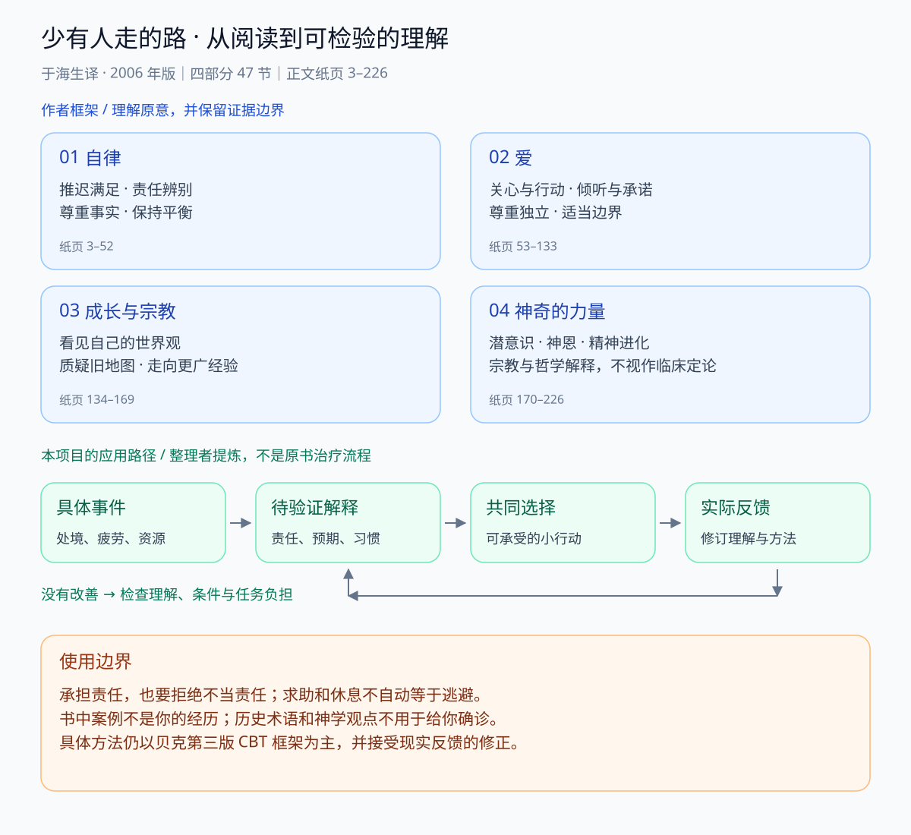

# 《少有人走的路：心智成熟的旅程》阅读笔记

阅读与整理日期：2026-11-07。分类：成长、自律、责任与关系／心理治疗经验及宗教哲学。**本书是补充理解材料，不替代本项目的 CBT 主要方法参考，也不是个人诊断标准。**

## 版本、范围与定位

- 作者：M·斯科特·派克（M. Scott Peck）；于海生译；吉林文史出版社，2006 年 3 月第 1 版，ISBN 7-80702-377-5。版本依据：PDF 文件第 3 页版权页。
- [本地原书](../资料/少有人走的路_心智成熟的旅程_M斯科特派克_Scott_Peck_z_library_sk,_1lib_sk,_z_li.pdf)，共 244 个 PDF 文件页。阅读的是这一册，不是整个《少有人走的路》系列。
- **已读范围：** 前置文字及目录（PDF 1–15）、四部分正文全部 47 小节（纸页 3–226／PDF 16–239）、后记（纸页 227–230／PDF 240–243），并浏览封底（PDF 244）。纸页 1–2 是作者前言；前置中文序言与作者自述分开处理。
- 方法：原书本地渲染、244 页逐页 OCR、按顺序分批阅读正文，再核对重点页面图像。不是仅看目录或摘要，也不是逐字校勘。OCR 有错字、漏字、空格及页码噪声；本笔记以概述为主，不把 OCR 当作可靠逐字引文。
- 本轮另行视觉核查：PDF 3、9–13（版本、目录），33–36（责任及术语），50（求助与工具），55（平衡），60（抑郁论述），91–92（受虐案例），141（治疗关系），204（进化与熵），232（病因与预后说法）。此前核查过的前置页和选段仍保留在阅读地图历史中。
- **页码规则：下文表格均为纸页；对应 PDF 文件页＝纸页＋13。** 同页可能结束一节并开始下一节，因此范围可以重叠。完整分页索引见 [OCR 合并文本](文本索引/少有人走的路-OCR合并.txt)。没有另读书中引用的外部著作或研究。

## 全书主线与阅读立场

**作者观点：** 人生包含需要面对的问题和痛苦；自律提供处理工具，爱提供投入的意愿；成长也要求更新认识世界的方式。最后一部分进一步把成长解释为潜意识、神恩及精神进化的作用。

**整理者评述：** 前半本适合提出关于回避、责任边界、倾听和自主性的反思问题。后半本从个案与体验进入宗教和哲学论证，不能因为作者有临床经历，就把所有解释视作已经验证的心理机制。作者前言也承认案例经过删节，呈现的是长期治疗中的突出片段，读者看不到全部停滞与反复。

阅读时同时保留两条线：一条是“这句话能帮助我观察什么”，另一条是“它凭什么成立、还有什么解释”。特别避免把“懒惰—原罪—疾病”串成评价自己的公式。

[可编辑 Excalidraw 图](图示/少有人走的路-阅读地图.excalidraw)。蓝色为作者框架，绿色为本项目整理的应用路径，橙色为边界；图中没有已确认的用户心理机制。

## 第一部分：自律（纸页 3–52／PDF 16–65）

这一部分的关键不只是“去做难事”，而是能分配时间、辨别责任、校验事实并随情境调整。四种工具相互制约，不能只拿“承担责任”压过“保持平衡”。

| 小节／纸页 | 作者论点与案例机制 | 可借鉴的观察方向及边界 |
| --- | --- | --- |
| 问题和痛苦／3–6 | 面对问题需要承受挫折；逃避眼前痛苦，可能让问题持续并增加后续痛苦。 | 区分任务本身的困难与搁置产生的额外成本。不把所有心理疾病都归因于逃避，也不认为越痛苦越有效。 |
| 推迟满足感／6–8 | 财务分析师把难办工作留到最后，整天受其牵制；改变任务次序后，工作体验改善。 | 看即时舒适与延后成本的分配。先难后易是案例策略，不是适用于所有任务、精力状态的铁律。 |
| 父母的过错／8–13 | 可靠关爱、榜样和时间投入，有助于形成“自己有价值、未来值得等待”的体验；严惩不等于自律教育。 | 可了解支持和安全感的作用；不能凭成人拖延反推童年缺爱，也不照搬作者的强因果和定型判断。 |
| 解决问题的时机／13–18 | 作者从“我不懂机械”转向耐心观察后解决具体问题；另一些人期待问题自行消失。 | 分开技能不足、没有留够时间、回避和有目的地等待。问题未处理不自动证明能力差。 |
| 承担责任／18–20 | 强调认识自己的可行动部分，否则持续等待环境替自己解决。 | 问“现在我能影响哪一部分”，而不是“是不是全是我的错”。军人及其妻子的案例回应方式不作为本项目的危机支持模板。 |
| 神经官能症与人格失调／20–23 | 作者以过度归责于己和过度归责于外对照，也说明两者可混合；判断责任归属需要学习。 | 保留本译本“人格失调症”的出处。它不是由“我不能”或拖延一句话即可判定的现代诊断；更不能二选一地给用户分类。 |
| 逃避自由／24–26 | 作者讲自己因工作安排过满求助上司，后来认出需要参与选择和取舍。 | 找可选择的下一步，同时承认权力、资源、制度等真实限制。求助、协商工作量不等于逃避自由。 |
| 尊重事实／27–28 | 用“地图”比喻认识；现实变化时，旧地图必须修订。投入越深，越可能抗拒新信息。 | 将既有解释当作当前版本，寻找修订条件。事实、推断、价值选择不能混写。 |
| 移情：过时的地图／29–32 | 电脑技术员将早年“不可信任”的经验带入新关系；曾经的保护策略可能不再适合当前环境。 | 是作者较宽泛的移情用法。可问“这个预期是否仍适合眼前的人”；不能预设所有警惕都失真或来自父母。 |
| 迎接挑战／33–38 | 反省并接受外界反馈，让地图被现实检验；作者还区分合理工具与欺骗式捷径。 | 纸页 37 明确支持借助有效工具。主动询问、阅读与求助可服务自主性，不必把独立理解成全部独自承担。 |
| 隐瞒真相／39–42 | 作者讨论主动虚构与隐瞒信息，也承认坦率要考虑目的、时机及对方的需要和承受能力。 | 诚实不等于无条件公开隐私。本节“白色谎言”偏指隐瞒，并不自动等于日常所谓善意谎言。梦的解释不能充当事实揭露。 |
| 保持平衡／42–46 | 自律需要灵活性；责任与拒绝不当责任、延迟与享受、表达与节制要平衡。骑车和下棋案例呈现作者自己也要调整。 | 可允许休息、适当标准和放下竞争。“缓一下”有时是恢复资源，不能每次都被判为逃避。 |
| 抑郁的价值／46–48 | 作者把部分低落与放下旧自我、人生转变联系起来。 | 仅作作者解释。不能据此认定抑郁必然有益、是成长必经之路，或将持续困扰只当作需要想通。 |
| 放弃与新生／48–52 | 成长可能需要放弃旧角色和确信；“兼容并包”要求保有自我，也允许新理解进入。 | 放弃的是可修订的观念或安排，不是个人价值、合理权益与安全；不要求自我消失。 |

### 第一部分的整合理解

**整理者提炼，不是原书诊断公式：** 遇到事 → 看清要求和不适 → 区分责任及现实限制 → 选择当前可行的处理或有安排的休息 → 看结果 → 修订安排。作者的“保持平衡”应当贯穿整个过程。

例如同样说“等会儿”，可能是有意休息，也可能是不想碰某个难点，还可能是任务模糊、时间不足或注意转移。书的作用是帮助提出区分问题；究竟哪一种，需要实际事件和反馈。

## 第二部分：爱（纸页 53–133／PDF 66–146）

作者把爱定义为为了自己或他人心智成熟而自我完善的意愿，强调行动、投入和独立。这是作者选定的定义，并非所有人必须采用的情感词典。其价值在于把“感觉很强烈”与“实际帮助对方”分开观察。

| 小节／纸页 | 作者论点与案例机制 | 可借鉴的观察方向及边界 |
| --- | --- | --- |
| 爱的定义／53–55 | 爱指向自身与他人的成长，是意愿与行动，而不只是一时冲动。 | 检查关心的实际作用，也保留自己的需求。不以是否高效成长来决定一个人是否值得被爱。 |
| 陷入情网／55–60 | 将恋爱体验理解为暂时的自我界限消融，与需要选择、付出的长期关系不同。 | 热情变化不必自动解释为关系失败；也不否定恋爱体验本身。书中发展与生物学叙述不是本项目的定论。 |
| 浪漫爱情的神话／60–62 | “命中注定的对象会让一切自然顺利”可能使人不愿处理真实差异。 | 留意自己对关系的预期，不因此要求维持有伤害的关系。 |
| 自我界限／62–65 | 作者区分暂时失去界限与通过持续投入扩大自我的体验。 | 关系中的连接与个人独立可并存；精神合一属于其哲学论述，不能当作成熟程度测试。 |
| 依赖性／65–71 | 先承认人人需要照顾，再区分需要支持与失去选择、必须依附的关系。 | 求助和相互依靠本身不等于病态；实际照护需要也不构成道德失败。书内“消极性依赖”称谓不可直接诊断。 |
| 精神贯注／71–76 | 对对象投入、依恋或占有不必然促进其成长；作者同时承认饮食、休息、运动和兴趣的滋养作用。 | “很在乎”与“是否尊重对方”分开。作者对宠物之爱等的狭窄界定仅保留为个人价值判断。 |
| “自我牺牲”／76–80 | 牧师过度替家人承担事务，维护自我形象却限制他人自主；作者提醒检查付出动机。 | 可辨别协助与包办，但须看对方实际能力。纸页 78–79 对受虐者动机的归因不能沿用，见下文边界。 |
| 爱，不是感觉／80–82 | 爱的感觉与爱的行动并非一一对应；是否投入需要选择。 | 可以感受变化又持续做重要的事；也可以因资源有限拒绝超负荷承诺。不是无论发生什么都要留下。 |
| 关注的艺术／82–91 | 倾听要暂停自己的议程，投入时间和注意；也需选择能认真听的时机，承认分心。 | 允许请求澄清、坦言没听清和约定时间；不装作理解，不要求任何人全天候回应。 |
| 死亡的风险／91–94 | 爱与投入可能伴随失去；为了完全消除风险而封闭自己，也可能损失有意义的联系。 | 是价值与风险的讨论，不把独居、内向或丧失后的退缩直接定为疾病。 |
| 独立的风险／94–98 | 作者离开不适合的学校等案例，说明自主选择可能违背他人期待，并需要支持与安全感。 | 独立不等于证明别人都错，也不要求一次激烈决裂；可逐步增加选择。 |
| 承诺的风险／98–107 | 雷切尔担心不按医生要求做就会被抛弃，关系中的持续回应逐渐挑战该预期。 | 这是个案，不是用户经历。书中绝对承诺与随后承认承诺有限存在张力；本项目不许诺永不离开或必然治愈。 |
| 冲突的风险／107–111 | 提出不同意见前先检查自己的依据、动机和理解；沉默和粗暴批评都可能伤害关系。 | 有分歧不等于关系结束；表达须尊重自主性、承受能力和真实安全条件。不是强迫对方接受“为你好”。 |
| 爱的自律／111–115 | 情绪既不应任意伤人，也不应被全盘压制；有限精力要求选择投入对象和方式。 | 情绪可以被理解，行动仍可选择。不能把“改变慢的人不值得帮助”变成规则，也不以家庭角色规定唯一生活方式。 |
| 爱与独立／115–123 | 他人不是自己的延伸；父母、伴侣要承认彼此不同的需要。婚姻以双方成长和相互支持为喻。 | 不把不符合家长期待当病态。作者关于母亲特征与精神疾病的归因不能凭案例推广。 |
| 爱与心理治疗／123–131 | 马西娅、海伦案例强调真诚、关心与关系变化，不能只依赖话术。 | 关系不能代替专业能力、同意和伦理边界；作者对性关系及亲友治疗的宽松说法不纳入本项目方法。 |
| 爱的神秘性／131–133 | 作者承认成长、爱的来源及治疗差异仍有难解之处，由此转入宗教部分。 | “暂不理解”是知识空缺，不能因此认定某个超自然解释成立。 |

### 第二部分的整合理解

**整理者提炼：** 有效帮助应包含关注、现实能力、边界和对自主性的尊重。用关心的名义要求对方服从，或以自我牺牲换取对方感激，都值得再检查。但不能反过来猜定所有付出都是控制。

对本项目而言，认真倾听意味着先准确理解、必要时承认理解有误，并允许你不同意解释或不做练习。不是模仿书中强势追问，逼出一个预先设定的答案。

## 第三部分：成长与宗教（纸页 134–169／PDF 147–182）

作者此处的“宗教”是宽泛的世界观，不限于宗教组织或信神。这解释了为什么他说人人都有宗教；它不等于替无宗教信仰者重新认定身份。

| 小节／纸页 | 作者论点与案例机制 | 可借鉴的观察方向及边界 |
| --- | --- | --- |
| 宗教与世界观／134–140 | 自称持有的观念与实际预期可能不同；斯图尔特自称无神论，却在作者解释中受惩罚性的世界观影响。家庭“小宇宙”可能被泛化为整个世界。 | 可以检查“我认为世界怎样、面对具体事又怎样预期”。梦与童年关联仅是作者个案解释，不从梦推断真实历史。 |
| 科学的宗教／140–144 | 以观察、怀疑、检验和可重复的经验挑战继承来的观念；也警惕把科学当成不可质疑的身份。 | 学习不只是接收信息，还要追问依据和适用条件。同样标准也应检查本书，不把“敢于怀疑”替代证据。 |
| 凯茜的故事／144–153 | 罪感、惩罚预期、家庭权威和婚姻困境纠缠；叙述中她逐渐质疑规则并作出选择，最终离开原宗教身份。 | 可区分念头、行为、规则和后果。不是所有宗教都造成疾病；不模仿书中用药、诱导询问和病因判断。 |
| 马西娅的故事／153–155 | 与凯茜相反，作者叙述马西娅在关系改善后更愿意接近宗教。 | 改善不必导向同一种信仰。不能用衣着颜色、是否信神单独衡量健康。 |
| 特德的故事／155–166 | 从失恋线索转向丧失、兴趣被嘲笑与被夺走的经历；不表达热情可能有保护功能。作者也挑战只把坏事算作证据的双重标准。 | 可核对“表达需要会有什么后果”的预期，但不能移植其童年。作者引导他去神学院的选择不作为替用户定目标的依据。 |
| 婴儿与洗澡水／166–169 | 反对全盘排斥或全盘推崇宗教，主张辨别具体信仰的作用。 | 不因一本书有可疑观点就抹掉全部启发，也不因有启发就接受全部论证。作者仍有自己的神学立场，并非价值中立。 |

### 第三部分的整合理解

**整理者提炼：** 从有限经验建立的规则，可以在当前现实中重新检验。要检查支持与不支持的材料，也允许实际环境确实不友好。对人的成长不预设“最后应当认同哪种信仰”。

## 第四部分：神奇的力量（纸页 170–226／PDF 183–239）

这一部分必须连同前文读，才能准确理解作者整套理论；但完整理解不等于接受。其中心逐步转向神恩、潜意识和上帝，证据主要是病例、个人体验、类比和宗教故事。

| 小节／纸页 | 作者论点与案例机制 | 可借鉴的观察方向及边界 |
| --- | --- | --- |
| 健康的奇迹／170–176 | 作者不仅问为何患病，也问为何经历逆境仍能保持健康、在事故中幸存，并将其关联到神奇力量。 | 可提醒自己关注资源和韧性；不能把幸存个案当超自然因果的证明，更不能把疾病归为性格或信仰失败。 |
| 潜意识的奇迹／176–185 | 梦、口误、临时联想和直觉被作者视为帮助认识自身的信息；提出潜意识的智慧与集体无意识。 | 想法可成为探究线索，不能直接判真。纸页 180–181 对迟到和漏签支票的解释，不足以证明任何迟到都代表敌意。 |
| 好运的奇迹／185–190 | 通过相似梦境、事故和偶得书籍讨论同步性与不期而遇的收获。 | 可留意环境中的信息和支持；案例本身不能排除巧合、选择性记忆等解释，不把心灵感应写成已证实事实。 |
| 进化的奇迹／190–195 | 作者借生物进化、熵和金字塔类比精神成长，把爱当作推进力量。 | 这段包含科学性主张，但书内论证不足以支持“进化违反自然规律”。本项目只保留其成长隐喻，不用熵解释个人症状。 |
| 熵与原罪／195–201 | 重新解释亚当夏娃故事：没有质疑、沟通和内在论辩；把逃避成长劳动称为懒惰或原罪。 | 可借“有没有停下来核验”反思学习；不采用“恐惧主要是懒惰”作为个人解释，更不把疲劳或停止治疗当罪过。 |
| 邪恶的本质／201–203 | 作者区分消极不投入与主动破坏他人成长，后者被放入神学的邪恶框架。 | 讨论具体伤害行为即可；不用“邪恶、病态自我”描述用户，也不把心理疾病道德化。 |
| 意识的进化／203–207 | 作者把成长描述为扩大意识、接近潜意识，继而提出潜意识与上帝相通的假设。 | 清楚标为神学解释。“潜意识知道一切”“疾病是违背上帝”不作为本项目的事实或方法。 |
| 力量的本质／207–211 | 区分支配他人的权力与能理解、作决定的心灵力量；信息增加也带来责任和不确定性。 | 可帮助区分控制别人和增加自身选择。无需全知才行动，也不把孤独当更成熟的证据。 |
| 俄瑞斯忒斯的传说／211–218 | 用复仇女神转为仁慈女神，比喻从排斥症状到理解信号、参与改变。 | 神话不是病因或疗效证据。可把困扰视为需要照顾的提示，不要求为患病认罪，或把药物、环境调整等排斥为逃避。 |
| 抗拒潜意识的暗示／218–226 | 作者把治疗看成工具，强调自身参与；讨论成长意愿、责任与对改变的抗拒，最后承认无法可靠预测谁会获益。 | 参与很重要，但不能把没有改善归咎于缺乏意愿。纸页 219 按婴幼儿月份对应疾病与预后的说法不用于评估；停止或调整方法可以是合理选择。 |

### 第四部分的整合理解

**整理者评述：** 作者一方面承认未知和个体差异，另一方面对潜意识、神恩和懒惰作出强结论，两者存在张力。可以从中获得关注新信息、资源与自主选择的启发，但“尚未解释”不能推出“只能由神奇力量解释”。

## 后记及前置文字

后记（纸页 227–230／PDF 240–243）讨论选择治疗者：观察是否认真关心、允许提问、能否承认不知道，以及人与人之间的匹配。**可借鉴的是提问权与选择权。** 作者关于不可治愈比例、理解本书就能排除某类情况、资质与能力关系的断言，没有在本笔记中作为可用标准。直觉和口碑不能替代必要的专业资格及方法核查。

中文序言含有对升学、婚育及生活方式的规范性评价，不能直接当作作者正文结论，更不作为判断读者是否成熟的尺度。作者前言说明病例经过处理、书中并不展示治疗的全部漫长过程，因此不能根据几个戏剧性转折期待一次对话就找到唯一病因。

## 需要明确保留的分歧

以下为**整理者的使用决定**，不是悄悄修改作者原意，也不宣称已系统复核所有外部研究。

1. **责任辨别，不是人格标签。** 纸页 20–23 的译词有真实出处；纸页 42 又强调拒绝不该承担的责任。两处必须合读。书中责任对照不能取代正式评估。
2. **痛苦不是考核。** 纸页 46–48 对抑郁与成长的联系不能推广为所有抑郁的解释；纸页 195–201、218–228 的“懒惰、意志、失败”解释不能成为责备无效或未完成实践的依据。
3. **受伤害者的动机不能靠猜。** 纸页 78–79 将反复返回暴力关系解释为享受道德优势，案例叙述不足以支持这个结论。需要区分控制、恐惧、依恋与资源限制等可能因素；受害者的处境不使施暴行为合理化。
4. **关心不取消边界。** 纸页 128 对“如果有益则可能发生性关系”的设想明确不采纳；本项目不把治疗者与来访者的性接触、恋爱或强迫亲密当作帮助方式。纸页 129–131 把亲友关系等同心理治疗的说法也不沿用。
5. **性取向不作为成长缺陷。** 书中把同性恋转向异性关系写成“正常生活”的叙述不用于本项目，也不提出改变性取向的目标。
6. **经历、梦和直觉不等于证据结论。** 纸页 176–190 的解释只能提供线索；不得根据迟到推定敌意、根据梦断定童年事实，或认为直觉必然比可观察事实可靠。
7. **神学与临床解释分开。** 纸页 190–207 的熵、原罪、上帝和潜意识体系照原意记录，但不成为病因模型。纸页 219 按缺爱发生月份推断疾病种类、严重度及预后的说法不用于用户评估。

## 与 CBT 资料的分工

| 问题 | 本书可提供的反思角度 | 后续实际方法优先依据 |
| --- | --- | --- |
| 是不是我的责任？ | 自己能承担什么，同时拒绝不当责任；纸页 18–26、42–46 | 贝克第 3、14、19 章：具体情境、证据、现实问题与资源 |
| “缓一下”发生了什么？ | 面对问题的时机、满足次序与平衡；纸页 3–18、42–46 | 贝克第 8、12–14 章；《思维改变生活》第四、九部分 |
| 预想提问会打扰别人 | 旧地图、求助工具、倾听与不同意见；纸页 27–38、82–91、107–111 | 贝克第 14、19 章；《思维改变生活》第十部分：协作检验与表达请求 |
| 怎么做记录反馈？ | 诚实与更新地图，不只有解释自己 | 贝克第 8、21–22 章；本书没有可直接照搬的标准想法记录表 |
| 怎么从被动学习转为校验？ | 观察、质疑、扩大“小宇宙”经验；纸页 134–144 | 阅读时区分事实、作者推断、适用范围，再用实例检验 |

具体教材入口：[贝克第三版笔记](认知行为疗法原著第三版-阅读笔记.md)、[《思维改变生活》笔记](思维改变生活-阅读笔记.md)。不能把“移情＝核心信念”“潜意识＝自动思维”“精神贯注＝专注力”直接画等号。

## 与你的五个目标连接

这里是**个人应用的待验证方向**，不是已确认的机制，也不是已约定练习。

1. **认识问题：** 先描述具体影响，再辨别责任、技能、资源与预期；不从“我没有责任心”倒推所有行为。
2. **识别当下模式：**“等会儿”“太累了”可以作为观察入口。还需核对是否真的疲劳、任务是否清楚、是否预想某种后果；未察觉念头时无需强行编出一句话。
3. **发生改变：** 如果主要是任务模糊，澄清比自责更有用；如果确需休息，可给休息和返回任务留一个可行安排；如果是担忧提问后果，再共同选择可承受的验证方式。这里只列选择逻辑，不预定你必须执行。
4. **记录反馈：** 只记录一次事件所需的信息：发生了什么、原先预期、实际行动和结果、哪些解释需要修改。不要求长篇日记，不用记录量证明努力。
5. **学会学习：** 对一本书依次问“作者在说什么、凭什么、什么情况下适用、什么能使我改变看法”。本书也接受同样检验。

目前你的实际反馈不足以确认：拖延后是否暂时轻松、对方是否真会拒绝、童年经历如何影响现在。书中个案不能填补这些空白。

## 可选复盘问题索引

以下问题是整理者根据阅读设计的自助提示，**不是本书原装练习，也没有自动分配给用户**。对话时按需要选一个即可。

- 纸页 13–18：这次没有处理，是没看清问题、缺条件、太累，还是在等某种不适消失？
- 纸页 20–26、42–46：哪些是我能影响的，哪些需要协商或别人负责？
- 纸页 27–38：我现在使用的是哪条预期？有什么当前事实支持或挑战它？
- 纸页 82–91：我想得到倾听、信息、建议，还是具体协助？有没有合适的时机和表达方式？
- 纸页 134–144：这是作者的结论、案例解释，还是可以核对的事实？

## 阅读验收

- 已顺序阅读四部分 47 小节，覆盖前言、后记；逐节留有论点、机制线索、页码和使用边界。
- 已保存 244 页本地 OCR 与合并索引；索引只供回查，不代替阅读证据。
- 已将历史术语、哲学观点、整理者判断、个人应用假设分开；未新增诊断、童年经历或已约定实践。
- 本笔记中的页码对应本地 2006 年版；其他译本可能不同。后续需要逐字引用或判断争议时，仍回查扫描页。
