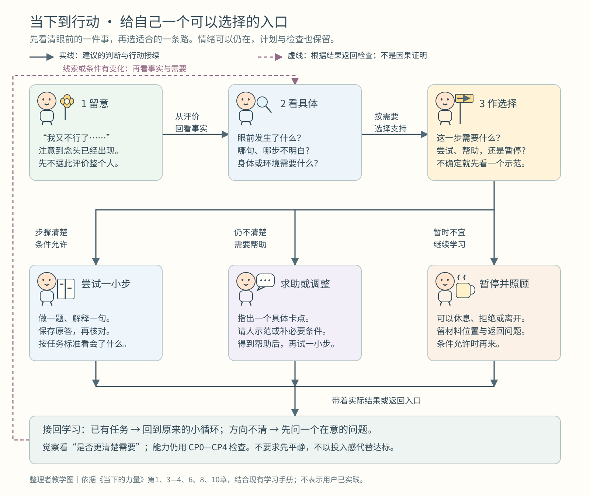

# 《当下的力量》：从被念头带走，到重新选择一步

分类：**觉察与灵性阅读／学习支持补充**。更新：2026-11-17。它在学习框架中负责帮助辨认此刻的经验与选择，不负责决定学什么、证明怎样学有效或判定能力达标。日常操作仍以[学会学习指导手册](学会学习-指导手册.md)为入口。

如果你一遇到困难就想到“我不行”，这份笔记希望陪你多看清一点：眼前具体发生了什么？你需要解释、练习、帮助，还是休息？不必先清空念头或变得自信，才有资格开始学习。

想直接跟做，可以跳到[一次完整示范](#一次完整示范读不懂时如何回到学习)；想先看路线，读[三条关系与地图](#先抓住三条关系)；要核对作者到底说了什么，再查[十章笔记](#十章阅读笔记)。不必先记住所有术语。

## 阅读范围与怎样回查

本地版本为《当下的力量（白金版）》，埃克哈特·托利著，曹植译，张德芬审校，中信出版集团；EPUB元数据日期为2016-12-06，ISBN为9787508661766。封面的销量与推荐语属于出版宣传，不作为方法有效性的证据。

- 已顺序阅读全部16个spine文档的文字，包括扉页及版权、献辞、张德芬导读、马克·艾伦序言、作者前言、全部10章问答正文。之前仅第1章选段的状态由本次完整文字阅读覆盖。
- 本版资源包中仅有一张封面图片，已查看；没有正文教学插图。下文图示均为整理者根据概念关系制作，不能说成原书图解。
- 引用采用“章号＋小节名＋EPUB路径”。流式EPUB没有稳定纸页，不编造页码。第1—10章路径依次为`OEBPS/Text/chapter01.xhtml`至`chapter10.xhtml`，对应spine7—16。
- 原书文件为[本地EPUB](../资料/当下的力量_白金版_=_The_Power_of_Now_A_Guid_z_library_sk,_1lib_sk,.epub)，检索可用[正文索引](文本索引/当下的力量_白金版_=_The_Power_of_Now_A_Guid_z_library_sk,_1lib_sk,.txt)。原书SHA-256：`fce61658d88411c8c94c31e6d5d800b182b774b47a582da74b592e41ddc7d04e`。
- 未通读书中引用的宗教典籍、其他作品，也未将书中医疗、物理学或群体差异说法作外部系统核查。这里记录原书主张及本项目的取舍，不能将读完一本书写成验证了它的全部理论。

## 先抓住三条关系

**念头出现 → 可以留意它 → 再检查事实与需要。** 第1章“观察思考者”提供了这个入口。实际教学中，“我正在想到自己很差”与“这次题目中的起点量没有找对”分别记录；观察念头之后仍需分析问题。

**目标与计划 → 指向现在能做的事情。** 第3章区分钟表时间与心理时间，第4章区分外在目的与内在目的。未来目标可以保留；需要辨认的是，当前思考有没有帮助安排事情，还是一再播放同一段担忧。这个功能判断是教学转化，不是给思想贴对错标签。

**承认此刻事实 → 选择改变、离开或暂时容纳 → 检查后续。** 第4、10章明确保留行动与拒绝。学习中的接续可以是尝试、求助、调整条件或暂停，不要求先感到平静。能力是否提高，另用学习任务来检验。

[放大图](图示/学习教学-当下到行动.svg) · [可编辑图](图示/学习教学-当下到行动.excalidraw)。实线表示建议的判断与行动接续；虚线表示按实际结果返回检查。连线不表示已经验证的心理因果。下面一排三条路线每次只选适合的一条，不是三项必做作业。

**读图示范：** 从“我又不行了”走到“我还没弄懂这道题为什么除以80”，再选择请老师示范起点量的找法。获得解释后，返回学习小循环，用新题看看能否独立找出起点。看清卡点是一个进展；做对新题才提供相应能力证据。

## 十章阅读笔记

以下每章分开记录作者的论述、可讨论的问题及教学取舍。书中“小我”“本体”“开悟”均按作者的灵性体系理解，不与临床概念自动互换。

### 第1章：你不等于你的大脑

**原书主线：** 从乞丐坐在金箱上的寓言进入，作者认为人把自我与思维、标签和过去经历混在一起，因此忽略“本体”。他提出倾听内心声音、留意情绪与身体感受，并以洗手、上下楼等日常动作练习注意。第1章的小节标题是“从你的大脑中解放出来”；此前手册写成“从你的思维中解放出来”，现已更正。

**可用理解：** 能注意到一句评价正在出现，便可以继续问它具体指向什么，而不立即把它当作自己的全部。例：“我学不会”暂时保留为念头，另找“我读到哪一句开始不理解”。

**教学取舍：** 不把“观察”教成思想清零。书中对思维无用比例、情绪导致疾病及情绪能量吸引事件的说法，不作为本项目的因果解释；感受值得认真对待，也不直接证明对外界的判断准确。

**只问一个问题：** 刚才那句话是在描述一次作答，还是在评价整个人？若分不清，老师先示范“我算错一题”和“我是失败者”的区别，再回到原答。

定位：`chapter01.xhtml`，“从你的大脑中解放出来”“情绪：身体对思维的反应”。

### 第2章：意识——摆脱痛苦的途径

**原书主线：** 作者把对当下的抗拒与旧有情绪痛苦联系起来，用“痛苦之身”描述一个可休眠、被触发并以痛苦为食的能量场；强调观察而不认同。也讨论恐惧、小我对完整感的追寻。

**可用理解：** 同一句反馈可能带出熟悉的反应。值得观察的是这一次的触发、念头、感受、冲动与实际行动，而不是马上给反应命名为某种固定人格。

**教学取舍：** “痛苦之身”保留为作者概念，不当成已证实的医学实体，不用它解释所有拖延或推断创伤。书中的“接纳，然后采取行动”可作为提示；是否有重复模式，需要几次真实记录与用户确认。

**只问一个问题：** 刚听到反馈时，你最想马上做什么？如果不知道，可以先回忆实际做了什么，不必强迫挖出一个动机。

定位：`chapter02.xhtml`，“别在当下制造更多的痛苦”“瓦解你的痛苦之身”“恐惧的起源”。

### 第3章：深深地进入当下

**原书主线：** 区分为实际事务服务的“钟表时间”和被过去、未来占据的“心理时间”。学习过去的经验、设定目标、安排日程都可以使用；问题在于把自我完整与幸福全部寄托在未来，或持续认同过去。作者也主张“所有的问题都是思维的幻象”。

**可用理解：** 今晚写计划并非逃离当下。可以问：这轮思考增加了什么信息、选择或安排？“明天先试一道题”留下入口；反复想“万一我永远学不会”尚未提供下一步，但它提示需要了解担忧。

**教学取舍：** 不采用“问题都是幻象”否认实际任务、损失、身体不适或资源不足。复盘仍有价值：保留事实、修正解释、安排下一步。观察与分析在本项目中接续，而不是互相排斥。

**只问一个问题：** 现在需要决定的，是未来的一百件事，还是其中一件？答案若是“要做计划”，那计划本身就是可执行动作。

定位：`chapter03.xhtml`，“摆脱心理时间”“在生活情境中寻找你的生命”“所有的问题都是思维的幻象”。

### 第4章：思维逃避当下的策略

**原书主线：** 从普通与深层“无意识”、抱怨与等待，转向离开、改变或接受处境的选择；区分外在旅程目标与当下如何行动的内在目的。末段讨论过去如何在当前反应中表现。

**可用理解：** “等准备好再开始”有时需要检查等待的到底是什么。缺材料就补材料；已能做却一直等待完美状态，可以商量一次低代价尝试。目标提供方向，当下的动作使方向可检验。

**教学取舍：** 三种选择受现实条件限制，可以分阶段，也可以需要支持。“无意识”不是临床意识障碍或道德分数。不要求否定过去的影响；了解历史在有需要时仍可帮助理解当前困难。书中把负面情绪称为污染的表述不用于课堂反馈。

**只问一个问题：** 你正在等的条件，缺了它真的无法做下一小步吗？若真的无法做，下一步是补条件，不是责备自己。

定位：`chapter04.xhtml`，“无论身处何地，全然地安于当下”“你生命旅程的内在目的”“过去无法在你的临在里生存”。

### 第5章：临在状态

**原书主线：** 用等待下一个念头、欣赏自然、注意沉默等例子说明“临在”是经验而不只是概念。随后把临在扩展为纯意识、宗教意义上的救世主与集体意识演化，也讨论导师和团体共修。

**可用理解：** 会背“活在当下”不等于知道自己刚才把注意力放在哪里。可以从看见桌上一件物品，再回到书上一句具体内容开始。

**教学取舍：** 体验练习不承担验证宇宙意识理论的任务，也不拿无念、开悟或持续平静给学生评级。原书关于艺术、石头意识及药物的概括不作为本项目的教学或健康判断依据；不照搬背后击打测试临在的故事。

**只问一个问题：** 你刚才注意到的一个具体细节是什么？答不出可以换一个熟悉的对象，不要求追求特别体验。

定位：`chapter05.xhtml`，“临在不是你所想的那样”“美好源自你临在的定静之中”“纯意识的实现”。

### 第6章：内在身体

**原书主线：** 作者将感受身体、呼吸、宽恕、创造性思考与倾听连起来，认为“内在身体”是通向本体的入口。他也明确提出减缓衰老、增强免疫及能量振动的说法。

**可用理解：** 学习卡住时，除了看想法，也看看自己是否困倦、姿势不舒服、需要暂停；听老师解释时，先听完关键内容，再核对自己的理解。这里的身体状态检查和复述安排属于教学设计。

**教学取舍：** 本章没有提供足以核实上述健康效果的证据，回答“试试看，你将会是证据”不能替代验证。课堂不以能量感、身体发光或宽恕作为进入学习的条件。注意身体若令你更不舒服，可以停止，改看周围物品或寻求支持。

**只问一个问题：** 现在最需要照顾的是哪一项身体或环境条件？不要先假定身体不适是情绪压抑造成的。

定位：`chapter06.xhtml`，“与内在身体联结”“减缓衰老的过程”“加强你的免疫系统”“倾听的艺术”。

### 第7章：进入未显化状态的大门

**原书主线：** 作者提出身体、临在、臣服、寂静和空间等入口，解释气与“未显化状态”的关系，延伸到无梦睡眠、宇宙及时间空间。开头有10—15分钟冥想建议。

**可用理解：** 可以选择一种自己能理解且舒服的注意入口，不需要同时掌握一整套方法。听到一种声音、看到一句文字，都可以作为回到当前活动的提示。

**教学取舍：** 冥想时长是原书经验安排，不是学习必须完成的配额；不把“未显化状态”当作学习记忆机制或物理学结论。学生不必接受该书宇宙观，仍可讨论注意与行动。

**只问一个问题：** 哪一种入口最不费力：看看眼前材料、留意周围声音，还是短暂停一下？也可以直接回到任务，不额外做练习。

定位：`chapter07.xhtml`，“深深地进入你的体内”“其他的大门”“寂静”“空间和时间的真正本质”。

### 第8章：开悟的爱情关系

**原书主线：** 从等待伴侣给予圆满，讲到依赖、冲突、表达与倾听，倡导在关系中观察自身反应。作者也讨论男女差异、女性集体痛苦之身、经期及性取向，最后谈放下对自我的对象化关系。

**可用理解：** 可把“先看见自己的反应，再表达具体感受与请求”迁移到学习求助、同伴讨论和接收反馈。迁移的是沟通提议，不是把亲密关系理论整体移植到课堂。

**教学取舍：** 不采用性别决定思维或情绪模式的分类，也不用“集体痛苦之身”解释生理问题。不因作者说关系只是引出既有痛苦，就否认别人行为造成的实际伤害。留意自己的反应，不等于替对方承担责任、必须宽恕或留在伤害中。

**只问一个问题：** 你想请对方具体说明哪一句、哪一步？若对方有人身贬低，可以先要求回到任务，必要时结束互动并求助。

定位：`chapter08.xhtml`，“在爱情关系中灵修”“为什么女人更容易开悟”“瓦解女性的集体痛苦之身”“放弃和你自己的关系”。

### 第9章：超越幸福和不幸

**原书主线：** 区分快乐与内在平和，讨论无常、成败循环、精力起伏、消极心态和慈悲；用湖面与湖深处的比喻说明外在变化与内在存在，并提出意识创造世界的灵性解释。

**可用理解：** 一次测验不佳可以保留为结果，不必进一步升级为整个人失败。学习安排也要允许现实状态变化；可以修改负担，再明确是否改变了目标范围。

**教学取舍：** 不用“负面情绪毫无作用”“所有痛苦来自抗拒”概括学生。情绪可以成为继续了解处境的线索，不能仅凭它判断原因。成绩仍需如实检查；“接受这次结果”不能把未达标改成达标。也不把苦难包装成学生应当感谢的成长机会。

**只问一个问题：** 这份结果实际说明哪一项还没做到，哪些结论它并不能支持？若暂时难以复盘，可以先保留原答，另约可承受的回看时点。

定位：`chapter09.xhtml`，“生命的无常和循环”“利用和放弃消极心态”“慈悲的本质”“一个不同层次的现实”。

### 第10章：臣服的意义

**原书主线：** 作者反复澄清臣服并非放弃行动，用陷入泥沼后设法脱身、浓雾中手电照亮当前一步作比喻；承认计划可以是此刻要做的事，也说可以坚定拒绝他人。后半讨论疾病、灾难、痛苦、选择与宽恕。

**可用理解：** 接受“这次还不会”，可以紧接着请老师演示；接受“此刻很累”，可以安排休息与下一次入口。改变状况不需要以否认当前事实为前提。

**教学取舍：** 本章一面承认拒绝和行动，一面又把疾病、受虐及持续痛苦归于思维认同或无意识，论述有明显张力。本项目明确保留现实责任与边界：不把被伤害归因于不够觉察，不要求受害者用内在转化解决他人的伤害，不拿“还痛苦”证明学生不愿改变。也不要求带着强烈不适持续深入痛苦练习。

**只问一个问题：** 现在可以做的一件事是什么——改变一小处、请人帮忙，还是暂时保护并照顾自己？不知道时，先找一个具体阻碍，而不是要求立刻“臣服”。

定位：`chapter10.xhtml`，“接受当下时刻”“在个人关系中臣服”“将疾病转化成开悟”“将痛苦转变成平安”“选择的力量”。

## 从书中取舍：哪些进入课堂，哪些保留为作者观点

| 原书内容 | 在学习框架中的位置 | 使用时保留的边界 |
| --- | --- | --- |
| 观察思考者、日常注意（第1、5章） | 察觉自我评价与注意偏移后，回看当前任务 | 发现走神后回来即可；不要求全程监控思想 |
| 钟表时间与心理时间（第3章） | 让计划、复盘产出一个当前安排 | 不以“想着未来”判定逃避，也不取消复盘 |
| 内在目的与外在目的（第4章） | 方向与当前行动并看 | 意义探索不能代替任务标准；专心不能证明做对 |
| 改变、离开或接受；臣服与行动（第4、10章） | 在行动、求助、调整与暂停间作选择 | 不必先平静才行动；实际选择受资源及处境限制 |
| 倾听、表达、留出空间（第6、8章） | 把反馈听具体，把求助问具体 | 可以不同意、拒绝和保护边界，不要求消除情绪 |
| 本体、未显化、能量频率、痛苦之身 | 理解作者体系的术语索引 | 不作为学习科学、医疗实体或个人诊断 |
| 疾病与免疫、衰老、男女及性取向的泛化 | 记录在章级批判性笔记中 | 不据此给健康建议、分组学生或推断能力 |

张德芬导读中的ABC解说属于导读者的概括，作者前言属于个人经验叙述，不能混成同一证据层级。尤其不能从“解释影响感受”推导“现实事件不重要”或“个人完全控制自己的想法”。本项目的CBT方法仍回查[专业教材笔记](认知行为疗法原著第三版-阅读笔记.md)，不以本书取代。

## 一次完整示范：读不懂时如何回到学习

以下是虚构课堂。与手册的百分比示范相接，不是用户已经做过的练习。每次只追一个问题。

**情境：** 学生看到“80分钟变60分钟，下降25%”，心想“我又看不懂，我不适合学习”，于是想去找另一套教程。

**第一步，留意一句话。** 老师：“刚才心里最响的一句话是什么？”学生：“我不适合学习。”老师：“先把它记成‘我正在这样想’，我们再看题目。”如果学生说不清，老师可以先问停在题目的哪里，不强求辨认情绪。

**第二步，找到一个具体缺口。** 老师：“20÷80里，哪一部分不清楚？”学生：“20是少掉的时间，但我不知道为什么除80。”此时产物是一个可回答的问题。教师可反馈：“你已经分清减少量，未知的是比较基准，我们从这里讲。”

**第三步，按需要选择。** 若还有余力，老师先示范“相对于原来的80，少了20”；若例子仍太大，换成10个物品少2个，再返回；若学生困倦到听不进去，则暂停，写下“下次打开这道80→60的题，先问分母为什么是80”。不靠反复要求学生专注来补教学缺口。

**第四步，返回学习与检查。** 老师换题：100分钟变80分钟，减少量相对谁？为什么？先保留作答，再看是否能独立指出起点100并解释20%。若用了提示，如实记录，再安排新题；不能因学生不再自责就宣布已学会。

**第五步，留下一句接续。** 例如“我已经能说明下降的基准，下次看回升时为什么不能仍除100”。若仍不会，就保留“需要再比较两个起点”的缺口。实际练习见[手册完整课堂](学会学习-指导手册.md#七跟做示范三次小学习接成一次大测)。

### 一个轻量检查点

这不是新等级，也不加入CP0—CP4评分。只在卡住时检查：**是否更清楚当前事实或需要？下一步是否明确到能做、能求助，或能再次找到入口？** 情绪仍在也可以继续；没有变清楚，就换示范、检查条件或寻求支持。

可选留一句：`我注意到____；眼前事实／未知是____；现在选择____；回来先看____。` 不必每天打卡。若只能说“我现在还说不清，需要陪我看一个例子”，也能作为求助入口。

## 三种相近场景，怎样选不同路线

| 场景 | 先看哪个区别 | 示范的下一步 | 之后检查什么 |
| --- | --- | --- | --- |
| 一直做计划、收藏方法，却未尝试 | 正在补必要信息，还是重复等待完全准备好？ | 选一个代表任务试草稿；真缺材料则先补材料 | 得到新信息或原答了吗？不是统计计划页数 |
| 被指出错误，立刻觉得自己很差 | 可核对的反馈，与对整个人的评价 | 请对方指出具体步骤，复述理解；遇贬低可要求回到任务 | 能否明确需修正的一点？必要时换支持来源 |
| 想继续，但身体疲倦、任务也乱 | 需要更多解释，还是先恢复条件？ | 先休息或减量，留材料位置与一个返回问题 | 返回时条件是否允许？不把暂停写成学习失败 |

上表是待尝试的教学选择，不是凭一个现象确认原因。若一种提醒多次没有帮助，先改支持方式，而不是要求更用力觉察。

## 小练习：能否把当下接到行动

不必全部做。选一个情境，说出“一项事实或未知＋一个合适的下一步＋怎样检查”，再看文末核对。

1. 明天要做汇报，你正在列出准备顺序。有人说：“活在当下就不要想明天。”你怎样判断这句话？
2. 同学说“你太笨了”，你想起书中的接纳。接纳是否意味着不反驳、不离开？可以如何回应？
3. 做题仍紧张，但你已经指出问题出在基准，并准备请求一个例子。是否必须先消除紧张？此刻与学习达标分别看什么？

[作答后核对](#练习核对)。这些问题检查区分与选择，不测试是否达到“开悟”。

## 接回原来的学习框架

觉察是一个随时可用的入口。任务明确、状态允许时，可以直接学习，无须先做自我分析。

| 现有环节 | 本书补上的问题 | 返回哪里 |
| --- | --- | --- |
| 方向探索 | 我在意什么？是否把自我价值全部押在一个未来结果上？ | [方向与动力](学会学习-指导手册.md#方向与动力每次只选一个问题)，一次问一项 |
| 启动 | “缓一下”之后，我需要恢复、澄清还是支持？ | [启动指南](迈出第一步-启动与反馈指南.md)，找可承受动作与返回入口 |
| 学习、串联与小测 | 我现在卡在哪句话、哪一步、哪条关系？ | 手册CP1、CP2，补例子、解释或关系练习 |
| 综合验收与保持 | 当前结果说明什么？我又额外评价了自己什么？ | 手册CP3、CP4，保留标准、帮助条件和实际结果 |
| 长期复用 | 这次看见的缺口，值得接到哪条已有理解？ | 卡片或主题入口按需要更新，不强迫每次内省建卡 |

完整七步融合与关系依据见[方法地图](学会学习-方法地图.md#当下的力量怎样融入学习框架)。本书与《心流》都谈注意与体验，但前者以灵性觉醒为主线，后者笔记讨论活动条件与投入体验；两者均不能单独证明技能掌握。本项目用《超速学习》等资料组织学习任务，用实际结果检验。

## 练习核对

**第1题：** 安排明天汇报可以是书中的钟表时间，也是现在可以完成的任务。可以写出准备顺序、材料缺口和检查方式；若只是反复想象失败，就再辨认具体担忧和需要的帮助。区别在功能，不在有没有想到未来。

**第2题：** 可以承认“对方说了这句话，我感到受伤”，同时拒绝人身评价，例如“请告诉我哪一步有问题；如果继续贬低，我们先停止讨论”。接纳当前事实不等于赞同、不设边界或免除对方责任。也不必先完全不生气才保护自己。

**第3题：** 不必等待情绪消失。此刻已经有一个具体缺口与求助入口；学习是否达标，要看在约定帮助条件下，能否用新题正确识别基准并解释。如果仍做不到，补教这一处。觉察、情绪变化和能力证据分别记录。

[返回练习](#小练习能否把当下接到行动)。若只会背“活在当下”，还不能选择具体动作，下一轮先跟做上面的课堂示范；不继续堆术语。
