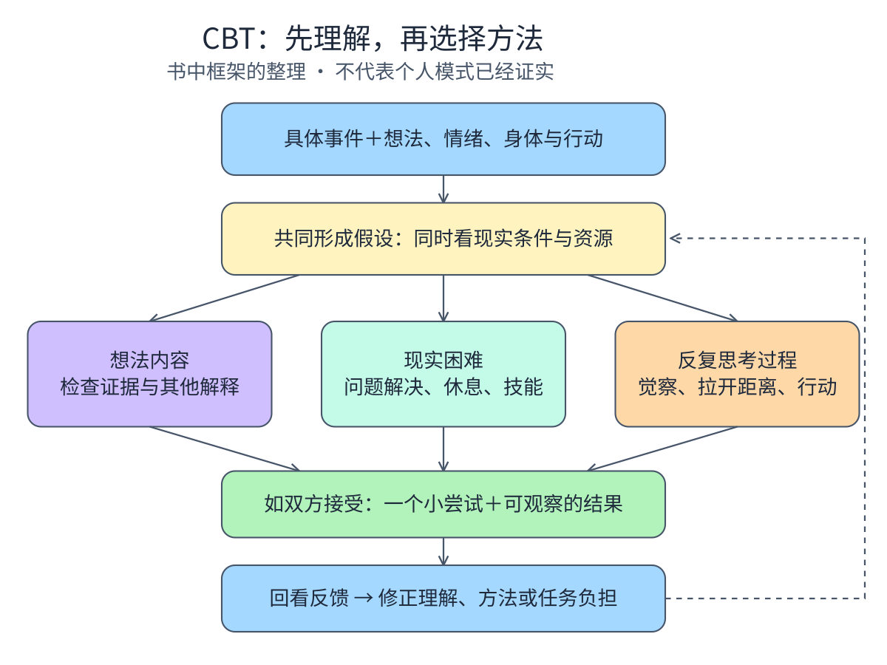

# 《认知行为疗法（原著第三版）：基础与应用》阅读笔记

更新：2026-11-07。分类：**认知行为疗法／专业基础教材**。按用户要求，作为本项目后续理解问题、识别模式、选择方法与检查反馈的主要参考之一。

## 版本、阅读范围与定位

- 作者：Judith S. Beck（朱迪丝·S.贝克）；王建平、李荔波、李婉君等译，中国轻工业出版社，2024 年 8 月第 1 版。英文为 *Cognitive Behavior Therapy: Basics and Beyond, Third Edition*，版权页标注英文版权 2021 年。ISBN 978-7-5184-4745-9。已核对本地 EPUB 的扉页、版权页和译者名单图像。
- 原文件：`资料/认知行为疗法原著第三版_基础与应用_朱迪丝S_贝克Judith_z_library_sk,_1lib_sk,.epub`。原文件未改动。SHA-256：`c0d52f00aa06f4c1c9149dd496b555485af27dedf9c6fd17b831ead2ff1b4fd7`。
- **实际阅读：已连续阅读前置文字、全部 22 章正文、各章反思与实操练习、附录 A—D。** 正文按 EPUB 阅读顺序读取，共 38 个内容文档；全文索引包含图中文字转写。另视觉核对第三章相互作用图、图 3.5、3.8、3.10；参考文献的 11 张图片已浏览书目条目。未逐一阅读参考文献所列原论文，未观看配套视频，未逐图逐字校勘。
- 定位采用「章名＋小节＋EPUB 内部文件」，不编造阅读器页码。正文第 N 章在 `EPUB/text/chNN.xhtml`，附录在 `appa.xhtml` 至 `appd.xhtml`。这些是压缩包内路径；可在原书目录跳章，或用本地 `阅读/文本索引/` 检索小节。
- 下文“作者要点”是书中内容的概括；“本项目使用”是整理后的协作选择；最后的个人关联单独标为假设。笔记不是原书逐段改写，也不是个人诊断报告。

## 本书给我们的核心框架

**先共同理解一个具体情境，再选择干预，最后让实际反馈修正理解。** 认知概念化不是把人装进某种类型，而是组织目前的证据：发生了什么，怎样理解它，情绪、身体和行动怎样相互影响，哪些结果使困难延续，哪些资源可能帮助改变。

第三版尤其强调康复取向、优势、价值观和志向。除了减少痛苦，还要问：想过什么样的生活，已经具备什么能力，哪些关系和环境能提供支持。积极信念需要真实经历支持，不靠硬灌积极口号。

后续使用时区分三个常被混在一起的问题：

| 需要判断的方面 | 如何理解 | 可能的工作方向 |
| --- | --- | --- |
| 想法的内容是否准确、完整 | 可能正确、部分正确，也可能证据不足 | 共同检查支持和反对证据、其他解释，必要时设计行为实验 |
| 是否有实际困难或能力条件限制 | 时间、疲劳、技能、环境、对方态度等都可能真实存在 | 解决问题、休息和资源调整、练习技能、设立边界；对暂不可改变之处考虑接纳 |
| 思考过程是否让人陷住 | 反复思考而没有新增信息或可行行动 | 觉察反刍、与想法拉开距离、转向当前可选择的行动 |

这是依据第 14、16、19、22 章整理的**方法选择提示**，不是三类人的划分，也不是互斥诊断；同一事件可能涉及多个方面。

[可编辑 Excalidraw 图](图示/CBT理解与反馈.excalidraw)。图展示书中方法的整理，不表示已经证实用户处于某种模式。

## 逐章笔记

### 第 1 章：概述认知行为疗法

定位：`EPUB/text/ch01.xhtml`。

**作者要点：** CBT 以持续发展的认知概念化组织治疗。自动思维、中间信念和核心信念是不同层次；技术可以来自不同体系，但选择技术需要有明确的个案依据。康复取向认知疗法（CT-R）强调价值、志向、优势和有意义的行动。

**方法与练习：** 通过情绪、身体或行为变化捕捉想法；在学习中观察自己的反应，循序练习技术。本章把教材学习置于训练与督导之中。

**本项目使用：** 从实际困难进入，不先挑一个术语来解释所有事。不能把阅读完成等同于具备治疗师资质；书中疗效研究是作者当时的引用，不是本项目独立完成的证据审查或个体疗效保证。

### 第 2 章：概述治疗

定位：`EPUB/text/ch02.xhtml`；治疗基本原则。

**作者要点：** 十四项原则围绕动态概念化、关系、进展监测、文化适配、优势、合作、价值与目标、当下、教育、效率、结构、引导式发现、行动计划及多种技术展开。聚焦当下不等于禁止讨论过去；过去是否值得讨论取决于目标和帮助。

**方法与练习：** 用自己的话理解原则，并思考如何应用；通过行动计划把会谈学习带入日常。

**本项目使用：** 有结构但不机械问卷化；判断成效既看困扰也看生活功能、联结和满意度。用户的偏好是适配依据，不视为偏离“正确流程”。

### 第 3 章：认知概念化

定位：`EPUB/text/ch03.xhtml`；“认知概念化概述”、认知模型、基于优势及传统认知概念化图。

**作者要点：** 具体情境中的自动思维，与情绪、行为及身体反应相互影响；规则、假设和核心信念提供更深层的理解。既画困难怎样维持，也看过去功能较好时的能力、信念、关系和资源。概念化需要共同核对，缺少证据处留问号。

**方法与练习：** 比较多个具有代表性的情境，形成暂定连接；书末练习要求整理案例并保留未知。不要用一个极端事件代表全部生活。

**本项目使用：**“我会打扰他”可以是某次自动思维，但不能据此填出“我不值得被帮助”的核心信念，更不能补造童年成因。思维、情绪、行动并非单向因果，身体和环境同样有影响。图 3.10 的标题存在疑点，见末尾核查记录。

### 第 4 章：治疗关系

定位：`EPUB/text/ch04.xhtml`；合作、反馈及关系问题。

**作者要点：** 理解、尊重、真诚、合作和适量积极反馈支持工作；不同人对共情、表扬、直接提问的偏好不同。关系出现困难，应检查治疗师是否误解、节奏过快或确实做错。

**方法与练习：** 核对理解，邀请真实反馈，处理关系中的不适；反思自己的反应及互动方式。

**本项目使用：** 用户说“我们没在同一频道”首先是对协作质量的反馈，不当作用户的认知偏差。AI 不能照搬作者的自我披露，虚构自己的生活经历、身体感受或治疗过的来访者。

### 第 5 章：评估会谈

定位：`EPUB/text/ch05.xhtml`。

**作者要点：** 了解当前问题、典型一天、功能影响、历史、身体状况、关系、既有支持和功能最佳时期；评估持续进行。同一行为表象可能来自不同问题，需要进一步辨别。

**方法与练习：** 整理初始信息与历史信息，为后续概念化和目标服务。正式治疗中的诊断、医疗协调和量表使用有其专业语境。

**本项目使用：** 采用与当下目标相关的少量问题，不一次收集完整病史。睡眠和疲劳需要作为真实条件了解。书中评估提纲不是聊天自动诊断表；联系他人或共享资料不在现有授权中。

### 第 6 章：首次治疗会谈

定位：`EPUB/text/ch06.xhtml`；心理教育、价值观与志向、目标及行动计划。

**作者要点：** 首次工作同时建立希望、说明模型、协商议题，联系价值与目标，并形成可行行动。价值是方向，目标是可观察的进展；目标应尽量落在本人能影响的范围内。

**方法与练习：** 从希望的生活体验反推小目标；总结并保留本人认可的要点，准备会谈外使用。

**本项目使用：** 先解释为什么这样理解与提问，再讨论练习。想不起念头就允许未知，不循环逼问。不能要求用行动控制他人态度，也不把作者示范的固定频率与流程当作我们已经约定的安排。

### 第 7 章：活动安排

定位：`EPUB/text/ch07.xhtml`；活动安排、预测与实际体验。

**作者要点：** 活动减少可能削弱愉悦、胜任和联结的机会；做了事却否定其意义，也可能维持低落。安排活动需要兼顾自我照顾、社会交往和有意义的任务。

**方法与练习：** 选择可完成的活动，比较事前预测和实际体验；按需要观察愉悦、成就或联结。若体验变差，要找当时发生了什么。

**本项目使用：** 不等于把日程塞满、追求产出最大化。休息也是自我照顾；记录可以很轻，不默认逐小时填表。活动一定改善情绪不是预设结论。

### 第 8 章：行动计划

定位：`EPUB/text/ch08.xhtml`；制订、落实、障碍及未完成的概念化。

**作者要点：** 计划要共同商定、与目标相关、足够具体且难度适宜；清楚何时、何地、怎样做，预演障碍并设置提醒。没有完成时，可能是实际障碍、组织问题、干扰性想法，也可能是治疗师给出的任务不合适。

**方法与练习：** 先在会谈中试一小步；拟定可能的阻碍和替代方案。行为实验提前写预期，再观察结果；不理想的结果也能提供信息。

**本项目使用：** 计划首先服务学习，不用于考核责任心。本章确有“组织混乱或缺乏责任心”的小节标题，但具体处理仍涉及清单、日程和提醒，不能把该措辞升级成人格判断。作者给出的完成可能性等经验阈值不作为强制标准。未被接受的建议不能写成已约定任务。

### 第 9 章：治疗计划

定位：`EPUB/text/ch09.xhtml`；总体计划和单次会谈计划。

**作者要点：** 计划由概念化、目标和新反馈共同决定。早期、后期关注点可不同；干预同时考虑现实问题、认知干扰和技能缺口。

**方法与练习：** 为优先目标选择适当方法；用假设问题得到解决时的反应，帮助识别真正困扰之处。学习者也可以规划自己的 CBT 学习。

**本项目使用：** 不是所有难过都要被修正。书中包含对亲属困境产生正常悲伤、并不需要继续干预的例子。允许用户选择暂不讨论某件事。

### 第 10 章：结构化会谈

定位：`EPUB/text/ch10.xhtml`；开始、中间、结束及总结。

**作者要点：** 检查近况、回顾行动、协商议程，聚焦问题与方法，再做总结、行动计划和反馈。总结既用于确认意思，也用于巩固学习和转场。

**方法与练习：** 用角色演练熟悉结构；让来访者用自己的话提炼收获。

**本项目使用：** 结构是帮助聚焦的工具。本章阿贝担心自己无法承担全天工作的例子，评估后发现顾虑可能合理，方向是考虑兼职等现实调整。这直接提醒：听到“我太累了”，不能先认定是在逃避。

### 第 11 章：结构化会谈中的问题

定位：`EPUB/text/ch11.xhtml`。

**作者要点：** 结构推进困难可能来自解释不清、议题过多、控制过强、关系受损或对方需要先表达。必要时调整原有议程和节奏。

**方法与练习：** 温和核对偏离原因；用角色练习应对结构或合作困难；按需要调整记录、提问和总结方式。

**本项目使用：** 情绪负担、重要现实事件和理解分歧优先于填完表格。用户不愿写表，不等于不愿改变。改进时也承认外界支持的作用，不强行把一切好转归功于改变想法。

### 第 12 章：识别自动思维

定位：`EPUB/text/ch12.xhtml`；自动思维特点、引出方法及困难处理。

**作者要点：** 自动思维可以是简短语言或画面，发生于事件前、中、后，也可由身体感觉、回忆等内部事件触发。重要的是与当前反应有关的想法，而非收集全部脑内语言。

**方法与练习：** 从具体时刻、情绪或行为转折入手，必要时澄清画面和意义；角色练习识别。区分当时出现的念头与事后推理出的解释。

**本项目使用：** 保留用户原话；“想不起来”也是有效信息。可以先从行动或身体线索观察，而不是提供一串候选动机让用户勉强认领。自动出现的想法本身不是疾病证据。

### 第 13 章：情绪

定位：`EPUB/text/ch13.xhtml`；区分情绪和自动思维、命名与强度。

**作者要点：** 情绪与对情境的解释相关，但情绪本身是体验，不是需要辩倒的命题。“我觉得自己很失败”仍包含评价，应与悲伤、羞耻等感受区分。

**方法与练习：** 帮助命名和区分多种感受，必要时用分数或轻中重描述强度；练习理解情绪和积极经验。

**本项目使用：** 不用“你不该这么难受”否定感受；不把某个念头与某种情绪一一硬配。评分是可选的沟通工具，不是诊断分数，也不必每次询问。

### 第 14 章：评估自动思维

定位：`EPUB/text/ch14.xhtml`；苏格拉底式提问、准确想法、其他策略及效果评估。

**作者要点：** 先选重要想法，再共同考察，而非预定它错误。问题可涉及支持与反对证据、其他解释、可能结果与应对、想法的影响、替代视角和下一步行动。准确但痛苦的想法可以转向解决问题或接纳；反刍有时要处理思考过程。

**方法与练习：** 挑合适的问题深入，而非把问题清单全部问完；必要时通过行动获得信息。回应后检查相信程度、感受与行动选择。

**本项目使用：** 没有改善时检查是否找错念头、遗漏画面或支持证据、回应不可信、触及更深信念，或其实在反刍。认知偏差名称只是辅助描述；感到好受不能单独证明一种解释为真。

### 第 15 章：回应自动思维

定位：`EPUB/text/ch15.xhtml`；治疗笔记、工作表及替代方法。

**作者要点：** 会谈中理解了，不一定日常能记住。用简短可信的笔记保留有效回应；旧问题可回看，新的问题再评估。书面表格不是唯一方式。

**方法与练习：** 在共同完成一个有效例子后，再考虑独立使用思维记录；根据负担拆分步骤或用口头、音频方式辅助。

**本项目使用：** 记录本人真正相信的结论，不把助手写的漂亮句子当成用户信念。优先一条可回看的提醒；详细表格按需。作者使用的改善幅度示例不是成功与否的硬门槛。

### 第 16 章：将正念融入认知行为疗法

定位：`EPUB/text/ch16.xhtml`；反刍、正念的介绍及练习。

**作者要点：** 对当下经验保持开放、好奇和接纳，让想法出现而不必跟随。反复思考可能被“再想就能解决”或“我控制不了它”等信念维持；与有效解决问题要区分。

**方法与练习：** 正式练习与日常活动中的觉察都可使用；观察注意如何游离和返回，再联系有意义的行动。

**本项目使用：** 重点是增加选择，不是强行清空大脑或立即平静。与《当下的力量》的观察思考者可以在体验层面对照，不能把两套理论直接等同。本书示范中的诱发反刍实验不自动用于日常对话。

### 第 17 章：概述信念

定位：`EPUB/text/ch17.xhtml`；信念、图式、模式及识别。

**作者要点：** 核心信念是内容层面的深层理解，图式是组织经验的信息加工结构；模式涉及认知、情绪、动机、行为和生理成分的共同激活。中间信念常表现为态度、规则或条件假设。适应性信念可能仍在，只是在困难时期不容易被调动。

**方法与练习：** 比较重复情境、澄清用词的个人含义；在适当时机用向下箭头探索意义。不是发现一个负面想法就立即深入最早经历。

**本项目使用：**“不够好”可能指能力、关系或道德评价，要由用户解释。模式不是人格类型；无能、不可爱、无价值是书中信念内容的分类，不是三种疾病。

### 第 18 章：修正信念

定位：`EPUB/text/ch18.xhtml`；增强适应性信念、修正功能不良信念。

**作者要点：** 既要松动僵化信念，也要借助真实经验建立更灵活的信念。注意人怎样折损正面证据；理智上理解和情绪上相信可能不同步。

**方法与练习：** 收集具体证据、认知连续体、行为实验、角色扮演、按新信念尝试行动；记录新旧信念变化。不是单次辩论便能永久改变。

**本项目使用：** 从具体事件推出有边界的结论，不用“我最优秀”取代“我最失败”。连续体可讨论某项技能程度，不能量化人的价值；不照搬以就业或社会评价衡量整个人“成功／失败”的示例。更深的体验式技术不作为聊天默认步骤。

### 第 19 章：其他技术

定位：`EPUB/text/ch19.xhtml`；问题解决、决策、技能、暴露、分级任务及其他策略。

**作者要点：** 会做但因担忧而没有做，与不知道怎么做，需要不同帮助。问题解决可以包括改变外部条件；决策权衡需要考虑事项的重要性，而不是只数优缺点条数。

**方法与练习：** 把任务拆成可控步骤；比较不同选择的代价；练习沟通；用饼图探索可能因素。作者还介绍暴露、注意转移、放松与情绪调节等方法。

**本项目使用：**“知道怎么问但不敢问”与“不会组织问题”可能并存。责任饼图是探索工具，比例不是测量所得事实。暴露不意味着进入真实危险或取消必要保护；放松若让人更难受，需要调整。章节介绍不等于已经具备实施复杂治疗的条件。

### 第 20 章：意象

定位：`EPUB/text/ch20.xhtml`；积极意象、自发消极意象及其修正。

**作者要点：** 自动思维不只有句子，也可能是画面、声音或伴随身体感觉的场景。积极回忆和应对预演可帮助调动资源；消极想象可能把人停在最坏瞬间。

**方法与练习：** 识别场景，区分预想与实际；预演如何应对、考虑情境之后会怎样，或检查意象与现实差异。书中练习让学习者回想并回应一个意象。

**本项目使用：** 用户说“我预想到对方不会回答”不一定已有视觉画面，不能替其编造。积极想象不保证事情发生；也不让用户为了完成练习反复进入强烈痛苦场景。高级早期记忆工作见附录 D 的边界。

### 第 21 章：结束治疗和预防复发

定位：`EPUB/text/ch21.xhtml`；早期准备、技能巩固、自我治疗及预警征兆。

**作者要点：** 独立运用技能的准备贯穿全过程，进步可能伴随波动。巩固可用的方法、识别预警信号，并准备状态变差时的应对和支持，而非把一次反复理解成全部归零。

**方法与练习：** 整理真正有用的笔记，回顾最近进展与未来障碍，准备困难时能查到的行动提醒；书中有结束治疗前的练习与强化会谈安排。

**本项目使用：** 支持用户逐渐自主识别和选择，不把持续依赖助手作为目标。我们没有确诊或疗程，不能把普通拖延称为“病情复发”；可以采用生活中的预警与复盘思路，但不照搬作者会谈频率或保证最终康复的话术。

### 第 22 章：治疗中的问题

定位：`EPUB/text/ch22.xhtml`；发现问题、概念化、停滞和修正。

**作者要点：** 持续无进展，需要检查概念化、关系、目标、方法、节奏、理解程度及会谈外行动；身体、药物和有害环境也可能干扰。指责来访者缺乏动机或“阻抗”，可能遮蔽治疗师自己的责任。

**方法与练习：** 通过反馈、具体功能变化和对内容的理解发现问题，确定是单次技术问题还是持续性失配；练习为连续无进展的案例拟修正计划。临床语境中还包括督导、重新评估和转介。

**本项目使用：** 不能以“用户没按我说的做”结束分析。如果帮助没有效果，要明确哪里理解错、负担过重、方法不匹配或支持不足；不自称有督导师或把 AI 复核说成临床督导。

## 附录与参考文献

| 部分与定位 | 阅读所得 | 使用边界 |
| --- | --- | --- |
| A，`EPUB/text/appa.xhtml` | 贝克研究所培训、工作表、视频与评估工具的资源入口；部分量表版权归 Pearson | 这是书内资源介绍，未实时核实服务和授权；列出量表不代表可以直接复制或用聊天确诊 |
| B，`EPUB/text/appb.xhtml` | 阿贝案例按初始信息、历史、概念化、计划、过程及结果组织；区分诱因与维持因素，包含优势与价值 | 阿贝的年龄、工作史、家庭史、诊断和量表分数全属书中案例，不进入用户个人记录 |
| C，`EPUB/text/appc.xhtml` | AWARE：接纳、观察、建设性行动、重复、保持有希望的预期 | 本项目概括为“留意并允许感受，在现实条件允许时选择行动”；不把一切身体症状认定为焦虑，也不把原文“不回避”的表述推广到危险环境 |
| D，`EPUB/text/appd.xhtml` | 通过角色扮演等体验式技术重建早期记忆的意义；作者明确说明其高级性质与适用时机 | 了解原理，不在普通聊天中自行实施创伤重体验；改变对记忆的理解不等于证实新出现的历史细节 |
| 参考文献，`EPUB/text/references.xhtml` | 11 张书目图片，涵盖概念化、合作关系、行为实验、正念、意象、疗效与督导研究等 | 已浏览条目，不等于已读这些文献；不能把教材引述包装成本次独立检索或当前指南结论 |

## 与已读书籍的分工

| 来源 | 本项目主要用途 | 不混同之处 |
| --- | --- | --- |
| 本书，Judith S. Beck | 概念化、合作与反馈、方法选择、困难修正的主要框架 | 是专业教材；不等于疾病诊断标准，也不是所有问题的唯一解释 |
| 《思维改变生活》 | 自助层面的解释、沟通与练习补充 | 有不同译法和写作语气；选练习时仍检查是否适合具体情况 |
| 《当下的力量》已核对选段 | 讨论觉察和观察内心活动的语言参照 | 灵性解释不能自动成为 CBT 的医学机制 |
| 《少有人走的路》已核对选段 | 核对责任、自律及历史译词的原书语境 | 不把“人格失调症”的书中讨论直接转成个人诊断 |

## 后续对话采用的工作方式

1. **先理解。** 允许自然叙述，核对近期具体事件和用户希望解决的事；先解释相关机制，再询问是否贴近。
2. **分清信息地位。** 哪些是用户原话，哪些是整理，哪些只是待验证解释；想不起来的部分留空。方法依据可回查本书对应章。
3. **同时看困难与资源。** 检查疲劳、环境、技能、支持和例外情境；不只搜寻负面信念。
4. **共同挑方法。** 需要检查解释、解决现实问题，还是减少反刍？可以组合，也可以暂时只澄清，不急着布置练习。
5. **实践以可观察为准。** 如双方接受，再明确想了解什么、最小步骤、何时做、怎样提醒及如何应对障碍。完成不是证明“想法错了”的任务。
6. **让反馈修改理解。** 保留实际发生的结果、意外和困难；若无效，先改解释或方法，而非升级指责。记录只到有助于下次使用的程度。

上述六步是本项目综合整理，不冒充书中一套命名的治疗协议。对个人的正式诊断和治疗安排仍需专业评估。

### 与用户已陈述经历的关联：仅为待验证方向

| 已有陈述 | 可参考的理解方向 | 尚不能确定 |
| --- | --- | --- |
| 提问前预想会打扰、占时间或不被回答 | 第 12、14 章：自动思维与预期；第 19 章：沟通技能与现实对象选择 | 对方实际态度、过去互动、用户当时的具体情绪；不能先称为读心术或无价值信念 |
| 常出现“等会儿”“缓一下”，有时忘记事情 | 第 7、8、19 章：活动、提醒、任务难度及行为后果 | 是否短期减轻不适、是否真的疲劳、是否缺少提醒；不能将所有延期归为回避 |
| 用户曾说“没有责任心” | 第 13、17、18 章：区别具体行为、情绪与整体评价 | 这是稳定核心信念还是一次自我批评，尚未知；不能据此归类人格 |
| 希望先理解逻辑再做练习 | 第 2、4、6、22 章：教育、合作、适配与反馈 | 当前没有用户已接受的实践，也没有效果数据 |

原书阿贝也有回避、求助困难和家庭事务减少，但相似行为不能证明相同原因；他的抑郁诊断、母亲批评经历及“无能”核心信念**均不得套用到用户身上**。

## 核查疑点与可继续使用的索引

- **图 3.10 疑点：** EPUB 图中文字写“适应性的核心信念”，下接“我无能”。已核对 `EPUB/images/figure-014.jpg`，原图也如此，不只是文本提取错误；与本章对该负性信念的说明存在不一致。笔记不据此把“我无能”定义为适应性信念；未查英文对应页或出版社勘误，不确定错误来源。
- 本书第三章译注将 helplessness 类别译为“无能类”；讨论时保留版本差异，不把词义限缩为客观技能不足。
- 术语入口：认知概念化、CCD／SB-CCD、康复取向、引导式发现、自动思维／热认知、中间信念、核心信念、反刍、行为实验、模式、意象。简明解释见 [共同术语表](共同术语表.md)。
- 检索顺序：机制理解看 3／12／17 章；“缓一下”看 7／8／19 章；准确但痛苦的想法看 14 章；反复想却不推进看 16 章；长期记录和反馈看 15／21／22 章。先定位，再回原文，不凭术语名称补推结论。
