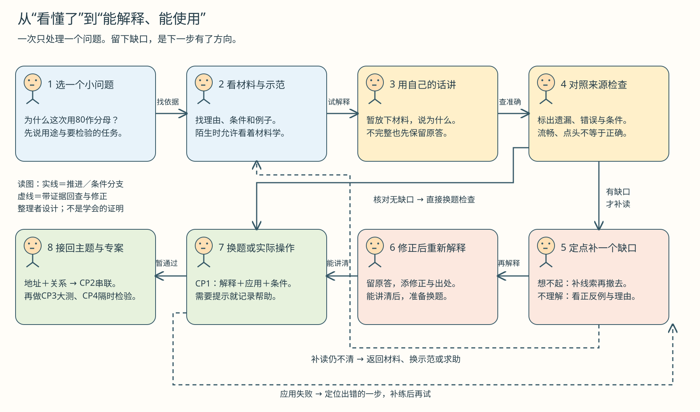

# 《费曼学习法》：用解释发现缺口，用行动检验理解

分类：**学习方法／输出与理解检验／知识复用**。更新：2026-11-18。

学习主入口仍是[指导手册](学会学习-指导手册.md)。这份笔记供你遇到“看懂了，却讲不清或不会用”时查阅；先看[跟做课堂](#跟做课堂把讲不清变成一个可修正的问题)，不用先背完24章。

## 版本、阅读范围与依据

尹红心、李伟著，《费曼学习法：用输出倒逼输入》，江苏凤凰文艺出版社，版权页为2021年3月第1版，ISBN 9787559454911。**这不是费曼本人写的书。** 第2章说五步骤是本书提炼总结，第19章也说明费曼本人没有把方法理论化。因此，下文统一称“本书作者的组织方式”，不把书中大量署名费曼的语句当作已独立核实的历史引文。

本轮按EPUB阅读顺序读完39个spine文档中的文字，包含前置材料、前言、六部分24章和后记；查看全部39张正文图片。没有稳定纸页码，使用章节＋EPUB内部路径定位。没有通读所引外部研究，也没有独立核验全部人物故事、统计和署名引语。正文索引及哈希清单分别见[文本索引](文本索引/费曼学习法.txt)、[阅读覆盖清单](文本索引/费曼学习法-阅读覆盖.json)。索引是检索材料，不是学习者的成绩。

**以下“作者观点”是转述；“教学转化”是本项目的取舍。课堂、题目、检查点和节奏是整理者设计，尚无用户实践或掌握证据。**

## 先抓住一个有用的关系

本书五步为：确立对象→理解→输出→回顾→简化。真正值得使用的连接是：**你尝试解释时留下一个具体缺口，缺口决定下一次输入什么；修正以后换题检查，再把有用的关系接入旧笔记。**

输出不能省掉输入。完全陌生时先看一个完整示范；解释卡住也不等于你不聪明。我们需要分清：想不起、没理解、表达不顺，还是根本没有练过实际操作。不同卡点需要不同动作。

[可编辑Excalidraw](图示/学习教学-解释到应用.excalidraw)。实线表示推进或条件分支，虚线表示带着证据回查；线上的字说明为什么连接。图是整理者对第10、14、16—17、20—24章的重构，并接入既有CP1—CP4，不是原书插图或效果保证。

## 跟做课堂：把讲不清变成一个可修正的问题

### 先看老师怎样改一条解释

沿用手册的百分比案例，减少换题材的负担。今天只处理“变化的百分比为什么要看起点”。准备材料A和一张纸；不需要同伴，不要求录视频或公开发帖。

**材料A：** 80分钟降到60分钟，少了20分钟；下降比例是20÷80＝25%。从60分钟回到80分钟，多了20分钟；增加比例是20÷60≈33.3%。变化量相同，作为比较起点的量不同，比例就不同。

| 时刻 | 示例学生的原答或动作 | 老师怎样引导，留下什么 |
| --- | --- | --- |
| 初次看完 | “百分比就是差除以数字。” | 不判定整个人不会。只问：“两个数字，除哪个？为什么？” |
| 第一次复述：对自己讲 | “下降用80，增加也用80……我不知道。” | 保留原答；圈出“比较起点”，这就是要回查的缺口 |
| 定点回查 | 再看材料A，把80→60、60→80分两行写 | 在每行箭头起点下面写“基准”；不用把全文再抄一遍 |
| 第二次复述：接受追问 | “每次变化都和这一次的起点比。回升时起点是60。” | 追问：“为什么不能因为少了20分钟就说少20%？”回答应区分绝对量与比例 |
| 核对并简化 | “变化比例＝变化量÷本次起点量；换起点要重算。” | 补条件：本例起点为正，变化量取增减的大小；这是该类问题的简写，不包办所有百分比问题 |
| 接入已有笔记 | 在N002写“用N001的基准规则解释回升不对称” | N001页边反向写“N002：起点变化的应用”，主题页M001保留两者地址 |

这段是示范，不能拿它当作你已经答对。可以先照着画两条箭头，再合上材料尝试下面的小题。你的第一版解释哪怕只有一句，也足够开始核对。

### 轮到你：一个问题加一个变式

1. 100分钟降到75分钟，再回到100分钟。分别变化多少百分比？先标出每次起点，再说明原因。
2. 有人说：“价格先涨20%，再降20%，所以回到原价。”如果原价100元，你如何用数字反驳或支持？

允许先看材料A学习；正式检查时合上材料和示范。若需要提示，就把提示写在原答旁边，稍后换题再试。这里不设速度要求。

[保留原答后查看核对](#课堂核对)

**CP1局部检查：** 两题的计算与基准解释正确；能说出变化量和变化比例的区别。只会背公式、看答案后复述或照抄示范，都还缺独立作答证据。暂时通过后结束这一小块即可，不必为了“彻底懂了”无限讲下去。

### 卡住以后走哪一条路

| 你观察到的情况 | 下一步只做什么 | 再检查什么 |
| --- | --- | --- |
| 知道原理，却忘记一个数或术语 | 看一次必要线索，再撤去线索回想 | 换数后能否独立恢复步骤 |
| 术语都认识，但不知道为何这样算 | 回看一对正反例，画出各自起点 | 不用原句说明两例差别 |
| 写得对，面对人说话却打结 | 先用纸笔或自己录一小段，必要时看提纲 | 分别记录知识正确性与表达帮助，不把紧张当作知识全不会 |
| 讲得流畅，却算错或操作失败 | 练出错的一步，并核查条件 | 在真实任务中重新完成该步；多讲几遍不能代替操作 |
| 两份资料冲突 | 写清争议原句、条件和出处；先保留未知 | 对比证据是否独立、场景是否一致，不按点赞数投票 |
| 仍然不懂或已经疲倦 | 留下“卡在哪、试过什么、下次看哪里”，求助或暂停 | 下次从这个缺口继续，不必重新开始整章 |

### 什么时候串起来，什么时候再测

**当场收尾：** 原答、修正、出处留在同一条笔记，不再另建一套“费曼打卡”。有真实关系才链接旧笔记；找不到关系可以先写待解决问题。

**主题收束时（CP2）：** 当你已经遇到“下降、回升、连续变化”这些需要比较的情境，就整理M001主题页。每条线写“应用”“对比”“前提”或“反例”，并用一个混合题检查是否真的会选择。整合由问题关系触发，不要求每读完一页或固定满三天画大图。

**专案大测（CP3）：** 回到[手册的综合任务](学会学习-指导手册.md#六怎样尝试一次大测让多个单元共同完成新任务)，使用新题、明确允许的帮助。口头讲解是部分证据，实际用途要求计算、写作或操作时，必须交付相应成果。

**保持与迁移（CP4）：** 下次学习开头先回想；若目标需要长期使用，可先约一周后换数和换情境再检验，再按结果调整间隔。这是一种起步安排，不是本书证明的最佳天数。期间看过答案须记下，不能把熟悉答案误当独立保持。

## 三次复述：三种任务，不是完成三遍就毕业

| 原书位置 | 作者的任务 | 在本项目怎样使用 | 不能据此推出什么 |
| --- | --- | --- | --- |
| 第10章，第一次 | 对自己凭印象复述、提出问题、加入自己的理解 | 先区分原文和自己的解释；完全不懂时先看示范，再记录具体卡点 | 开始时讲不出不等于能力差 |
| 第14章，第二次 | 向别人讲，用讨论和异议获得反馈 | 经同意请人追问“为什么、条件、例外”；没人时先用预设问题自检，注明还缺外部反馈 | 别人点头、赞扬或AI说“很好”不证明准确 |
| 第23章，第三次 | 建立原创观点、解释解决预测问题 | 修正后写一个可复用说明，附新例子、边界和检验；有原创想法先作为假设 | 创新、公开影响力或预测未来不是新手学会一个概念的必要条件 |

例如，导师可这样接话：“先把你确定的一句写下来。我们核对这句用了哪个依据，然后只找一个没接上的地方。”这比要求你一次讲得简洁、深刻、原创，更容易把注意力放回知识本身。

## 逐章笔记与原文定位

下列路径均相对原EPUB根目录。章节标题用于回查；每章区分作者的要点与本项目如何使用。六个STEP不等于六个操作步骤：第一部分讲基础，后五部分对应五步骤。

### 第一部分：学习的本质

**第1章 掌握一门知识有多难**（`text/part0004_split_001.html`）。作者对比输入、教条和标准化应用与主动输出，主张在讨论中选择方向。教学转化：检查能否解释和应用，而不是给学生分“精英／普通人”。阅读、记忆和标准步骤都有用途，不因未输出就一概判成无效。

**第2章 何为“费曼学习法”**（`text/part0004_split_002.html`）。作者归纳目标、理解、输出、回顾、简化五步，强调知识之间的联系。教学转化：用五步组织修正回路，不宣称这是费曼本人发布的标准程序；听者认可还要接事实核对。

### 第二部分：确立一个学习对象

**第3章 我们为什么学习**（`text/part0005_split_001.html`）。作者用连续追问“有用是什么意思”澄清方向，讨论开放、批判、逻辑和表达。教学转化：先写具体用途或想弄懂的问题，兴趣与欣赏也可以是目的；为现实任务学习不自动低于为兴趣学习。

**第4章 聚焦目标**（`text/part0005_split_002.html`）。目标会随阶段改变；连接未来方向与当下焦点。教学转化：落到这次要回答的一个问题；没有十足信心也能先试一小步，不要求先找到终身热爱。

**第5章 规划：和目标建立“强联系”**（`text/part0005_split_003.html`）。先检验目标必要性，再看计划是否真的通向目标，作者借SMART讨论规划。教学转化：把最后的实际任务反推到今天的练习；该章R写作Rewarding，保留作者版本，不混成统一定义。书中投资例的收益计算有问题，不能拿故事成功与否代替严谨论证。

**第6章 费曼技巧：目标原则**（`text/part0005_split_004.html`）。作者列全面、重点、挑战、可行与可调整等要求。教学转化：可以调整范围、支持与时间，并保留最终标准；不照搬“不能降低难度”的绝对要求给初学者施压。

### 第三部分：理解我们要学习的知识

**第7章 归类和对比知识的来源**（`text/part0006_split_001.html`）。先定问题、收集信息，再筛选和比较来源。教学转化：保留出处和适用条件；两篇转载不是两份独立证据，自己觉得有用也不等于内容真实。

**第8章 形成一张思维和流程导图**（`text/part0006_split_002.html`）。作者介绍概念、结构、因果等图式和图像辅助理解。教学转化：知识图回答“内容怎样关联”，流程图回答“下一步做什么”；给箭头标关系和条件。图能展示一种解释，不能独自证明它正确。

**第9章 阅读与记忆的原则**（`text/part0006_split_003.html`）。先概览主题、作者、结构，带问题读并保留重点。教学转化：作者20分钟概览是经验安排；难书可以更慢，概览也不等于通读。

**第10章 第一次复述**（`text/part0006_split_004.html`）。凭印象说，再提问题，最后联系已有知识形成观点。教学转化：原答不能被答案覆盖；自己的推论另作标记，卡点直接决定回查位置。

**第11章 费曼技巧：系统化原则**（`text/part0006_split_005.html`）。归纳、筛选、分析，以归类对比、联想、收束建立知识结构。教学转化：先发散候选联系，再核查关系；画得连贯不等于联系成立。原图最后一栏仍写“归纳”，正文则讲分析，笔记不暗中当作同一套精确标签。

### 第四部分：输出是最强大的学习力

**第12章 以教代学**（`text/part0007_split_001.html`）。面向外行用简洁语言、类比、个人理解解释，并寻求反馈。教学转化：类比必须有“不像的地方”；保留必要术语及前置知识。不要求任何复杂概念都能用两句话让所有年龄的人完整理解。

**第13章 用“输出”倒逼“输入”**（`text/part0007_split_002.html`）。通过模拟讲解、答问、传授和质疑场景，重新组织知识。教学转化：用输出暴露缺口、定点输入；不采用该章未经外部核验的神经机制叙述、终生不忘或阶层跨越承诺作为依据。

**第14章 第二次复述**（`text/part0007_split_003.html`）。真实讨论前准备提纲，听取有理由的异议，并加入自己的理解。教学转化：请求具体反馈，不求赞许；同伴需要愿意且有时间。初学解释允许不完整，不能用“公开容错率很小”逼迫学生表演完美。

**第15章 费曼技巧：输出原则**（`text/part0007_split_004.html`）。图中串起场景模拟、通俗语言、简洁与深度、重点理解、讨论反馈。教学转化：它混合了准备、表达质量和反馈，不是五个自动发生的因果环节。用任务是否完成检验输出系统，而不是以发文数量衡量。

### 第五部分：回顾和反思

**第16章 怀疑和探索让我们更聪明**（`text/part0008_split_001.html`）。重新检查事实、遗漏和知识关系，区分理解不足与原材料问题。教学转化：把“不懂”定位到一句话、一步计算或一个条件；未知可以暂留，不要求把所有争议一次解决。

**第17章 寻找反证**（`text/part0008_split_002.html`）。寻找相反数据、逻辑漏洞、过时信息与不同观点；卡壳时区分记忆和理解。教学转化：反对意见是核查起点，不自动构成反证；另一个权威、更新的年份也不自动更正确。怀疑应落到可检查条件，避免无限质疑而不行动。

**第18章 “内容留存率”决定了我们学习的效能**（`text/part0008_split_003.html`）。作者强调方向、理解表达、应用创新与回顾整合，并主张研究原理。教学转化：保留用途导向，撤掉统一90%阈值；记住多少、理解多少、会用多少是不同问题。碎片笔记可经检验和连接形成知识，不一概丢弃。

**第19章 费曼技巧：回顾原则**（`text/part0008_split_004.html`）。归纳探索、反证与保留有用知识，并承认方法由后人整理。教学转化：用“原答→缺口→证据→修正→再试”记录反馈，不写成仅有感想的复盘。

### 第六部分：简化和吸收

**第20章 好东西太多，也会消化不良**（`text/part0009_split_001.html`）。筛选重要内容、抓结构、把知识纳入已有系统；在线学习要结合用途。教学转化：删冗余不删推导和边界，保留来源入口。章首自评题不能作为经过验证的学习能力量表，读书量或每日写心得不是达标证据。

**第21章 纵向拓展和精进**（`text/part0009_split_002.html`）。以核心问题深入研究，区分“我”和“我的观点”，允许不同意见，宁可慢些理解。教学转化：补瓶颈并回整体任务验证；本章对“刻意练习”的宽泛用法不替代《超速学习》的具体拆练。探索广度与深入并非永远互斥。

**第22章 深度挖掘，实现知识的内化**（`text/part0009_split_003.html`）。记核心、整理结构、输出、简化，建立能调用的知识系统。教学转化：写清何时调用、与哪条笔记何种关系，并用新任务检查。能读小说不自动等于能翻译小说，迁移要另检验。

**第23章 第三次复述**（`text/part0009_split_004.html`）。强调原创观点、解释解决与预测，以及兴趣和自我效能。教学转化：先允许准确重述与应用成为阶段成果；自己的新观点需证据，不能为了原创编造。作者关于热情、影响力与人生成就的强断言不当作个人能力判定。

**第24章 费曼技巧：简化原则**（`text/part0009_split_005.html`）。反对只收集结论、删掉推演；围绕需要、重要、核心内容深挖。教学转化：将简化版写成“主张＋理由＋条件＋例子＋出处”，检查压缩后是否仍能指导任务。后记（`text/part0009_split_006.html`）重申输出与系统；不沿用把通勤或社会地位当作学习失败标志的评价。

## 原书图文怎样读，哪些不能照搬

39张正文图包含流程、分类、引语卡、行情示意及学习金字塔。以下选取直接影响教学的图做解析；查看原图不等于核实图中论断。

| 定位 | 图在表达什么 | 我们怎样读取和修正 |
| --- | --- | --- |
| 第2章，`images/00037、00017、00012、00031、00042.jpeg` | 五步各自通向注意、系统理解、教学、分析与内化 | 是作者的组织图；增加从反馈返回输入的线，避免读成走完必然学会 |
| 第8章，`00011、00020.jpeg` | 两幅不同走势用于支持对知识的图像解释 | 图形展示例子，不能靠一张走势证实普遍理论；先问时间、样本、替代解释 |
| 第11章，`00024.jpeg` | 归纳→筛选→归纳，末栏内容是分析逻辑与导图 | 正文与图标题不完全一致；抓住收集、过滤、建关系的功能，不机械背标签 |
| 第12章，`00039.jpeg` | 用5%—90%排列不同学习方式的留存率 | 本书未提供可复核的实验条件、测验及原始研究，不把金字塔数字当策略排名或benchmark |
| 第15章，`00002.jpeg` | 模拟场景→通俗表达→简洁有深度→理解重点→反馈 | 把准备条件、质量要求和反馈拆开检查；表达好听不能替代正确性 |
| 第17章，`00033、00034.jpeg` | 记忆／理解卡点分流，以及知识—解构—论证—怀疑—反思循环 | 保留分流，补上实际操作和表达负担；回到可检验任务，避免循环思考没有出口 |
| 第18章，`00038、00005、00027.jpeg` | 方向、学到何种程度、再学习与整合三个层次 | 拆成CP0任务、CP1—CP3表现和CP4保持；不用单一留存比例合并判断 |
| 第24章，`00001、00040.jpeg` | 需要／重要／核心，以及专业方向和知识体系 | 保留取舍功能；“成为专家”可以是长远目标，不是每次学习的最低门槛 |

另外，第12章用光的行进路线说明波粒二象性的故事不作为本项目物理教材；第8、13章的双重编码和记忆机制表述未作专门科学核查。第10、16、20、23章的调查数字与人物故事也只作为作者叙述记录，不包装成已验证研究。这些限制不妨碍使用“解释—核查—再试”的实践建议，但必须把建议和证据强度分开。

## 与已有书籍的分工

| 已有来源 | 新书可以补什么 | 继续由原框架负责什么 |
| --- | --- | --- |
| [超速学习](超速学习-阅读笔记.md)第8—11章 | 三次复述提供不同场景，帮助定位解释缺口 | 直接练习、提取、反馈与保持；费曼技巧的来源限定不能被新书覆盖 |
| [大脑喜欢这样学](大脑喜欢这样学-阅读笔记.md) | 为组块写出自己的解释与调用条件 | 组块、练习与学习条件；不以口头输出替代技能练习 |
| [卡片笔记写作法](卡片笔记写作法-阅读笔记.md) | 将修正后的解释变为可连接笔记 | 地址、关系、主题入口和实际写作复用；不把每段复述都保存成永久卡片 |
| [麻省理工深度思考法](麻省理工深度思考法-阅读笔记.md) | 从讲解中发现箭头含义不清 | 区分相关、因果、层次与时间，检验模型是否解释事实 |
| [如何找到想做的事](如何找到想做的事-阅读笔记.md)与[当下的力量](当下的力量-阅读笔记.md) | 把眼下要理解的问题缩小到可尝试范围 | 前者支持方向探索，后者只取觉察提议；都不替代学习结果证据 |

## 课堂核对

**第1题：** 下降25%；回升约33.3%。前者起点100，后者起点75；都变化25分钟，但分母不同。若两个都写25%，先回到材料A标起点，再换成60→45→60独立重做。

**第2题：** 先到120元，再减少120×20%＝24元，最后96元。第二次百分比以120为基准，因此两次变化量不同。若只说“涨跌不对称”而不给出基准和计算，还没有完成这道应用题。

这两道题只检验这里的百分比问题，不能推广为“数学已学会”。若做对但需要提示，记录提示条件；若提前看过核对，另换同能力任务。

[返回课堂题目](#轮到你一个问题加一个变式) · [回到指导手册](学会学习-指导手册.md)
