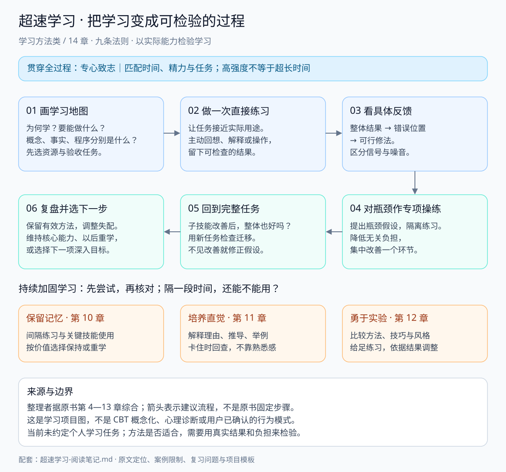

# 《超速学习》阅读笔记

分类：**学习方法／自主学习与技能训练**。按用户指定，与 CBT 认知行为疗法资料分开。更新：2026-11-07。

本书用于理解怎样设计学习项目、练习、检验、反馈和保持所学；不作为心理诊断、人格判断或治疗依据。下文“作者观点”指原书的论述；“整理评述”是对论证和使用条件的分析；“应用示例”是供以后选择的设计，不是已约定任务或用户经历。

## 来源与实际阅读范围

- 作者：Scott H. Young（本文件版权页译为斯科特·扬，图片封面作史考特·杨）；译者：林慈敏；方智出版社，2020 年 5 月电子版及实体初版第一刷；ISBN 9789861755533。原著英文名 *Ultralearning: Master Hard Skills, Outsmart the Competition, and Accelerate Your Career*，版权年份 2019。
- 本地原书：[EPUB](../资料/超速学习_我这样做_一个月学会素描_一年学会四种语言_完成MIT四年课程_z_library_sk,_1lib_sk,.epub)。书内版权信息位于 `OEBPS/text00027.html`。本地文本与图片存在简繁字形差异，笔记保留主要译词，不推断其转换来源。
- [本地文本索引](文本索引/超速学习_我这样做_一个月学会素描_一年学会四种语言_完成MIT四年课程_z_library_sk,_1lib_sk,.txt) 按 OPF spine 的 30 个 HTML 文件排序提取；哈希与提取信息见 [清单](文本索引/manifest.json)。索引仅作检索，不是阅读证明。
- **已顺序阅读**：作者与译者介绍、专文导读及三篇推荐序、全部 14 章、计划补充附录、电子书特别收录的四个单元、版权信息与目录。正文对应 `OEBPS/text00007.html` 至 `text00020.html`；附录为 `text00021.html`；特别收录正文为 `text00023.html` 至 `text00026.html`。
- **图像核查**：浏览包内全部 17 张 JPG；另放大核对献辞页 `Image00012.jpg`、特别收录扉页 `Image00013.jpg`、第 1 章人像前后对照 `Image00014.jpg`、第 11 章自行车结构示意 `Image00003.jpg`。其余主要是封面、标志、字符图、装饰、照片和特别收录中的重复示例；未逐字校勘封面宣传小字与低分辨率图片。两个文本很少的 HTML（`text00002`、`text00022`）分别为献辞和特别收录扉页，并非遗漏正文。
- **未完成也不声称完成**：书中所引研究论文、传记及外部网页的独立查证；外链视频观看；不同版本对校。下文科学研究均作为“作者引用的证据”整理，不能把读完本书写成已审查所有原始研究。
- EPUB 无固定纸页，以下以章名、内部文件及小节名定位，不编造页码。

## 全书主线与九条法则

作者将超速学习界定为主动掌握学习方向、投入较高认知努力以获得知识与技能的策略。它不是固定日程或保证缩短到某个时长的配方。自主可以包含教师、课程和伙伴；强度也不等于熬夜、连续久学或每个生活领域都全力冲刺。

整理后的主线：明确要获得的能力 → 设计接近用途的任务 → 尝试并发现差距 → 针对瓶颈练习 → 回到整体任务检验 → 延迟复测并决定如何保持。九条法则服务于这个循环，不是九项必须每天打卡的要求。

| 法则／正文章 | 要解决的问题 | 可观察的学习证据 | 容易误用的地方 |
| --- | --- | --- | --- |
| 后设学习／第 4 章 | 学什么、为何学、怎样学 | 有明确用途、范围、资源和检验任务 | 收集教程、研究方法代替开始 |
| 专心致志／第 5 章 | 启动、维持、专注方式 | 能进入任务并完成有质量的练习 | 把疲劳都解释成逃避，强迫久坐 |
| 直截了当／第 6 章 | 学过却用不出来 | 在接近目标用途的情境里完成任务 | 只看教程；或否定必要基础学习 |
| 反复操练／第 7 章 | 整体练习掩盖局部瓶颈 | 改善子技能后，整体表现也改善 | 只重复熟悉动作，练了却不回到整体 |
| 提取记忆／第 8 章 | 熟悉感被误当成掌握 | 不看答案能回想、解释或解决问题 | 先看答案再觉得自己会；只背碎片 |
| 意见回馈／第 9 章 | 不知道差距和调整方向 | 有具体错误、原因线索或修正方法 | 把羞辱当反馈，把一次结果当定论 |
| 保留记忆／第 10 章 | 当时会，过后遗忘 | 隔一段时间仍可用，或可快速重学 | 追求永不遗忘，把所有内容做成卡片 |
| 培养直觉／第 11 章 | 能背术语，不能解释原理 | 能推导、举例、说明步骤理由 | 讲得顺就算正确，套比喻不检查限制 |
| 勇于实验／第 12 章 | 方法停滞或目标需要独创 | 比较不同策略的结果与成本 | 频繁换工具，没有充分练习和比较 |

[可编辑 Excalidraw 图](图示/超速学习-学习循环.excalidraw)。图是整理者基于第 4—13 章的综合，不是原书插图或个人心理机制图。

## 逐章笔记

### 第 1 章：你能在不上 MIT 的情况下，学会 MIT 的某套课程吗？

原文：`OEBPS/text00007.html`；小节包括 MIT 挑战、语言学习、冷知识竞赛、独立游戏制作、人像画学习。

**作者观点与案例。** 作者从自己的计算机科学自学，扩展到刘易斯的语言学习、克雷格的知识竞赛、巴隆的游戏开发等案例，寻找共同方法：有目标的主动实践、迅速取得反馈、遇到问题调整路径。不同人有不同起点、资源与时间安排，不是同一种课程模板。

**机制与方法。** 人像练习以参考照片叠图暴露比例误差，缩短“画完—看出差距—再画”的循环；MIT 学习从一次攻一门调整为交错学习数门，以减轻过于集中的安排。案例提示应观察可修正的具体结果，而不是只统计花了多少时间。

**整理评述。** 个案不能说明平均效果或成功概率。作者的 MIT 自学不等于实际就读或获得学位，须与附录合读；刘易斯的德语 C2 尝试并未全部通过；巴隆有多年投入及伴侣等支持。第 1 天与第 30 天画像来自作者选择的展示，能说明案例，不是受控实验。其他人的成就不作为用户的速度或价值标准。

### 第 2 章：超速学习为何重要？

原文：`OEBPS/text00008.html`；重点：“那么天赋呢？”“再忙也能超速学习”。

**作者观点。** 这是一种自主、较高强度的学习策略，可能用于职业发展、转变方向、补充现有能力，也可以服务兴趣和个人意义。作者承认天赋差异，重点是改善可调整的学习过程。

**方法。** 先确定学习对自己有什么意义，再选择全职短期、兼职长期或改进当前学习方法；同一个人也可以对不同主题采用不同强度。主动决定方向与是否请老师是两个问题，不必将自主等同于独自摸索。

**整理评述。** 书中就业、学费与技术变化是写作时期的论述，不能视为当下保证。掌握知识、取得资格、拥有真实工作经验需要分别验证。高强度应理解为有效投入，不是占满全部时间；不能从进展慢推出不够努力。

### 第 3 章：如何成为超速学习者？

原文：`OEBPS/text00009.html`；蒙特贝洛公开演说案例与九法则总览。

**作者观点。** 蒙特贝洛用密集演讲、录像回看、不同听众反馈、教练指导与专项练习，推进公开演说能力。方法不是神奇天赋的专利，但要围绕具体问题不断调整。

**机制与方法。** 多次真实演说让“准备—表现—反馈”的间隔缩短；录像提供自我观察，教练帮助定位单凭整体反应不易看见的细节。可以先确定一项输出任务，再为它建立反馈来源。

**整理评述。** 作者承认从成功者回溯方法有选择偏差；其小规模学习者尝试也不是随机对照实验。蒙特贝洛原有的舞台经验、资源和比赛机遇不可省略。九法则是可调整的原则，不是照做必达同样成就的步骤。

### 第 4 章：后设学习——先画一张学习地图

原文：`OEBPS/text00010.html`；“为什么、做什么、如何做”“你应该做多少计划”。

**作者观点。** 开始前研究这个领域如何组织、能力如何获得，能减少走弯路；做过项目后，还会积累关于自己学习方式的经验。

**三类规划问题。** 为什么：目标是解决实际问题，还是兴趣探索？若为职业目标，先核对这项技能是否真能帮助目标。做什么：区分需要理解的概念、需要记住的事实、需要操作的程序，找到可能的瓶颈。如何做：先参考成熟课程、标准路径与成功学习者，再按用途强调某些部分、暂时排除不必要部分。

**方法索引。** 专家访谈用于核对目标与路径；请求应有具体问题、有限时长，允许拒绝或不回应。标竿学习法用于得到起点；强调／排除法用于按目标取舍。作者提出约 10% 的准备时间经验法则，对很长项目可更低，并随进度重新研究。

**整理评述。** 比例不是科学阈值或必须达成的配额；第 13 章“至少 10%”的检查语句也应放回本章的弹性语境。未看见实际任务前，不宜过早删去基础知识。研究本身也可能成为拖延：当新增资料很少改变下一步时，应以一次真实尝试补充信息。

### 第 5 章：专心致志——把刀磨利

原文：`OEBPS/text00011.html`；三类问题：开始、持续、专注质量。

**作者观点。** 无法开始、开始后分心，以及专注方式不适合任务，是不同问题。只用“缺乏自律”概括，会失去调整线索。

**机制与方法。** 启动困难时先觉察当下是任务带来不适，还是别的活动更有吸引力；可从约五分钟的短尝试开始，再按需要加入定时工作与休息。维持专注时检查环境干扰、材料形式以及心中未解决的事。专注质量需要配合任务复杂度：复杂思考与简单操作的最佳状态不必相同。

**关键区别。** 作者区分心流与努力学习：学习新难题可能需要停下来检查错误，不一定有顺畅沉浸感。能专注多久和学会了多少也不是同一指标。短间隔有利于记忆安排，复杂项目则可能需要较长的连续时间进入状态。

**整理评述。** 五分钟、番茄钟或时段长度都是可试工具；不是失败后继续加码的要求。确实疲劳、缺少睡眠或现实事务未处理时，应检查这些条件。书中以强烈措辞评价拖延的段落不照搬为个人判断；传记中的极端作息不作为建议。

### 第 6 章：直截了当——走最短的路，勇往直前

原文：`OEBPS/text00012.html`；学习迁移、直接练习及四种方法。

**作者观点。** 在一种形式里学到知识，不保证自然迁移到另一种用途。需要让练习包含目标情境里真正要做的判断、提取和操作。

**案例与机制。** 贾斯瓦尔的建筑求职案例说明，作品和训练应与雇主需要的实际能力连接。理解概念、答题和在现实问题中使用，可能需要不同练习；深厚知识与多样情境也有助于迁移。

**四种方法。** 项目式学习直接制作成果；沉浸式学习增加真实使用机会；飞行模拟器法在无法直接实践时模拟关键认知要求；矫枉过正法增加任务要求以暴露弱点。模拟的关键是思考与操作需求，不是机械复制背景、颜色等表面细节。

**整理评述。** 本章对正式教育的批评须与第 13 章承认学校、团队、导师价值的段落合读。直接练习不等于跳过所有基础；无法安全承担的真实任务应在练习环境中模拟。兴趣型学习也可以以解释、分析或讨论为输出，不必强行商业化。

### 第 7 章：反复操练——直击你最大的弱点

原文：`OEBPS/text00013.html`；富兰克林写作练习；先直接学习，再操练。

**作者观点。** 完整任务同时占用注意力，可能使关键子技能一直得不到充分练习。应从整体任务发现瓶颈，再隔离练习，最后返回整体任务检验。

**五种方法。** 时间切片：单练困难片段；认知成分：单练一种处理能力；模仿复制：借用其余部分，集中练目标部分；放大镜：给某一局部更多时间；先决条件串联：尝试任务后识别缺失的基础，再回头补足。

**可检验循环。** 先做完整任务 → 提出“哪个环节限制整体”的假设 → 设计局部练习 → 再做完整任务。若局部熟练了但整体没改善，要检查瓶颈判断与迁移，而不是增加重复次数。

**整理评述。** “最弱”不一定是最值得练的部分，应看它是否限制目标表现。速率决定步骤是作者的化学类比，不是对学习机制的直接证明。模仿用于练习理解，不意味着可将他人作品作为原创发布。

### 第 8 章：提取记忆——用测验来学习

原文：`OEBPS/text00014.html`；测验效应、有益的困境、前向测验效应、五种练习。

**作者观点与证据。** 作者引述卡皮克等人的研究，说明努力回想不只是测量学习，也能促进学习。重复阅读带来的流畅感可能让人高估长期掌握；自测时的困难感反而可能使人低估成果。拉马努金案例是解释性例证，不能证明某种单一方法造成其天赋。

**方法。** 快闪卡适合明确的问题—答案配对；自由回想是在读后合上材料，写出要点；试题簿把章节改写为核心问题并保留答案来源；自创挑战把技术知识变成待完成任务；阖上书本学习把解释、画图等活动改造成主动提取。

**条件与区别。** “有益的困境”不是越难越好：延迟太久以至完全无法提取，需要线索或重学。学习前先试答未知问题可作为定位缺口的方法，但不能把没有学过而答不出来视作能力不足。提取哪些内容也要取舍：高频核心知识、识别何时可用某方法的线索，与随时可查的细节不必同等背诵。

**整理评述。** 试题簿要问概念和用途，不只是把句号改成问号。图示是否有效取决于如何制作和使用，不能从某项实验推出所有概念图无效。答案需要核查；练习时暂时不用资料，不代表实际工作应拒绝查文档。

### 第 9 章：意见回馈——别闪避重拳

原文：`OEBPS/text00015.html`；反馈反效果、三类反馈、时机、四种改善方法。

**作者观点。** 洛克在小场地测试笑话，尝试减少名气和表演方式带来的干扰，取得关于素材的反馈。反馈的价值取决于信息内容、可信度、时机和如何解释；数量更多或语气更严厉不保证更有效。

| 类型 | 回答什么 | 例子与限制 |
| --- | --- | --- |
| 结果型 | 整体有没有达到标准？ | 分数、完成与否；通常不能直接说明原因 |
| 信息型 | 哪一处存在问题？ | 某段未被理解、某个测试失败；未必给出修法 |
| 改正型 | 怎样改、正确做法是什么？ | 解答比较、可信专家指导；开放任务未必有唯一答案 |

**方法。** 消除噪音，避免对单个数据点过度反应；把难度调到能产生有区分度的信息；关注学习速率来比较方法；在可承受条件下提高反馈频率。先独立尝试，再对照答案或请教，必要时稍后复测，兼顾及时纠错与记忆巩固。

**整理评述。** 不强行从整体好恶推断某个元素是原因，不把观众猜测当成专家诊断；代理指标也不等于最终能力。作者主张早面对强烈反馈，但本章同时承认反馈可能有害，第 14 章又强调控制挑战与成功机会。后续应采用具体、可信、可行动的任务反馈，不要求承受羞辱，也不把拒绝某条意见视为不愿成长。

### 第 10 章：保留记忆——别往有漏洞的桶子倒水

原文：`OEBPS/text00016.html`；遗忘解释、四种保留机制、项目内与项目后的保持。

**作者观点。** 理查德兹会记住法语拼字模式，不代表会使用法语交流。记忆是任务特定的；作者也承认无法完整获知他的学习过程。遗忘可能涉及衰退、相互干扰及提取线索问题，不能用一个简单比喻解释全部记忆。

**四种方法。** 间隔法把练习分散，并根据表现调整间隔；程序化通过正确重复使常用操作更自动；过度学习在首次达到正确后继续练关键部分；记忆法用形象、空间或联想帮助建立难记信息的入口。

**实际取舍。** 卡片适合词汇、事实等，复杂能力还需要真实任务；记忆术有建设成本，联想回忆也可能比直接提取慢。作者区分项目进行中避免遗忘，与项目结束后的维护；可用规律练习、生活中使用或阶段性进修，不必维持全部细节。

**整理评述。** 程序化不是所有知识都可变成无意识操作；作者明确承认部分延伸应用属推测。过度学习不等于过度疲劳，也不保证永久记住。间隔不应长到无法恢复，也没有给所有人通用的固定复习日历。记忆重建的讨论提示不能把清晰感当成回忆真实的保证，但本书不用于开展记忆恢复或个人病因推断。

### 第 11 章：培养直觉——先深掘，再累积

原文：`OEBPS/text00017.html`；专家模式、四条规则、费曼技巧及其脚注。

**作者观点。** 费曼案例和作者引用的专家研究，用于说明流畅直觉可能建立在大量领域知识、具体实例与模式识别上；它不是无条件可靠的天赋判断，也不会自动迁移到所有领域。自行车图示说明“经常见到”和“能解释结构”有差别。

**四条规则。** 对困难问题多作有限尝试；通过重建证明或过程来理解；用具体实例检验抽象陈述；主动提问并检查自己是否真的懂。所谓挣扎定时器，是给独立尝试一个有界时段，不是永远不能求助。

**费曼技巧。** 写下概念或问题；用自己的话向不熟悉它的人解释，解题时说明每一步的理由；卡住时查书或请教，再重写解释。完全不懂时可以边看材料边解释，不必强行闭卷；已有理解后可闭卷检查，再通过实例和比喻深化。

**重要出处。** 作者在脚注明确说，这个具体方法由他整理并命名，不能确定费曼本人明确使用过；与物理学的费曼图也不是一回事。后续不把网上流传的固定步骤说成费曼亲自提出。

**整理评述。** 通俗表达必须保留正确条件，流利与正确需要分别验证；比喻应指出失效处。本章对达克效应的概括不能用来给不提问者贴标签，也不能从“问题少”单独推断无知或缺少自信。

### 第 12 章：勇于实验——往舒适圈外探索

原文：`OEBPS/text00018.html`；梵谷案例；三类实验与五种方法。

**作者观点。** 随着基础能力增加，适合自己的路径、技法与风格越来越难完全从标准课程取得；需要在充分练习与探索新路线之间调整。实验要能提供新信息，不是随机忙碌。

**三类实验。** 换学习资源或方法，比较如何学；选择不同子技能，比较接下来学什么；探索不同风格，比较怎样表达或解决问题。每次给所选方法足够的试用时间，再决定保留或调整。

**五种方法。** 先模仿再创造；把不同方法放在相近条件下比较；增加限制以打破旧解法；组合原本分开的技能；有意探索某个维度的极端，再决定是否回调。

**整理评述。** 尽量一次改变一个关键因素，并记录任务难度、时间和结果；个人试验仍受熟悉度、顺序与状态影响，不能当成普遍科学结论。高维空间的数学比喻不能证明极端方法一定更好；成长心态不能消除现实资源和能力差异。梵谷的疾病、死亡与传记争议不用于诊断用户，也不将痛苦浪漫化为创作条件。

### 第 13 章：你的第一个超速学习计划

原文：`OEBPS/text00019.html`；五步计划、两种替代策略。

**作者的五步。** 先研究范围、主要资源、他人的学习基准、直接练习机会、备用材料与操练；安排投入量、具体时段及项目长度，长期项目先试行一周；执行时以九法则检查当前方法；结束或暂停后检视成果与过程；最后决定维持、以后重学或继续专精。

**机制。** 先做有限承诺和试行，可以发现理想排程与真实精力的差距。复盘不只看失败：成功时也要识别哪些支持与方法值得保留。作者自己的韩语后续计划效果不佳，说明知道原则也可能在安排中失配。

**三种结束选择。** 维持：把核心技能融入生活或保留少量练习。重学：对低频内容保留用途识别和检索入口，容许细节遗忘。专精：选择一个新的深度目标，而不是无限延长原计划。

**重要补充。** 低强度习惯和正式教育都是作者认可的替代或配合策略；学校可能提供资格、团队、导师及沉浸环境。作者明确不主张为了自学而辍学。

**整理评述。** “没有安排时间就是不在乎”的推断不直接采用，应同时考虑现实约束。第 13 章提到心流检查，但第 5 章已区分心流和有效学习，因此不把进入心流设为验收条件。完成标准是目标能力的证据，暂停也可以产生有效反馈。

### 第 14 章：一种非传统的教育

原文：`OEBPS/text00020.html`；波尔贾家庭案例；家庭、学校与职场的学习环境。

**作者观点。** 波尔贾姊妹的棋艺发展显示长期训练、环境、资源和动机可能带来的巨大变化；培养学习不能只靠命令，还需兴趣、适当挑战和支持。书中复盘她们的练习与九法则的联系。

**机制与方法。** 比赛、棋局资料、家教、提问与写作分别提供直接实践、专项训练、反馈和解释机会。作者建议帮助人形成自己认同的目标，谨慎运用竞争，并为学习保留时间与资源。初期与自己的过去比较，可能比持续与高水平者比较更有帮助。

**证据边界。** 作者自己指出这个家庭没有随机分配、对照与遮盲，不能排除遗传、资源等因素，也不能据此证明任何孩子都能复制成就。家人关于幸福的陈述不构成对所有影响的独立评估。

**整理评述。** 不把幼儿超长训练或“制造天才”主张作为本项目建议。职场中的挑战任务也需要与风险、支持和责任匹配，不能让不会的人无支持地承担关键任务。作者称这类组织设计部分仍是设想。学习项目结束后发现更多未知，可以成为选择下一步的依据，而不是必须不停加码的要求。

## 附录、前置文字与特别收录核对

### 附录：成就背后的条件

原文：`OEBPS/text00021.html`。

- **MIT 挑战**：2011 年 10 月至 2012 年 9 月；33 门课程；默认及格线约为 50%，部分无期末考的课程用作业或期中评估。有实验设备限制、课程替换，没有完成学校要求的论文项目。作者后来用自己设定的更严格评分重评，有 6 门从通过变成未通过；他仍支持原来的评分判断。应完整呈现自评标准及不确定性，不称取得 MIT 学位或证明完全等同正式教育。
- **四种语言**：2013 年 9 月至 2014 年 8 月；西班牙语约 B2 是作者估计，葡萄牙语稍弱，中文有当时汉语水平考试第四级笔试结果，韩语自述为中下程度。作者和同行者表现不同；各语言有约 25–50 小时准备，作者中文准备约 100 小时。不能简称“零基础同时精通四门语言”。考试说明按当时版本记录，不作为现行等级解释。
- **人像画**：2016 年 7 月，一个月约 100 小时，结合速写、照片叠图反馈、书籍与课程。目标是画逼真人脸，不等于一个月掌握所有绘画能力。

### 导读与推荐序

原文：`OEBPS/text00003.html` 至 `text00006.html`。詹姆斯·克利尔强调实践与反馈；三篇推荐序提供各自对学习、职业和兴趣的理解。它们属于推荐者观点，不是作者每项主张的证据。关于学习倍速、未来工作变化、方法必然有效的推广说法，不直接写成事实或个人承诺。

### 电子书特别收录：七个诀窍

原文：`OEBPS/text00023.html` 至 `text00026.html`。四个单元分别讨论为何学习、作者计划、七个诀窍及应用；七个诀窍为计划设计、专注与生产力、主动学习、反馈循环、间隔练习、深度加工、过度学习。

**与正文对照后应保留的修正。**

1. 特别收录 `text00024` 将 MIT 项目描述为取得大学学位，**与附录明确否认取得学位矛盾**。本笔记采用附录的具体说明；不擅自判断矛盾来自作者、翻译还是版本编辑。
2. 特别收录说规划时间常与实践时间相当；第 4 章则讨论约 10% 的启发式与边际价值。不能合成为统一的时间比例要求。
3. “永远不会忘记”之类表述与第 10、13 章承认遗忘和维护成本的论述不一致，后续采用后者的有限表述。
4. 特别收录的“反馈越快越好”需补上第 9 章的条件：先给独立尝试机会，确认反馈可靠，并按任务决定时机。
5. 深度加工研究不能推出动机在所有学习中都不重要；特别收录本身也强调目标与持续投入。

## 学习工具索引与项目模板

以下是整理者的可选工具，来源见对应章节；不要求一次全部使用。

| 当前学习现象 | 先检查什么 | 可选方法／章节 | 怎样判断有帮助 |
| --- | --- | --- | --- |
| 收藏很多资料，迟迟不知道从哪开始 | 目标是否能表达成一项能力、资源是否已够开始 | 学习地图＋一次小任务／4、13 | 能做出第一份可检查的结果 |
| 教程看懂，独立完成时卡住 | 练习与实际用途是否一致；缺少哪一步 | 直接任务＋专项操练／6、7 | 在新但相近的任务中独立程度提高 |
| 看过就觉得会，几天后讲不出来 | 有没有主动回想、解释与延迟测验 | 试题簿、自由回想／8、10 | 隔时仍能回答核心问题并举例 |
| 做了很多遍仍停滞 | 是否重复熟悉部分；反馈是否指出具体差距 | 瓶颈练习、三类反馈／7、9 | 同类错误减少，整体表现也改善 |
| 知道术语，不知道为什么成立 | 是否能解释过程、举例、说出适用条件 | 费曼技巧、证明与反例／11 | 不依赖原句，仍能准确解释与处理变化 |
| 一直换工具或课程 | 是否给过足够练习；比较指标是否一致 | 有期限的对比实验／12 | 得出保留或调整方法的具体理由 |
| 学完很快淡忘 | 哪些能力值得长期保持 | 间隔练习、项目维护或重学／10、13 | 核心技能可用，维护成本能承受 |

**一页项目模板（整理者据第 4、13 章改写）。**

- 我想获得的能力及用途：
- 项目范围／这次暂不覆盖的部分：
- 当前基线：用一个小任务观察现在能做到哪一步。
- 验收任务：在什么条件下，完成什么，什么证据算达到目标？
- 学习地图：需要理解的概念、记住的事实、练习的操作。
- 主要资源与求助入口：先选少量足够开始的资源。
- 实际可用的时间与精力：先试行，再决定是否调整。
- 直接练习与可能瓶颈：瓶颈先作为假设。
- 反馈来源：结果／具体错误／修正建议；谁或什么可以验证？
- 延迟复测与新情境检验：避免只看当场和熟题表现。
- 复盘：什么有效、什么无效、哪些条件变化、下一轮只改什么？
- 结束选择：维持／容许遗忘以后重学／继续专精。

### 面向开发学习的示例

这是一个可选示例，不是用户已选的项目：学习为一个练习用接口设计并验证缓存失效方案。

先用小场景观察现有能力，明确目标为能解释读写路径、处理旧数据问题并用测试验证。用少量资料建立必要概念后，做可运行的练习；如果失败来自不会构造并发时序，就单练时序图和测试，再回到完整方案。反馈包括测试结果、能否定位旧数据出现的条件，以及可靠资料或评审给出的修正。隔一段时间在新场景中重做，并说明方案的限制。

这个例子的完成证据是方案、解释与验证结果；看完一门课或抄完一份笔记只能作为过程信息。资料可在真实工作时查询，闭卷练习只用于检验掌握，不要求工作中凭记忆冒险。

## 与本项目五个目标的关系及后续使用

**主要对应目标 5“学会学习”与目标 4“记录和反馈”**，并可帮助把目标 3 的技能学习落到实际任务。它对目标 1、2 只提供学习过程的观察角度：例如是目标不清、练习不匹配、没有回想、反馈不足还是需要休息；不能据此完成心理诊断或解释所有习惯。

后续谈学习，先查本书第 4、6—9、13 章；谈记不住，查第 8、10 章；谈理解和提问，查第 11 章。需要理解情绪、信念与行为维持因素时，另查 CBT 教材并结合具体事件，不因为本书也使用“实验”“反馈”“认知”等词就混为同一体系。

用户曾描述被动接收信息、不主动校验，但尚没有一个具体学习任务的完整观察。以上工具可以帮助以后区分困难出现在哪里，**目前不能确认哪种学习机制适用于用户，也没有已约定练习或成效记录**。不把“读完更多书”当作生活改变，也不把助手替读和做笔记当作用户已经掌握。

## 后续可用于主动提取的问题

1. 自主、高强度分别是什么意思？为什么它们不要求独学、久学或拒绝正式课程？（第 2、13 章）
2. 学习地图的“为什么、做什么、如何做”各解决什么问题？准备何时可以转入实践？（第 4 章）
3. 怎样判断练习真的接近用途，而不是只有表面相似？（第 6 章）
4. 为什么专项操练之前和之后都要做完整任务？（第 7 章）
5. 熟悉感、当场表现与延迟掌握有什么区别？（第 8、10 章）
6. 三类反馈各能回答什么？什么时候不能强行升级反馈？（第 9 章）
7. 哪些内容值得保持，哪些只需保留以后重学的入口？（第 10、13 章）
8. 费曼技巧怎样暴露理解缺口？为何不能把它说成费曼本人提出的固定流程？（第 11 章及脚注）
9. 有意义的学习实验与不停更换方法有什么区别？（第 12 章）
10. 附录对 MIT、语言与绘画案例补充了哪些影响判断的条件？（附录）

这些问题是笔记的复习入口，不是自动布置的作业；回答不完整时，用章号回查即可。
