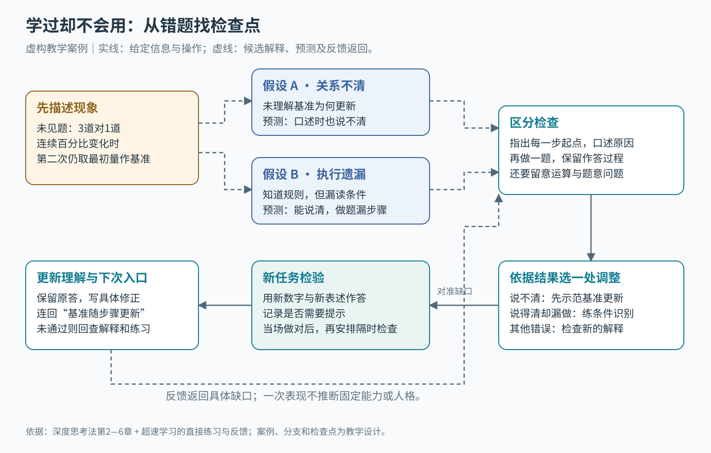

# 麻省理工深度思考法：把解释变成可以检查的模型

分类：学习方法／问题分析与模型检验。更新：2026-11-17。

这本书最值得带进学习的动作是：**先说明发生了什么，再提出关系解释，预测改变后会发生什么，最后用实践修正解释。** 它能帮助你从“我是不是不够努力”转向检查任务、知识、反馈和环境之间的具体关系，但不能替你确定个人问题的原因。

第一次使用，先读[读图课](#读图课从箭头到可以检验的解释)，再做[跟做练习](#跟做练习为什么学过却不会用)。想建立完整学习专案，回到[指导手册](学会学习-指导手册.md)。本笔记中的练习、门槛和学习案例均为整理者设计，不是作者的原题，另有标注的立体几何例子除外。

## 版本、定位与实际阅读范围

- 原书：《麻省理工深度思考法：从模型及动力机制来思考现象》，平井孝志著，张玉虹译，中国华侨出版社，后浪策划，2018年版。书名中的 MIT 来自作者学习经历与系统动力学影响，不把它当作 MIT 官方教材。
- 本地 EPUB：[原文件](../资料/麻省理工深度思考法_从模型及动力机制来思考现象_平井孝志_Z_Library.epub)。已顺序读完提取索引的全部文字，含前言、7章、专栏、后记和目录版权，共13个文档段；没有通读其引用的外部资料。
- 章节位置：第1—7章依次为 `index_split_003.html`—`index_split_009.html`；前言为 `002`，后记为 `010`。EPUB 分页随阅读器变化，以下用章、节、图号定位。
- 本轮逐张核对原图：3-2、3-6、4-3、4-4、5-2、图6。其他插图未逐张校勘；“正文文字已读”不包含全部图像细节已经读尽。
- [提取清单与原文件哈希](文本索引/新增两书提取清单.json)用于回查，不作为读完或学会的证明。

## 逐章理解：每章给学习者增加什么能力

### 第1章：检查自己的解释有没有停得太早

定位：`index_split_003.html`，1.1—1.5。作者列出九种思维定式：因果倒置、普通解、依赖框架、范围适应、关键词、执着初始假设、忘记初衷、偏重过程、失去独立思考。这里的“因果倒置”用法较宽，也涉及把结果当作问题根源，不能直接等同于逻辑教材中的严格定义。

它们的共同问题是：**给出了一个听起来熟悉的名称，却没有解释具体过程。** 例如“学习没有效果，因为方法不对”几乎适用于任何失败，无法决定下一步。把它改成“我看例题时能跟上，但遮住步骤就无法选择公式”，才能选出下一项检查。

练习：拿一句自己的判断，补上“在哪个任务、出现了什么可观察现象、还有什么解释”。检查点：别人能据此安排一次观察，而不是只能回答“要加油”。这些类别用于检查论证，不能给人贴上不爱思考的标签。

### 第2章：从静态结构走到随时间变化

定位：`index_split_004.html`，2.1—2.9。模型呈现你选择的要素与关系；动力机制描述这些关系持续作用后，事情怎样随时间变化。作者以企业广告竞争等例子说明：今天有效的对策，经过对手回应与多轮反馈，可能产生不同结果。

四步是建模、解读动力机制、寻找对策、行动反馈。学习中的应用是：“多看一遍”会立刻增加熟悉感，但隔天能否独立调用需要另测。**动力机制不是个人动机，也不等于启动意愿。** 模型只保留当前问题所需部分，不追求把全部生活装进一张图。

检查点：你能分别说出“目前认为哪些因素相关”和“若这样持续几轮，预计什么会改变”。后者要给出观察条件，不能只说会越来越好。

### 第3章：画图之前，先决定每条线的意思

定位：`index_split_005.html`，3.1—3.6。作者提出输入、输出、竞争、合作、影响者五类提示，以及跨层次思考、正负循环、因果与相关、检验模型。它们源自商业分析，不要求每次学习都填满五栏。

对学习问题，可以选“任务要求—练习方式—可见错误—纠错行动—下一次表现”作为局部结构。箭头至少写成一句关系：“闭卷作答让某些提取缺口变得可见”；不要只连“笔记→成绩”。有待确认的因果线必须标为假设。

作者强调因果而非相关。教学时保留相关作为线索，但不把它升级为因果：观察到两者同变，可以继续调查，不能据此认定改变前者一定改善后者。检查点：至少指出一条关系的依据和一种替代解释。图看起来有趣、简洁或完整，均不能替代这个检查。

### 第4章：看积累、延迟、边界和他人的回应

定位：`index_split_006.html`，4.1—4.11。作者从时间轴讨论存量与流量、非线性、作用与反作用、不同参与者视角、拐点、相变和“本源动力”，并提出用完整故事检查解释的连贯性。

最适合初学者先掌握的是：**一段时间新增了多少，与当前累积了多少，是两件事。** 例如，今天新增5条笔记，不代表多了5项可独立使用的能力。能力也不是可简单相加的水量，水池只是帮助区分“速率”和“当前状态”的类比。

图4-3展示逐渐增长、成长／衰减、上下波动、S形曲线、生命周期、趋近目标六种示意形态。它们没有实际数据刻度，不能拿一条示意曲线给自己的进步做预测。先记录可比较的任务结果，再考虑哪种解释与资料相符。

检查点：说出一个可能的延迟或限制，并说明怎样观察它。相变与水密度、组织改革的类比不能证明“改革越痛苦越正确”；花粉积累等健康叙述也不作为本项目的医学解释。故事讲得通仅是内部一致性检查，仍需外部证据。

### 第5章：改变关键关系，而不只追着结果跑

定位：`index_split_007.html`，5.1—5.7。作者让读者重新检查前提、较远的原因、影响范围、更高层目的以及思考顺序，寻找能改变系统的支点。

如果目标是能解释概念，瓶颈却是从未自己解释，那么只增加阅读页数未必对准问题。可先试一次“合上材料解释—对照—修改”，观察是否暴露了过去没看到的缺口。这只是一个候选对策，失败时继续查前置知识、示例和任务难度。

图5-2的立体几何题特别适合教学：先看两个表面积中哪些部分相同，再决定是否需要计算每一块。详见下方读图课。检查点：能说清对策改变的是哪一条关系，预计通过什么过程影响结果，而不是只说换一种更有效的方法。

### 第6章：用真实回应修改假设

定位：`index_split_008.html`，6.1—6.4。新材料推广案例从技术吸引力走向客户信任、第三方说明、试用与竞争后的再定位。B公司案例从市场问题转向样品交付、部门配合及资源分配规则；仅开会和调整流程没有自动解决激励冲突。

案例的学习价值是“最初解释可以被推翻”。不能把案例里的管理措施、投资做法或强压手段直接用于自己的学习。图6把行业、企业间关系和组织内部能力放在不同层次；复杂问题可能需要跨层找原因，但学生第一次只需画与当前任务有关的一条路径。

检查点：在练习前写预测，练习后记录与预测不符的地方。如果什么结果都能解释成“方法正确，只是我不够努力”，模型就失去了被修正的可能。

### 第7章：训练思考，而不是收集更多模型名称

定位：`index_split_009.html`，7.1—7.7。训练包括从新闻标题预测解释再比较、积累思考雏形、可视化、观点碰撞、历史视角和开放问题。共同点是先形成自己的回答，再接受新材料挑战。

初学者先选范围小、有材料可核对的问题；“无解的问题”不是开始训练的必经关卡。类比用于生成候选解释，还要检查两种情境有哪些条件不同。早期可以画粗略草图帮助思考，最后再整理视觉层次；“视觉化放最后”不禁止边想边画。

检查点：比较后至少留下一个具体修改及原因。只把自己的图画得更漂亮，不算完成这一步。

## 读图课：从箭头到可以检验的解释

### 原图3-2：正负号表示影响方向，不表示好坏

原图左侧是两国军备扩张互相强化；右侧是需求提高价格、价格反过来抑制需求。读图顺序：先找变量，再读每条箭头，最后沿闭环走一圈。

在这个模型约定里，“＋”表示同向影响，“－”表示反向影响，并隐含其他条件的限制。强化循环既可能放大进步，也可能放大消耗；平衡循环可能稳定系统，也可能阻碍改变。因此不把“正循环”自动译成良性循环。

教学迁移：若写“练习→成功→信心→练习”，还缺什么？缺少成功如何判定、失败后的分支、时间与难度条件。**不是画了闭环，循环就真的存在。**

### 原图3-6：两件事同时好，不能直接画成因果

原图将“英语好→工作能力强”标作相关，同时提出“职员很努力”分别影响两者的第三因素解释。它展示了如何提出替代解释，没有提供能证明“努力”就是唯一原因的数据。也不能因此推断英语训练对所有工作都无益。

照着做：观察“笔记多的人考得好”时，补画原有知识、学习时间或任务难度等候选因素；标记尚未核对。接着问：“我想改善的是记录数量，还是特定任务表现？”这决定下一步测什么。

### 原图4-4：水池教你区分量与速度

水池内蓄积量是存量，水龙头和排水口的每单位时间进出量是流量。图中三个框可读成“流入—累积—流出”，但精确计算还须给时间和单位。

小试：池内20升，每分钟进3升、出2升，持续5分钟且不溢出，最后多少？作答时写出单位。[作答后核对](#水池题核对)

### 原图5-2：先看抵消关系，再算数值

原题图中正方体边长4厘米，从角A沿三条棱的中点I、J、K切下三棱锥，比较剩余立体和切下部分的表面积差。关键不是先求斜切面IJK，而是发现它在两个立体中各出现一次。

设原正方体表面积为 A，原来角上三块小三角形面积之和为 C，新切面面积为 B。剩余表面积是 A−C+B；切下部分是 C+B；相减得到 A−2C。原题 A=96，C=3×(2×2÷2)=6，差为84平方厘米。斜切面可以另算，但本题无需计算它；这纠正正文“无法求出”的过强表述。

学习动作：把题目中的对象分组，再看共同部分，而不是马上套每个面的公式。现在把边长改为6厘米，中点条件不变，自己求差。[作答后核对](#切角题核对)

### 原图6：分层用来查缺口，不是越复杂越好

上部考虑竞争、合作、市场和供给，中部是销售与利润目标，下部是样品速度、人才、客户交流与部门协作。读者可沿“协作→样品速度→业务结果”追问中间条件，再对照第6章实践如何推翻初始判断。

迁移时只取这种读法：先找输出，再沿线回查你能观察或改变的因素。不要复制企业组织图去解释一个人的全部学习困难。

## 跟做练习：为什么学过却不会用

下面是**虚构教学案例，不是用户经历，也不是已经验证的实验**。

输入材料：小林看百分比例题时都觉得明白；三道未见题只对一道。复查发现，他把“先降再升”的第二次基准仍取成最初数值。

[可编辑图](图示/学习教学-模型与证据.excalidraw)。实线表示案例给定信息或操作顺序；上部虚线表示候选解释与待检验预测，底部虚线表示反馈返回。框内预测与箭头旁文字说明关系，底部反馈回到具体关系与练习。

| 步骤 | 学生实际做什么 | 示范产物 | 检查点与未通过分支 |
| --- | --- | --- | --- |
| 描述现象 | 写一个具体任务和原答 | 未见题3道对1道；第二次基准取错 | 若只写“理解差”，找一题原答再说 |
| 提出解释 | 写原因假设与替代解释 | 假设A：未理解基准更新；B：知道但漏读条件 | 能说出两者会出现什么不同表现；否则再问一道解释题 |
| 检查关系 | 让他指出每一步起点，并口述为什么 | 若能说对却算错，还要查执行或运算；若说不清，先示范基准 | 不能从一次错误直接定为固定习惯 |
| 选择小改动 | 示范一题，练一题，核对原因 | 每一步先标“当前量”，再计算 | 能解释示范才撤掉提示；否则减少步骤 |
| 用新题检查 | 同能力不同数字，保存原答与帮助条件 | 记录是否独立选对每步基准 | 有提示才对就记“需要提示”，不记独立达标 |
| 修正与连接 | 更新错误解释及下次入口 | 笔记关系：连续变化会更新基准；留隔时新题 | 当场做对只说明本次表现；保持待复测 |

小练习：另一个学生能够闭卷解释概念，但操作时总找不到工具按钮。你会继续让他背概念，还是换一个检查？写出“现象—两个解释—一个区分检查—下一步”。[完成后核对](#模型练习核对)

本课的 benchmark：在一个未见小案例中，能分开现象与解释，给出至少一种替代解释，设计能区分解释的观察，按结果改下一步。四项逐项检查；这里的项数是教学设计。只会背四步，或能画复杂图却说不出哪种结果会改变判断，都还不能记为掌握。

## 接入学习框架与使用边界

本书接入已有框架的“关系→结构→评估修正”：关键词选可观察对象；组块区分任务、行为、结果和条件；关系写清含义及依据；结构找反馈与层次；细节补单位、时间、例外；评估用反例和任务；最后把核对过的理解画清楚。与[《卡片笔记写作法》](卡片笔记写作法-阅读笔记.md)连接时，关系标签可以是支持、反例、条件或应用，不必全画成因果。

本书偏商业经验与系统思考介绍，不能单独提供因果识别方法、学习效果保证或心理诊断。采用的是“提出并修正解释”的工作方式，不接受“一个本质解释能解决全部问题”。有时候技能不足、资源限制或信息缺失就是当前应处理的问题，不必每次都寻找更深层人格原因。

## 答案与核对

### 水池题核对

20+(3−2)×5=25升。若只答“增加5”，要补“增加5升、最终25升”；若答35，遗漏出水。水量计算不能直接套成知识增长公式。[返回题目](#原图4-4水池教你区分量与速度)

### 切角题核对

A=6×6²=216，C=3×(3×3÷2)=13.5；差为216−27=189平方厘米。需解释新切面抵消，只给数值不足以检验关系理解。[返回题目](#原图5-2先看抵消关系再算数值)

### 模型练习核对

可检查“没学过界面位置”与“知道位置但无法辨认当前界面状态”：先让学生指认截图或在实际界面寻找，记录用了什么提示。前者补一次带位置线索的操作示范，后者比较不同状态并练识别，再撤提示做新任务。也可能出现软件版本差异或权限问题，需据观察继续排查。关键是检查能区分候选解释，并让下一步随结果改变，不要求唯一措辞。[返回练习](#跟做练习为什么学过却不会用)
